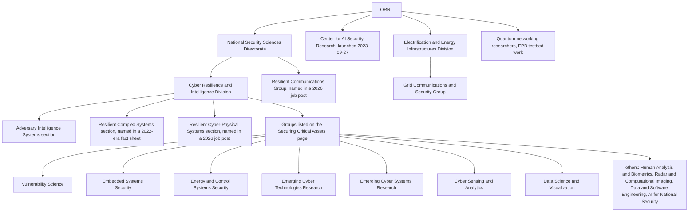

# ORNL cyber atlas

Independent research, not affiliated with, sponsored by, or endorsed by ORNL, UT-Battelle or DOE. Public sources only (ornl.gov, osti.gov, energy.gov, public GitHub, Zenodo, open-access papers). No logins, no scanning, no contact with lab staff. People appear by role only. Last checked: 2026-11-21.

## The short answer

ORNL's public cyber work falls into five lanes: **vehicles**, **the power grid**, **AI security**, **analyst tools and detection**, and **quantum-secured communication**. Vehicle security is the busiest lane in public right now (new code in 2025 and 2026). AI security is the loudest (CAISER, Photon), but its code is not public. Most of the older analyst tools (2010 to 2019) were open-sourced and then went quiet. Newer work is mostly licensed to companies or kept unpublished, with small helper tools released. [INFERRED from the dated evidence in the briefs and the [signals page](signals.md)]

**Key takeaway:** if you want to read and run real ORNL cyber code today, the shortlist is [Cyberwheel](../../projects/cyberwheel.md), [Systemd Snapshot](briefs/systemd-snapshot.md), [CANRate](briefs/canrate.md), the [ROAD dataset](briefs/road-can-dataset.md), [PETINA](briefs/petina.md), [pcapmunger](briefs/orca.md) and [OSCAR](briefs/oscar.md).

## Where to go next

| Page | What it answers |
|---|---|
| [Deep dive: vehicle cyber](deep-dives/vehicle-cyber.md) | How ORNL attacks, monitors and protects truck and car networks, and what you can run at home |
| [Deep dive: AI security](deep-dives/ai-security.md) | CAISER, Photon, Lantern, AMIGO, the AI/ML cyber range and Cyberwheel, as one story |
| [Deep dive: grid and quantum security](deep-dives/grid-and-quantum-security.md) | CyTRICS teardown testing, Cyber Grid Guard, AI-PhyX, QKD on EPB's fiber |
| [Deep dive: analyst tools lineage](deep-dives/analyst-tools-lineage.md) | ORCA to Stucco to Situ to Akatosh, 2010 to 2019, and why it went quiet |
| [Outside-in signals](signals.md) | Commit activity, funding sponsors, job posts, licensing, Wayback |
| [Learn and build](learn-and-build.md) | What a 17-year-old cybersecurity student can study and build from all this |
| [Candidate catalog rows](cyber-catalog.csv) | The new projects in catalog format, waiting for a second fact-check sweep |
| [Sources](source-ledger.md) and [verification notes](verification.md) | Every source, what was checked, and what came up empty |

## How the cyber side of ORNL is organized (from public pages)

Sources and tags for the tree:
- Division name, the two research sections, five facilities and five focus areas: [KNOWN: CRID fact sheet, https://www.ornl.gov/wp-content/uploads/2026/05/NSSD-CRID-Fact-Sheet.pdf, document number 2022-G00224].
- The eleven capability groups: [KNOWN: https://www.ornl.gov/securing-critical-assets/]. The page lists them as capabilities; that each is a formal group is [CORROBORATED] for Vulnerability Science (ORNL news 2022-11-18), Embedded Systems Security (an ORNL staff page seen in search results, not re-fetched) and Emerging Cyber Technologies Research (2026 job post), and [INFERRED] for the rest.
- "Resilient Cyber-Physical Systems Section": [KNOWN: AI Cyber Engineer posting, requisition 17230, 2026-11-04, https://jobs.ornl.gov/job/Oak-Ridge-AI-Cyber-Engineer-TN-37830/1437296400/]. The fact sheet's section names are older (2022 document number), so section names have probably changed. [INFERRED]
- CAISER: [KNOWN: https://www.ornl.gov/news/ornl-launches-center-ai-security-research-study-ais-impacts-society-security/]. Whether CAISER sits inside CRID is [UNKNOWN]; the launch story places its founding director as head of an "Advanced Intelligent Systems" section.
- Grid Communications and Security Group in EEID: [KNOWN: https://www.ornl.gov/capabilities/grid-security/].
- Facilities named in the fact sheet: Cyber Science Research Facility, Grid Research Integration and Deployment Center (GRID-C), Vehicle Security Laboratory, Embedded Systems Lab, Identity Science Laboratory. [KNOWN: fact sheet]

## The map: every ORNL cyber project in this repo

Tags: KNOWN = stated in a cited primary source; INFERRED = reasoned; UNKNOWN = open. "Code" means public source code we could read.

### Vehicles and transport
| Project | What it does | Code? | Last public sign | Brief |
|---|---|---|---|---|
| CAN-D | Reverse-engineers CAN signal definitions from raw logs | No | 2020 OSTI record | [brief](../../projects/can-d.md) |
| ROAD dataset | 3.5 h of real CAN traffic with labeled attacks, CC BY 4.0 | Data | 2024 record update | [brief](briefs/road-can-dataset.md) |
| VAAF | Web app to emulate and log CAN attacks; licensing | No | 2024-12 story, 2026 lab page | [brief](briefs/vaaf.md) |
| SHIELD | In-truck CAN/J1939 monitor: signature, timing, content checks | No | undated page | [brief](briefs/shield-can.md) |
| CANRate | Rust tool measuring max stable CAN message rate, GPL-3.0 | Yes | 2026-02 commit | [brief](briefs/canrate.md) |
| ELDSentry | Inline filter protecting trucks from attacks through the logging device | Via DOE CODE | 2026-10 record | [brief](briefs/eldsentry.md) |
| CAN intermittent fault benchmark | ML vs DL fault detection on CAN, LDRD | Via DOE CODE | 2024-10 record | [brief](briefs/can-intermittent-fault.md) |

### Power grid and critical infrastructure
| Project | What it does | Code? | Last public sign | Brief |
|---|---|---|---|---|
| CyTRICS at ORNL | Teardown testing and bills of materials for energy devices | No | 2026-06 OSTI report | [brief](briefs/cytrics-ornl.md) |
| Cyber Grid Guard | Ledger-backed tamper detection for substation data; licensed | No | 2026-06 story | [brief](briefs/cyber-grid-guard.md) |
| AI-PhyX | ML tool suite for distributed-energy cybersecurity, CESER | No | 2024-07 story | [brief](briefs/ai-phyx.md) |
| AVUD | Static analysis of smart-meter firmware; R&D 100 | No | 2022-09 report | [brief](briefs/avud.md) |
| URBAN-NET | Infrastructure interdependency and cascading failure | No | OSTI 2017 | [brief](../../projects/urban-net-toolkit.md) |
| CPAD | Cyber-physical attack detection | No | patent record only | catalog entry only |

### AI security
| Project | What it does | Code? | Last public sign | Brief |
|---|---|---|---|---|
| Photon | Exascale, multi-agent search for AI model weaknesses | No | 2026-03 story | [brief](briefs/photon.md) |
| Lantern | Interactive workbench for one-off adversarial attacks | No | 2025-02 paper | [brief](briefs/lantern.md) |
| AMIGO | Evasive-malware generator used to test detectors; licensed | No | 2023-03 story | [brief](briefs/amigo.md) |
| AI/ML cyber range | Repeatable range for comparing AI security products | No | 2021 paper | [brief](briefs/ai-ml-cyber-range.md) |
| Cyberwheel | RL cyber defense simulator, MIT | Yes | 2025-08 commit | [brief](../../projects/cyberwheel.md), [deep dive](../../deep-dives/cyberwheel/synthesis.md) |
| PETINA | Differential privacy library, MIT, on PyPI | Yes | 2026-10 commit | [brief](briefs/petina.md) |

### Analyst tools, detection and forensics
| Project | What it does | Code? | Last public sign | Brief |
|---|---|---|---|---|
| ORCA and pcapmunger | ML intrusion detection; released PCAP data-prep helper | Helper only | 2022-05 commit | [brief](briefs/orca.md) |
| Stucco | Cyber knowledge graph from security feeds and text | Yes | 2019-11 commit | [brief](briefs/stucco.md) |
| Situ | Streaming network anomaly detection; licensed | No | OSTI | [brief](../../projects/situ.md) |
| NV | Visualizes vulnerability-scan results | Yes | 2016-01 commit | [brief](briefs/nessus-visualization.md) |
| Akatosh | Before-and-after host snapshots to verify IDS alerts | No | 2018 story | [brief](../../projects/akatosh.md) |
| Hyperion | Computes what an executable does without running it | No | OSTI | [brief](../../projects/hyperion.md) |
| Heartbeat | Malware detection from hardware power signals; licensed | No | OSTI 2019 | [brief](../../projects/heartbeat-malware.md) |
| Beholder | Rootkit detection from system-call timing | No | OSTI 2013 | [brief](briefs/beholder.md) |
| Data Diode | Software enclave that blocks data leaving; IARPA | No | OSTI 2014 | [brief](briefs/data-diode.md) |
| Data Driven User Emulator | Realistic user traffic for IDS testing | No | DOE CODE 2020 | [brief](briefs/data-driven-user-emulator.md) |
| Systemd Snapshot | Maps systemd boot dependencies for Linux forensics | Yes | 2025-08 commit | [brief](briefs/systemd-snapshot.md) |
| Cincinnatus | Binary-data change detection | No | OSTI only | catalog entry only |

### Quantum-secured communication
| Project | What it does | Code? | Last public sign | Brief |
|---|---|---|---|---|
| QKD grid authentication | QKD keys authenticate MQTT grid messages on EPB fiber | No | 2025-01 follow-on story | [brief](briefs/qkd-grid-authentication.md) |
| TASQC | Quantum-secured timing authentication for the grid | Yes (old) | 2019 commit | [brief](../../projects/tasqc.md) |

### Security-adjacent engineering
| Project | What it does | Code? | Last public sign | Brief |
|---|---|---|---|---|
| OSCAR | Radiation portal alarm station; zero-trust federation hub, MPL-2.0 | Yes | 2026-11-21 release | [brief](briefs/oscar.md) |
| Live Data Server | Small Django service with authenticated uploads | Yes | see brief | [brief](../../projects/live-data-server.md) |

Count: 35 projects; 11 were already in the catalog and 24 are new in this atlas. The new ones have had one fact-check sweep and are listed in [cyber-catalog.csv](cyber-catalog.csv) until a second sweep promotes them (RULES 11 and 20).

## Scope limits kept in this atlas
- Artifacts only. No scanning, probing, subdomain or DNS work, and no guessed URLs on ORNL hosts (RULES 16).
- No profiling of people. Several sources name researchers; this atlas uses roles.
- AMIGO and other offensive tools are described only at the level of their public descriptions. No attack reconstruction.
- No attempt to infer classified or restricted work. Job posts that mention classified environments are counted as hiring signals only.
- An unmerged branch of this repository (`claude/research-team`) holds separate cyber discovery notes and CAN experiments. This atlas was built from main and does not depend on it.
