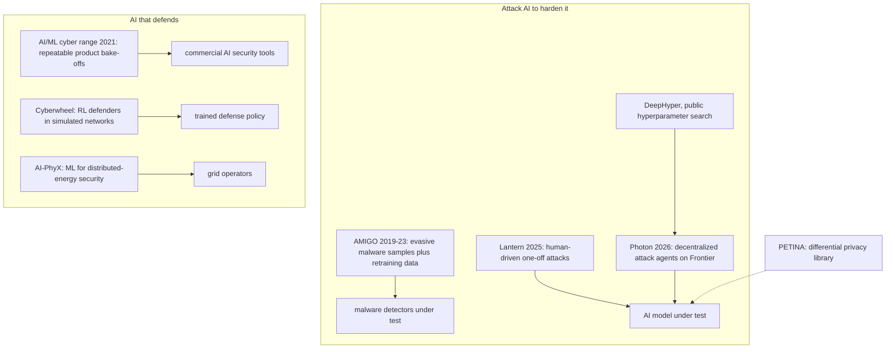

# Deep dive: ORNL AI security (attacking AI, and AI that defends)

Independent research, not affiliated with ORNL. Public sources only; people by role only. Written 2026-11-21.

## The short version
ORNL works both directions at once:
1. **Attacking AI to make it safer:** AMIGO (2019 to 2023) tested malware detectors with evasive samples; Lantern (2025) lets a person craft one-off attacks; Photon (2026) runs thousands of coordinated attacks on Frontier. [KNOWN: briefs]
2. **Using AI to defend:** Cyberwheel trains reinforcement-learning defenders in a simulated network; the AI/ML cyber range compared commercial AI security tools; AI-PhyX applies ML to grid security. [KNOWN: briefs]

**Key takeaway:** the public trail runs from one lab tool (AMIGO, a Navy challenge evaluator) to a dedicated center (CAISER, 2023) with exascale testing (Photon, 2026). Only Cyberwheel and PETINA have public code. [KNOWN: dates; INFERRED: the progression]

## The center: CAISER
- Launched 2023-09-27 to study AI vulnerabilities and risks, with AFRL's Information Directorate and DHS S&T as partners. [KNOWN: launch story]
- Initial focus areas: AI for cybersecurity, biometrics, geospatial intelligence and nuclear nonproliferation. [KNOWN: launch story]
- Today's page describes end-to-end assessments across hardware, software, data supply chains, cyber-physical interfaces and human processes, plus testing at exascale. [KNOWN: CAISER page]

## How the pieces fit

Every box is KNOWN from its brief. The dotted PETINA edge is INFERRED (privacy tooling sits next to model security, no stated link). The range-to-AMIGO tie is INFERRED.

## Timeline
| Date | Event | Source | Tag |
|---|---|---|---|
| 2019 | A SULI undergraduate intern writes AMIGO's binary instrumentation code | AMIGO news | KNOWN |
| 2021-02 | Paper on the AI/ML cyber range, presented in Cookeville, TN | publication page | KNOWN |
| 2022-06-01 | AMIGO DOE CODE record | DOE CODE 95906 | KNOWN |
| 2023-03-23 | AMIGO licensed to a startup | ORNL news | KNOWN |
| 2023-09-27 | CAISER launched | ORNL news | KNOWN |
| 2024-07 | Cyberwheel repo created in the ORNL org | GitHub API | KNOWN |
| 2024-07-22 | AI-PhyX launch story (CESER) | ORNL news | KNOWN |
| 2025-02 | Lantern paper | publication page | KNOWN |
| 2025-03-10 / 2025-08-11 | Cyberwheel v1.1.0 / v2.0 releases | GitHub API | KNOWN |
| 2025-06-05 | Trade press: Photon release expected "in the coming months" | GovCIO Media (search result) | KNOWN-from-search-result |
| 2025-08-26 | Last Cyberwheel commit to date (352 total) | GitHub API | KNOWN |
| 2026-03-24 | Photon announced | ORNL news | KNOWN |
| 2026-11-04 | "AI Cyber Engineer" posting in the Emerging Cyber Technologies Research Group | jobs.ornl.gov, req. 17230 | KNOWN |

## What the outside tells us
1. **Cyberwheel has gone quiet.** 352 commits, v2.0 in August 2025, no commits in the 15 months since, 57 stars and 11 forks (2 of them pushed after September 2025). [KNOWN: GitHub API] The project may have moved to non-public work or simply finished its funded phase. [INFERRED; the LDRD funding is recorded in the [Cyberwheel deep dive](../../../deep-dives/cyberwheel/synthesis.md)]
2. **Photon reuses a public tool.** DeepHyper is open; Photon's change is the objective (find attacks instead of good hyperparameters). [KNOWN: Photon story]
3. **Hiring wants ML plus packet-level basics.** The 2026 AI Cyber Engineer post asks for an MS, ML depth, "basics of cybersecurity such as file and network traffic analysis", and the ability to get a DOE clearance. [KNOWN: posting] Traffic analysis is a TCAT-level skill; the degree and clearance are the long-term gates. [INFERRED]

## Claim boundary
- Photon scale numbers (60,000 prompts per hour, more than 95% use of 1,920 GPUs) are ORNL's own claims, not independently checked. [KNOWN as claims]
- AMIGO: described only as the public story describes it. No reconstruction.
- Which models CAISER has tested: not public, not pursued.

## Unknowns and what would change the picture
- A public Photon or Lantern repository would turn two short briefs into readable code.
- A new Cyberwheel release would reverse the "quiet" reading.
- Searched without result: public code for Photon or Lantern in the ORNL GitHub org listing (191 repos) and by name search (see [verification](../verification.md)).

## Sources (accessed 2026-11-21)
- Briefs: [Photon](../briefs/photon.md), [Lantern](../briefs/lantern.md), [AMIGO](../briefs/amigo.md), [AI/ML cyber range](../briefs/ai-ml-cyber-range.md), [AI-PhyX](../briefs/ai-phyx.md), [PETINA](../briefs/petina.md), [Cyberwheel](../../../projects/cyberwheel.md)
- https://www.ornl.gov/center-for-artificial-intelligence-security-research/
- https://www.ornl.gov/news/ornl-launches-center-ai-security-research-study-ais-impacts-society-security/
- https://jobs.ornl.gov/job/Oak-Ridge-AI-Cyber-Engineer-TN-37830/1437296400/
- https://api.github.com/repos/ORNL/cyberwheel (stars, forks, pushed date)
