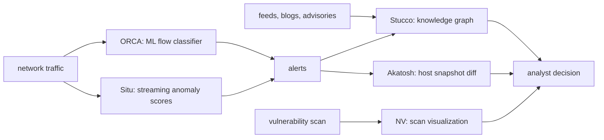

# Deep dive: the analyst-tools lineage (2010 to 2019)

Independent research, not affiliated with ORNL. Public sources only; people by role only. Written 2026-11-21.

## The short version
For about a decade, ORNL's public cyber work built tools for the people in a security operations center: an ML detector that learns your network (ORCA), a scan visualizer (NV), a streaming anomaly scorer (Situ), a knowledge graph that adds context to alerts (Stucco) and a before-and-after host snapshot to confirm alerts (Akatosh). Several were open-sourced on GitHub, and DHS S&T shows up repeatedly as a funder or transition path. Public activity stops around 2016 to 2019. [KNOWN: dates per brief; INFERRED: the arc]

**Key takeaway:** these are the most readable ORNL cyber projects for a student, because the code (Stucco, NV) or detailed descriptions (ORCA, Akatosh) are public and the problems are ones every SOC still has: too many alerts, too little context.

## The tools as one workflow

Each tool's inputs and outputs are KNOWN from its brief. Arranging them as one SOC workflow is INFERRED; no source says they were integrated.

## Timeline
| Date | Event | Source | Tag |
|---|---|---|---|
| about 2011 | ORCA described as a visual analytics framework for network defense data | SPIE 2011 paper (seen in search results) | KNOWN-from-search-result |
| 2012-09 | `ornl-situ` GitHub org created (now says "Repo Moved. See ORNL-SAVA") | GitHub API | KNOWN |
| 2012-10 | First Stucco and SAVA repos | GitHub API | KNOWN |
| 2012-12 to 2016-01 | NV development | GitHub API | KNOWN |
| 2013 / 2014 | Beholder and Data Diode OSTI records | OSTI | KNOWN |
| 2015 | Akatosh work begins from an internship | Akatosh brief | KNOWN |
| 2018-06-01 | Stucco final report for DHS S&T | ORNL report | KNOWN |
| 2018-08-28 | Akatosh story: DHS S&T Transition to Practice | Akatosh brief | KNOWN |
| 2019-11-27 | Last Stucco commit | GitHub API | KNOWN |
| 2022-05-09 | pcapmunger released from ORCA's training pipeline | GitHub API | KNOWN |

## What the outside tells us
1. **DHS S&T was the steady customer.** The Stucco report was written for DHS S&T's Cyber Security Division; Akatosh went through DHS S&T's Transition to Practice; a DHS archive page lists STUCCO. [KNOWN: Stucco report, Akatosh brief; DHS page from search result]
2. **The team's code moved homes.** `ornl-situ` points to `ornl-sava`, which holds the stream libraries and NV. [KNOWN: GitHub API]
3. **Why it stopped is not public.** Possible reasons include funding ending, the work moving to non-public projects, or staff moving on. [UNKNOWN; listed as possibilities, not findings]
4. **Licensing took over.** Situ and Heartbeat were licensed to a company (atlas dossier on AI security), and later tools (AMIGO, Cyber Grid Guard, AVUD) went the same way. [KNOWN per source; INFERRED: the trend]

## Claim boundary
- No claim that these tools were integrated or deployed together.
- People named in sources are left as roles.

## Sources (accessed 2026-11-21)
- Briefs: [ORCA and pcapmunger](../briefs/orca.md), [NV](../briefs/nessus-visualization.md), [Stucco](../briefs/stucco.md), [Situ](../../../projects/situ.md), [Akatosh](../../../projects/akatosh.md), [Beholder](../briefs/beholder.md), [Data Diode](../briefs/data-diode.md)
- Atlas dossier: [AI security and cyber resilience](../../guide/project-dossiers/ai-security-and-cyber-resilience.md)
