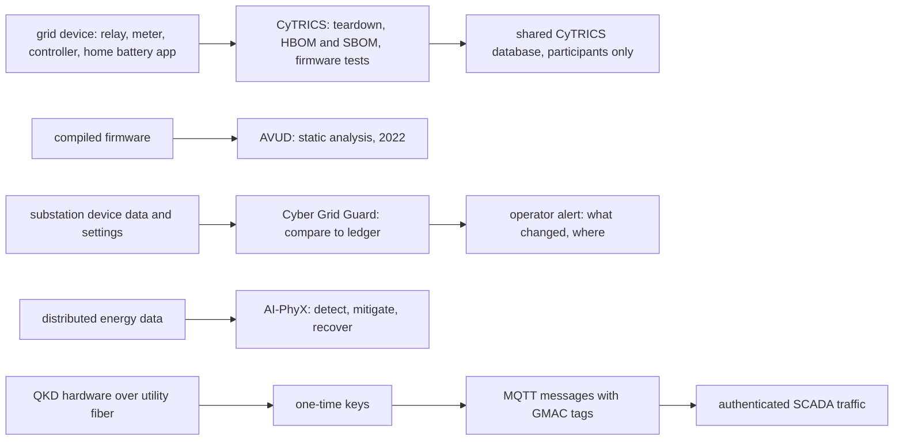

# Deep dive: ORNL grid and quantum security

Independent research, not affiliated with ORNL. Public sources only; people by role only. Software and published artifacts only: no real grid, utility system or device is mapped or probed (RULES 16). Written 2026-11-21.

## The short version
ORNL attacks the "can we trust the grid's data?" problem from four sides:
1. **Know what's inside the boxes:** CyTRICS teardown testing and bills of materials for energy devices. [KNOWN: CyTRICS brief]
2. **Check the data hasn't been changed:** Cyber Grid Guard's ledger-backed tamper detection, licensed in 2026. [KNOWN]
3. **Spot attacks with ML:** AI-PhyX for distributed energy resources. [KNOWN]
4. **Make messages unforgeable:** QKD keys authenticating MQTT control messages on EPB's fiber in Chattanooga, plus older quantum timing work (TASQC). [KNOWN]

**Key takeaway:** the grid lane is split across two parts of the lab (the cyber division in National Security Sciences, and the Electrification and Energy Infrastructures Division) and paid for by at least three DOE offices: CESER, the Office of Electricity, and Office of Science/LDRD for the quantum side. [KNOWN: sponsors per brief; INFERRED: "split"]

## Who pays for what (public records only)
| Work | Sponsor named in a public source | Source |
|---|---|---|
| CyTRICS testing | DOE CESER | ORNL news 2022-11-18; OSTI 3364695 |
| AI-PhyX | DOE CESER | ORNL news 2024-07-22 |
| QKD grid authentication paper | CESER among sponsors | OSTI 1879969 |
| Cyber Grid Guard | DOE Office of Electricity | ORNL news 2026-06-10 |
| EPB polarization follow-on | ORNL LDRD and DOE ASCR (plus UTC) | ORNL news 2025-01-13 |

## How the pieces fit

Boxes and their inputs and outputs are KNOWN from the briefs; there is no public evidence that these systems connect to each other, so no edges are drawn between them.

## Timeline
| Date | Event | Source | Tag |
|---|---|---|---|
| 2016-10 to 2019-05 | TASQC repo activity (14 commits, 5 author names) | GitHub API | KNOWN |
| 2018 | CyTRICS conceived | CyTRICS one-pager | KNOWN |
| 2022-07-26 | QKD authentication of smart grid messages published | Scientific Reports | KNOWN |
| 2022-09 | AVUD report (R&D 100, commercialized) | ORNL publication page | KNOWN |
| 2022-11-18 | ORNL delivers its first CyTRICS bill of materials | ORNL news | KNOWN |
| 2024-07-22 | AI-PhyX launched | ORNL news | KNOWN |
| 2025-01-13 | No-downtime entangled signal on EPB network | ORNL news | KNOWN |
| 2026-06-01 | CyTRICS assessment report on home battery apps (ORNL, INL, PNNL authors) | OSTI 3364695 | KNOWN |
| 2026-06-10 | Cyber Grid Guard licensed | ORNL news | KNOWN |

## What the outside tells us
1. **CyTRICS is widening.** The 2026 report covers consumer mobile apps for home batteries, not just control-room hardware. [KNOWN: OSTI abstract] The program's definition of "energy device" is growing toward connected consumer products. [INFERRED]
2. **Commercialization is the exit path.** Cyber Grid Guard (2026) and AVUD (2022) both went to companies; neither has public code. [KNOWN]
3. **EPB in Chattanooga is the recurring real-world partner** for both the QKD work and AI-PhyX's planned demonstration. [KNOWN: briefs] For an East Tennessee student, this is the closest real grid-security testbed in the public record. [INFERRED]

## Claim boundary
- QKD: "first use of QKD keys to authenticate smart grid communications" is the paper's own claim. [KNOWN as claim]
- Cyber Grid Guard was "tested in an operational environment in an ORNL substation"; this atlas does not call it deployed at utilities.
- CyTRICS findings and device names are not public and were not sought.

## Unknowns and what would change the picture
- Public code for any of these except old TASQC. A DOE CODE record would change that.
- What CESER's monthly ORNL activity reports say: one appeared in search results but its OSTI record is "not found" today. Not used. [KNOWN: tried]

## Sources (accessed 2026-11-21)
- Briefs: [CyTRICS at ORNL](../briefs/cytrics-ornl.md), [Cyber Grid Guard](../briefs/cyber-grid-guard.md), [AI-PhyX](../briefs/ai-phyx.md), [AVUD](../briefs/avud.md), [QKD grid authentication](../briefs/qkd-grid-authentication.md), [TASQC](../../../projects/tasqc.md), [URBAN-NET](../../../projects/urban-net-toolkit.md)
- https://www.ornl.gov/capabilities/grid-security/
- Atlas dossier: [quantum networking and grid security](../../guide/project-dossiers/quantum-networking-and-grid-security.md)
