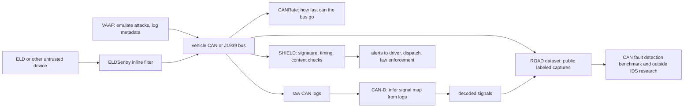

# Deep dive: ORNL vehicle cybersecurity

Independent research, not affiliated with ORNL. Public sources only; people by role only. Written 2026-11-21. Every claim links back to a brief in [../briefs/](../briefs/) or a source listed at the bottom.

## The short version
ORNL runs a full loop on vehicle networks: **measure** the bus (CANRate), **decode** it (CAN-D), **attack** it in the lab (VAAF), **record** real attacks for others (ROAD dataset), **watch** for attacks on the road (SHIELD), and **block** a known way in (ELDSentry). [KNOWN: each step is a separate public artifact; INFERRED: that they form one loop]

**Key takeaway:** this is the most active public ORNL cyber lane. The two newest ORNL cyber software records we found on DOE CODE (CANRate, March 2026; ELDSentry, October 2026) are both vehicle tools, both NNSA-sponsored, and the lab's heavy-truck site lists eight current research threads. [KNOWN: OSTI records; https://hvcs.ornl.gov/research/]

## Why ORNL cares about trucks
The stated reason is cargo: trucks hauling radioactive sources for medicine and industry. [KNOWN: VAAF news 2024-12-31; SHIELD capability page] That explains NNSA as sponsor of CANRate and ELDSentry. [KNOWN: sponsor fields; INFERRED: the explanation] The CRID fact sheet also lists a Vehicle Security Laboratory inside the National Transportation Research Center. [KNOWN: fact sheet]

## Key terms
- **CAN bus:** the shared network that lets a vehicle's computers (ECUs) talk. Every message has an ID and up to 8 data bytes, and there is no built-in sender authentication. [INFERRED: general background; consistent with the briefs]
- **J1939:** the CAN-based protocol heavy trucks use. [KNOWN: HVCS site, SHIELD page]
- **DBC file:** the map from raw CAN bytes to signals like speed or RPM. Makers keep these private, which is why CAN-D reverse-engineers them. [KNOWN: CAN-D brief]
- **ELD:** the Electronic Logging Device required in most US commercial trucks since 2017 to record driving hours. [KNOWN: ELDSentry OSTI record]
- **Fabrication / masquerade / fuzzing:** sending fake messages with a real ID; replacing a real ECU's messages; spraying random messages. [KNOWN: ROAD dataset description names these classes]

## How the pieces fit

Edges are [KNOWN] where a source states the input or output (each brief), and [INFERRED] for the arrows between tools, because no source says one tool feeds another, except that ROAD includes signal-translated series. [KNOWN: ROAD record]

## Timeline
| Date | Event | Source | Tag |
|---|---|---|---|
| 2020-11-23 | CAN-D codebase OSTI software record | https://www.osti.gov/biblio/1822873 | KNOWN |
| 2020-12-28 | ROAD dataset v1 on Zenodo, CC BY 4.0 | https://zenodo.org/records/10462796 | KNOWN |
| 2024-01 | ROAD record updated | Zenodo API (modified date) | KNOWN |
| 2024-10-25 | CAN intermittent fault benchmark, LDRD | https://www.osti.gov/doecode/biblio/145906 | KNOWN |
| 2024-12 | hvcs.ornl.gov first captured by the Wayback Machine | Wayback CDX API | KNOWN |
| 2024-12-31 | VAAF offered for licensing | ORNL news | KNOWN |
| 2025-10 to 2026-02 | CANRate commits in the ORNL GitHub org | GitHub API | KNOWN |
| 2026-03-19 | CANRate DOE CODE record, NNSA | https://www.osti.gov/doecode/biblio/177813 | KNOWN |
| 2026-10-01 | ELDSentry DOE CODE record, NNSA | https://www.osti.gov/doecode/biblio/192285 | KNOWN |

## What the outside tells us
1. **Steady output, small public pieces.** Tools that are released are small and specific (a rate tester, a filter, a dataset); the bigger systems (VAAF, SHIELD) are licensed or unpublished. [KNOWN: per brief; INFERRED: the pattern]
2. **Truck focus is growing.** The current HVCS research list is all J1939 and heavy-vehicle work: ECU firmware test benches, diagnostic messages, a forward road image processor, address-claim attacks, detection and forensics. [KNOWN: HVCS site]
3. **A group fingerprint.** ORNL's research portal profile for "Emerging Cyber Systems Research" lists Controller Area Network as its top topic. [KNOWN-from-search-result: https://impact.ornl.gov/en/organisations/emerging-cyber-systems-research/, not re-fetched] So vehicle work probably lives in that group. [INFERRED]

## Claim boundary
- Said: these tools exist, what they do, who sponsored the records, and when.
- Not said: which vehicles or fleets ORNL tested, or any vulnerability details. None of that is public, and this repo does not look for it.
- Upgraded nothing: VAAF is "available for licensing", not "deployed"; SHIELD's page describes a "devised" system.

## Unknowns and what would change the picture
- Whether VAAF or SHIELD code will ever be public. A DOE CODE record would change this.
- How CAN-D, VAAF and SHIELD share code, if at all. Only a public repo would settle it.
- Searched without result: a public VAAF or SHIELD repository (GitHub org listing for ORNL, DOE CODE keyword search for "controller area network"; see [verification](../verification.md)).

## Build it at home (safe, legal, your own gear)
See [learn and build](../learn-and-build.md), project 2. Short form: Linux `vcan` virtual bus or two Raspberry Pis with CAN boards, `can-utils`, the ROAD dataset, and a timing-based detector you write yourself.

## Sources (accessed 2026-11-21)
- Briefs: [CAN-D](../../../projects/can-d.md), [ROAD](../briefs/road-can-dataset.md), [VAAF](../briefs/vaaf.md), [SHIELD](../briefs/shield-can.md), [CANRate](../briefs/canrate.md), [ELDSentry](../briefs/eldsentry.md), [fault benchmark](../briefs/can-intermittent-fault.md)
- https://hvcs.ornl.gov/research/
- https://www.ornl.gov/news/framework-available-study-vehicle-cyberattacks
- https://www.ornl.gov/capabilities/shield/
- https://www.ornl.gov/wp-content/uploads/2026/05/NSSD-CRID-Fact-Sheet.pdf
