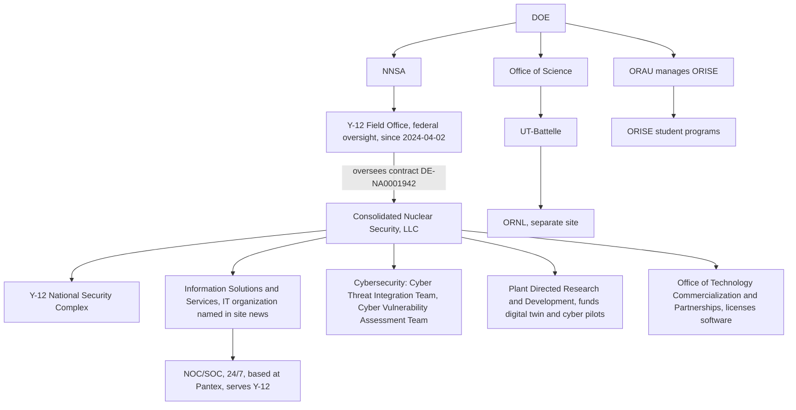

# Y-12 atlas: what Y-12 does, and its public cyber and software work

Independent research, not affiliated with, sponsored by, or endorsed by Y-12, Consolidated Nuclear Security (CNS), NNSA, DOE, ORNL or UT-Battelle. Public sources only (y12.doe.gov, energy.gov, gao.gov, osti.gov, official job boards). No logins, no scanning, no contact with site staff, nothing restricted, controlled or classified, and no guessing about any of it. People appear by role only. Last checked: 2026-11-22.

## The short answer

Y-12 is a nuclear weapons production plant, not a research lab. It makes and stores enriched uranium components for the weapons stockpile and supplies uranium feedstock for the Navy's reactors. [KNOWN: [S1](source-ledger.md#s1), [S4](source-ledger.md#s4)] So its public cyber and software record is **much thinner than ORNL's**: no public GitHub org, three OSTI software records (2011 to 2017), and a short list of in-house business applications offered for licensing. [KNOWN: [signals](signals.md)] What *is* public comes mostly from oversight documents (NNSA's yearly report card on the operator, GAO, the DOE Inspector General) and from a handful of technical reports, conference papers and site news stories.

**Key takeaway:** the most interesting public Y-12 cyber project is a 2019 manufacturing **cyber range and wargaming** effort with Los Alamos (MTEWS), and the most interesting software thread is **digital twins plus large language models for predictive maintenance**, published with the University of Tennessee in 2026. The most realistic student path into Y-12 cyber work is through its 24/7 **network and security operations center (NOC/SOC)**. [INFERRED from the briefs below]

## How Y-12 relates to NNSA, CNS, ORNL and ORAU (plain words)

| Who | What they are | How they connect to Y-12 | Tag |
|---|---|---|---|
| **DOE** | The federal Department of Energy. Owns the land and facilities in Oak Ridge. | Parent department. | KNOWN: [S1](source-ledger.md#s1) |
| **NNSA** | The National Nuclear Security Administration, a semi-independent agency inside DOE that runs the weapons labs and plants. | Owns Y-12's mission and funding. Its **Y-12 Field Office** (set up 2024-04-02, replacing the NNSA Production Office that covered both Y-12 and Pantex) oversees the site. | KNOWN: [S4](source-ledger.md#s4) |
| **CNS** | Consolidated Nuclear Security, LLC. A private company team: Bechtel National (lead), with Leidos, ATK Launch Systems and SOC LLC. | **Runs Y-12 day to day** under NNSA contract DE-NA0001942. Its people are CNS employees, not federal staff. | KNOWN: [S1](source-ledger.md#s1), [S4](source-ledger.md#s4) |
| **ORNL** | Oak Ridge National Laboratory, a research lab run by UT-Battelle for DOE. | A **separate site and a separate operator**. Both sit on the Oak Ridge Reservation and grew out of the same 1943 Manhattan Project (ORNL was "X-10", Y-12 was the uranium separation plant). They share history and some collaboration, not management. | KNOWN: [S5](source-ledger.md#s5), [S6](source-ledger.md#s6); INFERRED: "collaboration, not management" |
| **ORAU / ORISE** | ORAU is a nonprofit university consortium. It manages ORISE, which runs many student and fellowship programs (including ORNL's). | No management role at Y-12 that we found. Y-12's own summer interns are hired by CNS directly, not through ORISE. | KNOWN: [S7](source-ledger.md#s7), [S22](source-ledger.md#s22); INFERRED: no ORISE role at Y-12 (absence of evidence) |

### The operator contract (public records)
- **Contract:** DE-NA0001942, awarded 2013-01-08, CNS started running the site 2014-07-01. The base term ran to 2019-06-30, and with options the period of performance now runs to **2027-09-30**. [KNOWN: [S1](source-ledger.md#s1), [S2](source-ledger.md#s2)]
- **Pantex split off.** The same contract originally covered Pantex in Texas too. NNSA awarded Pantex separately to PanTeXas Deterrence in June 2024, and CNS's Pantex work ended on 2024-10-31. [KNOWN: [S1](source-ledger.md#s1), [S3](source-ledger.md#s3)]
- **What comes next is not public yet.** NNSA says it intends to recompete Y-12 for award in 2027. [KNOWN: [S2](source-ledger.md#s2)] A trade-press analysis from August 2026 says no sources-sought notice or RFI had been posted, and that the last attempt (an award to Nuclear Production One) was terminated after protests, leading to a sole-source extension for CNS. [KNOWN-from-search-result: [S47](source-ledger.md#s47)] **There is no successor operator yet as of 2026-11-22.** [INFERRED: no award notice found on NNSA's contract page, which was updated 2026-10-23]
- **How CNS is graded.** NNSA rates CNS each year in a public Performance Evaluation Report. For FY 2025 CNS earned "Excellent" overall and 92 percent of the available award fee; the goal that covers IT and cybersecurity (Goal 4) was rated "Very Good". [KNOWN: [S8](source-ledger.md#s8)]

Tags for the chart: Field Office, contract and CNS members [KNOWN: S1, S4]; IS&S and NOC/SOC location [KNOWN: [S16](source-ledger.md#s16)]; the two cyber teams [KNOWN: [S8](source-ledger.md#s8)]; PDRD funding of digital twins and of cyber work at universities [KNOWN: [S43](source-ledger.md#s43), [S33](source-ledger.md#s33)]; OTCP [KNOWN: [S26](source-ledger.md#s26)]; ORNL and ORISE [KNOWN: S6, S7]. Where these sit in CNS's internal org chart is UNKNOWN.

## Where to go next

| Page | What it answers |
|---|---|
| [Deep dive: the cyber program from the outside](deep-dives/cyber-program-from-the-outside.md) | What 18 years of public oversight records say about Y-12 cybersecurity, and what they can't say |
| [Deep dive: software and digital transformation](deep-dives/software-and-digital-transformation.md) | Y-12's in-house apps, the software it licenses, and the digital twin and LLM work |
| [Outside-in signals](signals.md) | OSTI counts by year, patents, GitHub and Zenodo, job posts, budget lines |
| [Learn and build](learn-and-build.md) | Realistic paths into Y-12 for a high school cybersecurity student, and projects to build |
| [Candidate catalog rows](y12-catalog.csv) | The briefs in catalog format, waiting for a second fact-check sweep |
| [Sources](source-ledger.md) and [verification notes](verification.md) | Every source, what was checked, what came up empty, and what was skipped |

## The map: every public Y-12 cyber and software item we found

Tags: KNOWN = stated in a cited primary source; INFERRED = reasoned; UNKNOWN = open. "Code" means public source code. **None of these has public code.**

### Cybersecurity
| Item | What it is | Code? | Last public sign | Brief |
|---|---|---|---|---|
| IBCI and MTEWS | Y-12 and Los Alamos cyber range and wargaming system for small manufacturers in the defense supply chain | No | 2019-10 report | [brief](briefs/ibci-mtews.md) |
| NOC/SOC | 24/7 network and security operations center serving Y-12 (based at Pantex) | No | 2026 job post | [brief](briefs/noc-soc.md) |
| Classified Wi-Fi (CSfC) pilot | Pilot of NSA's Commercial Solutions for Classified wireless design, with monitoring through the SIEM | No | FY 2025 report card | [brief](briefs/csfc-wireless-pilot.md) |
| IIoT risk report | Risks and mitigations when nuclear industry adopts Industrial Internet of Things devices | No (report) | 2022-07 OSTI | [brief](briefs/iiot-risk-report.md) |
| Cyber conference talks | Transport cyber-physical landscape (2021), the Kaspersky ban (2019), AI/ML testing of physical security (2021, title only) | No | 2021 OSTI | [brief](briefs/cyber-conference-talks.md) |

### Software engineering and AI
| Item | What it is | Code? | Last public sign | Brief |
|---|---|---|---|---|
| RCAPTS | Web tool that tracks readiness reviews before nuclear facility startup; licensed to a small business | No | 2025 NNSA calendar | [brief](briefs/rcapts.md) |
| eDC/RO | Web system that routes documents for classification review | No | 2025 licensing book | [brief](briefs/edc-ro.md) |
| EMBOS | Electronic medical records for an occupational health clinic | No | 2025 licensing book | [brief](briefs/embos.md) |
| Licensable software portfolio | EMInS, FMES, HERO, ELMS, ERMS, eIROS, Knowledge Preservation Management, MCA application | No | 2025 licensing book | [brief](briefs/licensable-software-portfolio.md) |
| Digital twin + LLM maintenance | Unreal/Unity twin, MQTT telemetry, Random Forest and LLMs for predictive maintenance, with UT Knoxville | No | 2026-08 journal article | [brief](briefs/digital-twin-llm-maintenance.md) |
| Bernie AI pilot | First site outside LLNL to pilot LLNL's Bernie AI infrastructure tool | No | FY 2025 report card | [brief](briefs/bernie-ai-pilot.md) |
| Ethical AI for safeguards | Y-12 and PNNL papers on governing AI in the nuclear safeguards setting | No (papers) | 2023-05 talk | [brief](briefs/ethical-ai-safeguards.md) |
| Task-load training patent | ML that tunes simulator training difficulty from biometrics; with Avrio Analytics | No (patent) | 2022-12 patent | [brief](briefs/task-load-training-patent.md) |

Count: 13 briefs covering about 20 named items. All are new to this repository and have had one fact-check sweep (see [verification](verification.md)).

## How thin is the public record? (honest answer)
- **Thin.** For comparison, ORNL's public GitHub org has 191 repos and our ORNL cyber atlas mapped 35 projects, 7 with runnable code. For Y-12 we found zero public repos and zero runnable code. [KNOWN: [signals](signals.md); [ORNL cyber atlas](../cyber/README.md)]
- The four independent DOE cyber assessments of Y-12 that are listed publicly (2012, 2015, 2018, July 2026) are **titles only**; the reports are not public. [KNOWN: [S10](source-ledger.md#s10)]
- Most of what can be said about Y-12 cyber today comes from two pages of NNSA's FY 2025 report card. [KNOWN: [S8](source-ledger.md#s8)]
- That thinness is expected for a weapons production site and is not evidence of little activity. [INFERRED]

## Scope limits kept in this atlas
- Artifacts only. No scanning, probing, subdomain or DNS work, and no guessed URLs on Y-12, CNS, NNSA or DOE hosts (RULES 16).
- No profiling of people. Several sources name staff; this atlas uses roles.
- No restricted, controlled, classified, UCNI or export-controlled material, and no guessing about any of it. One public-looking document carried a CUI marking and was skipped unread beyond that check; see [verification](verification.md#skipped-on-purpose).
- Physical security is out of scope beyond titles. Specific site equipment named in public reports is left out on purpose.
- Oversight findings are reported at the level the public documents state them, without adding detail.
