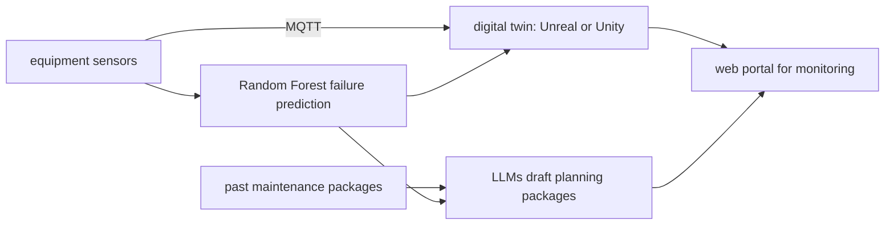

# Deep dive: software engineering and digital transformation at Y-12

Independent research, not affiliated with Y-12, CNS or NNSA. Public sources only. People by role only. Last checked: 2026-11-22.

## The short answer
Software at Y-12 comes in three public layers. **Layer 1** is home-built business software (2010s): web apps for readiness reviews, medical records, emergency management, classification review and logistics, some licensed to outside companies. **Layer 2** is enterprise IT the site must adopt from NNSA (zero trust, federated identity, cloud, digital thread). **Layer 3** is new R&D (2024 to 2026): digital twins, machine learning for predictive maintenance, LLMs, VR training and AI tools such as Bernie. None of it is open source. [INFERRED from the briefs; each layer's pieces are KNOWN as cited below]

**Key takeaway:** Y-12 software engineering looks like a large regulated manufacturer's IT shop plus a growing applied-AI group, not like ORNL's open research-software culture. [INFERRED]

## Layer 1: home-built enterprise apps
- Why they exist: the plant runs its own clinic, fire department, communications and maintenance, so it builds software for them. [KNOWN: [licensing book, S27](../source-ledger.md#s27)]
- What exists publicly: RCAPTS, eDC/RO, eIROS, EMBOS and ERMS, EMInS, FMES, HERO, ELMS, Knowledge Preservation Management, and a gamma-spectrum analyzer app. [KNOWN: S27; see the [portfolio brief](../briefs/licensable-software-portfolio.md)]
- Only three of these ever got OSTI software records (RCAPTS 2011, EMBOS 2012, eDC/RO 2017). [KNOWN: [S30](../source-ledger.md#s30), [S32](../source-ledger.md#s32), [S31](../source-ledger.md#s31)]
- The one documented outside license: RCAPTS to a small business, which then supplied it to three other DOE sites. [KNOWN: [S28](../source-ledger.md#s28), [S29](../source-ledger.md#s29)]
- Visible stack hints: web-based, PHP and JavaScript for at least one app (ERMS), Windows for the analyzer app. [KNOWN: S27] Current job postings seen in search results ask for C#, Java, JavaScript/React, SQL, web APIs and DevSecOps. [KNOWN-from-search-result: [S25](../source-ledger.md#s25)]

## Layer 2: enterprise IT from NNSA
- FY 2025 report card items: IPv6, Energy Hub Access, data loss prevention (not yet met); AI management and limited NNSA federated access (done early); endpoint detection and response, an enterprise secure network hub, OneNNSAccess and zero trust architecture (more work needed); "smart electronic procedures" for production. [KNOWN: [S8](../source-ledger.md#s8)]
- Digital engineering: an enterprise Product Definition Data Management system for sharing product definition data between Y-12 and Los Alamos; CNS recognized as an enterprise leader on AI, extended reality and digital thread; CNS leads the enterprise Smart Factory working group. [KNOWN: S8]
- Software quality: the report card mentions gaps found in "digital assurance and software quality assurance" during risk work, which were addressed. [KNOWN: S8]
- Budget backdrop: NNSA's FY 2027 request raises the enterprise IT and Cybersecurity line 36 percent, to $935M, and describes continuous monitoring, cloud and identity management. [KNOWN: [S15](../source-ledger.md#s15)]

## Layer 3: applied AI and digital twins
- Digital twins for training and planning, a five-level maturity model, funded by Plant Directed R&D. [KNOWN: [S43](../source-ledger.md#s43)]
- Two 2026 journal papers with UT Knoxville: a twin built on Unreal Engine 5 / Unity with MQTT telemetry, Random Forest failure prediction and LLMs, and LLMs that draft maintenance planning packages. [KNOWN: [S39](../source-ledger.md#s39), [S38](../source-ledger.md#s38)]
- Bernie AI pilot (first site outside LLNL). [KNOWN: S8]
- Ethical-AI work with PNNL for safeguards. [KNOWN: [S41](../source-ledger.md#s41), [S42](../source-ledger.md#s42)]
- A patented ML method for adaptive simulator training, with Avrio Analytics. [KNOWN: [S40](../source-ledger.md#s40)]

Tags: components and flow as described in the two abstracts [KNOWN: S38, S39]; the exact wiring between boxes is our simplification [INFERRED].

## How this compares with ORNL
| | ORNL | Y-12 |
|---|---|---|
| Public code | 191 repos in the main GitHub org | none found |
| How software leaves the site | open source plus licensing | licensing only |
| Typical software | research codes, HPC, data pipelines | business workflow apps, production systems, applied AI |
| Where to read about it | GitHub, DOE CODE, papers | licensing book, report cards, a few papers |
Sources: [ORNL cyber atlas signals](../../cyber/signals.md); [Y-12 signals](../signals.md). [KNOWN for counts; INFERRED for "typical"]

## Open questions
- Which languages and frameworks the in-house apps use today. UNKNOWN beyond the hints above.
- Whether any of the 2026 digital twin code will be released. UNKNOWN; nothing on DOE CODE as of 2026-11-22.
