# Connections map

How projects relate: shared code, shared facility, same group, dependencies.
Independent research from public sources only; not affiliated with ORNL. Last updated 2026-10-24 (connections pass 22: SNAPRed, PyRS, KORC). All sources accessed 2026-10-24 by unauthenticated GitHub reads (contents API, contributors API, raw README and build files).

## Overview
This covers the 62 catalog rows (catalog.csv after commit 389c575) plus outside projects shown as `ext` (ExaCA, FATES, MOOSE, FIREWHEEL, LLNL GridKit, SUMO/VISSIM/AIMSUN, STRIPE). Links: 177 numbered links (91 through pass 5, +6 pass 6, +5 pass 7, +5 pass 8, +1 pass 10, +7 pass 12, +6 pass 13, +14 pass 14, +5 pass 15, +11 pass 16, +7 pass 17, +6 pass 18, +5 pass 19, +1 pass 20, +4 pass 21, +3 pass 22). Tagged claims (pass 22): 189 [KNOWN], 21 [CORROBORATED], 69 [INFERRED], 41 [UNKNOWN], 12 [UNRELATED] = 332, counted over numbered link lines only.
**Counting rule:** tag totals count every tag marker in the Links section, so each part of a split link (e.g. "[KNOWN] shared contributor; [INFERRED] same group") counts separately. That is why tagged claims exceed unique links. (Pass 5's header said 111 claims; a mechanical recount of pass 5's numbered links gave 120 (71 KNOWN, 37 INFERRED, 12 UNKNOWN), so the old figure was an undercount.)
**Verification status:** batch 3 briefs (scale, vera, gitr, real-twin, gauntlet, energyplus) are VERIFIED (fact-check sweep 2 done, 2026-10-24). Batch 4 briefs (landscan, shift-exnihilo, fixs, autobem, situ, roof-savings-calculator) are folded in as unverified. Stubs (`stub-osti-only`): akatosh, can-d, cincinnatus, heartbeat-malware, cpad, hyperion, wufi-ornl, urban-net-toolkit. `draft-osti-only`: situ, roof-savings-calculator. AutoBEM: status `unknown` (Model America on Constellation counts as its docs page); brief unverified. Maturity words are kept as written in sources (RULES 10). The clearest clusters, most of them backed by dependency files and shared contributors:
- **AM simulation:** Myna drives AdditiveFOAM and 3DThesis, and shares developers with Finch and HydraGNN.
- **Neutron software:** SNAPRed and PyRS are built on Mantid, and data-workflow shares their maintainers.
- **Grid solvers:** GridKit uses ReSolve and shares its lead developer.
- **Heterogeneous computing and quantum:** QIR-EE shares developers with IRIS and TASMANIAN.
- **OLCF:** a facility hub (User Docs, Test Harness) that Flowcept, HydraGNN, ExaTN and HeCBench point to.
- **Earth and climate:** ORNL DAAC data services (Daymet, GEDI, TESViS), plus FATES (outside project, LANL per OSTI), which runs inside E3SM's land model.

Fact-check corrections (verification/log.md, 2026-10-24) are reflected here. ExaTN's status is **unknown**, not archived: it's stale since 2023 but not flagged archived. ReSolve, TASMANIAN, AdditiveFOAM and Xolotl had their licenses corrected. Briefs (6): hydragnn, mantid, gridkit, thermochimica, datafed and cyberwheel are all Fact-Checker cleared (verification/log.md) and folded in as cleared. Per the fact-check pass, two brief claims are now [INFERRED]: that DataFed never stores passwords, (Cyberwheel's VM use is now [KNOWN] via the LDRD report). OSTI DOE CODE records now confirm ORNL ownership for DataFed, Thermochimica, GridKit, Myna and HydraGNN.

## Diagram

```mermaid
graph LR
  subgraph HPC
    hecbench[HeCBench]; resolve[ReSolve]; tasmanian[TASMANIAN]; iris[IRIS]; olcfdocs[OLCF User Docs]; oth[OLCF Test Harness]
  end
  subgraph AI_data["AI/data"]
    hydragnn[HydraGNN]; flowcept[Flowcept]; datafed[DataFed]; vivaldi[Vivaldi]; mtg[Mind the Gap]
  end
  subgraph neutrons
    mantid[Mantid]; snapred[SNAPRed]; pyrs[PyRS]; dwf[data-workflow]; drs[django-remote-submission]
  end
  subgraph nuclear_fusion["nuclear/fusion"]
    xolotl[Xolotl]; stell[Stellarator-Tools]; thermo[Thermochimica]; far3d[FAR3d]; korc[KORC]; gitr[GITR]; scale[SCALE]; olm[OLM]; vera[VERA]
  end
  subgraph grid_energy["grid/energy"]
    gridkit[GridKit]; hfi[HydroFleetIntel]
  end
  subgraph materials
    additivefoam[AdditiveFOAM]; myna[Myna]; finch[Finch]; thesis[3DThesis]
  end
  subgraph quantum
    exatn[ExaTN]; qiree[QIR-EE]
  end
  subgraph cyber
    cyberwheel[Cyberwheel]; tasqc[TASQC]; akatosh[Akatosh stub]; cand[CAN-D stub]
  end
  subgraph buildings_transport["buildings/transport"]
    gauntlet[Gauntlet]; realtwin[Real-Twin]; stor4build[Stor4Build]; eplus[EnergyPlus]
  end
  subgraph climate_earth["climate/earth"]
    gedi[GEDI Tutorials]; daymet[Daymet]; tesvis[TESViS MODIS]; elm[E3SM ELM]; fates[FATES ext LANL]
  end
  gridkit -->|optional dep| resolve
  gridkit -.-|shared dev| resolve
  snapred -->|depends on| mantid
  pyrs -->|depends on| mantid
  dwf -.-|shared devs| pyrs
  dwf -.-|shared devs| snapred
  hecbench -->|kernel from| hydragnn
  myna -->|drives| additivefoam
  myna -->|drives| thesis
  myna -.-|shared devs| finch
  hydragnn -.-|shared dev| additivefoam
  xolotl -.-|shared dev| gridkit
  xdeps[PETSc/plsm ext]
  xolotl -->|depends on| xdeps
  uqtk[UQTk ext Sandia]
  xolotl -->|UQ scripts| uqtk
  qiree -.-|shared devs| iris
  iris -->|QIR-EE device backend| qiree
  accel[CUDA/HIP/OpenCL/OpenMP/Level Zero/Hexagon ext]
  iris -->|backends| accel
  matris[MatRIS]
  kokkos[Kokkos ext, ORNL contributor]
  cabana[Cabana]
  cabana -->|built on| kokkos
  finch -->|built on| cabana
  xolotl -->|depends on| kokkos
  adam -->|built on| kokkos
  xacc[XACC]
  qiree -->|optional backend| xacc
  tnqvm[TNQVM]
  tnqvm -->|accelerator plugin| xacc
  tnqvm -.-|optional ExaTN| exatn
  xaccb[IBM/IonQ/Rigetti/qsim/... backends ext]
  xacc -->|plugins| xaccb
  exago[ExaGO]
  hiop[HiOp ext]
  exago -->|optional dep| hiop
  exago -.-|4 shared contributors, no code link| gridkit
  exago -->|Frontier build scripts| olcfdocs
  pnnlexago[pnnl/ExaGO archived ext]
  pnnlexago -.->|continued as?| exago
  cabdeps[ArborX/HYPRE/heFFTe ext]
  cabana -->|optional deps| cabdeps
  matris -->|built on| iris
  xsdk[xSDK ext]
  xsdk -->|bundles| tasmanian
  tasmanian -->|GPU backends| accel
  charm[CHARM-SYCL ext Tsukuba]
  charm -.-|toolchain paper| iris
  qiree -.-|shared dev| tasmanian
  qiree -.-|same org| exatn
  fates -->|runs inside| elm
  daymet -.-|ORNL DAAC| gedi
  tesvis -.-|ORNL DAAC?| daymet
  oth -.-|OLCF| olcfdocs
  flowcept -->|Frontier example, OLCF ack| olcfdocs
  brokers[Redis/Kafka/RabbitMQ/MQTT, MongoDB/LMDB ext]
  flowcept -->|optional deps| brokers
  mlibs[Dask, MLflow, TensorBoard ext]
  flowcept -->|adapters| mlibs
  ldrd11521[LDRD 11521 INTERSECT]
  ldrd11521 -->|names| flowcept
  zambeze[Zambeze]
  zambeze -->|references| flowcept
  hydragnn -->|OPF power grid| gridapp[Power grid OPF ext]
  hydragnn -.-|OLCF| olcfdocs
  exatn -.-|Summit| olcfdocs
  hecbench -.-|OLCF material| olcfdocs
  suites[Rodinia/SHOC/NPB-GPU/LULESH ext]
  suites -->|ported into| hecbench
  hydragnn -.-|OPF examples| gridkit
  thermo -.-|materials domain| xolotl
  xolotl -.-|same org| stell
  vivaldi -.-|building data| mtg
  flowcept -.-|?| hydragnn
  datafed -.-|?| flowcept
  hecbench -.-|?| iris
  drs -.-|?| dwf
  daymet -.-|?| elm
  datafed -.-|OLCF| olcfdocs
  moose[INL MOOSE ext]
  moose -->|submodule| thermo
  firewheel[Sandia FIREWHEEL ext]
  cyberwheel -->|modified, emulation| firewheel
  fw16[Sandia Firewheel 2016 OSTI ext] -.-|ancestor?| firewheel
  ldrd[LDRD 11049 FY2025] -->|testbed| cyberwheel
  cwusers[3 papers using Cyberwheel ext]
  cyberwheel -->|used by| cwusers
  stripe[STRIPE framework ext]
  gitr -->|component of| stripe
  modelam[Model America v1.0 dataset]
  autobem -->|produced| modelam
  modelam -->|EnergyPlus/OpenStudio models| eplus
  modelam -.-|DOI only, compute at ALCF| olcfdocs
  llnlgk[LLNL GridKit 2016 ext, namesake] -.-|namesake, not a source| gridkit
  vivaldi -->|uses| gauntlet
  stor4build -->|uses| eplus
  olm -->|ORIGEN libs| scale
  scale -.-|reactor domain| vera
  korc -.-|shared dev| stell
  korc -.-|shared dev| pyrs
  gitr -.-|PMI domain| xolotl
  far3d -.-|stellarator domain| stell
  tasqc -.-|grid timing| gridkit
  akatosh -.-|cyber domain| cyberwheel
  cand -.-|cyber domain| cyberwheel
  hfi -.-|?| gridkit
  subgraph batch4["batch 4 (cyber, buildings/transport, nuclear, geo, grid)"]
    cinc[Cincinnatus stub]; hb[Heartbeat stub]; cpad[CPAD stub]; situ[Situ draft]; hyp[Hyperion stub]; fixs[FIXS]; pyx[pyxodr3d]; rsc[Roof Savings Calc draft]; autobem[AutoBEM]; wufi[WUFI-ORNL stub]; shift[Shift/Exnihilo]; landscan[LandScan]; unet[URBAN-NET stub]
  end
  adam[adamantine]; exaca[ExaCA ext LLNL]; usas[USA Structures]; ppa[post-processing-agent]; lds[live-data-server]; sumo[SUMO/VISSIM/AIMSUN ext]
  myna -->|drives| adam
  amdeps[deal.II/ArborX/Trilinos ext]
  adam -->|built on| amdeps
  myna -->|drives| exaca
  pyrs -.-|residual stress, no code tie| additivefoam
  korc -.-|same org, particle tracking| gitr
  korcdeps[PSPLINE / fusion-io / HDF5 ext]
  korc -->|build deps| korcdeps
  finch -->|exaca format, coupled build| exaca
  thesis -->|RDF files| exaca
  additivefoam -->|ExaCA data script| exaca
  stork[Stork ext, unknown origin]
  finch -.-|optional Stork interpolation| stork
  thesis -.-|Stork mode| stork
  tesvis -->|serves| daymet
  tesvis -->|serves| gedi
  dwf -->|livereduce/PPA| mantid
  realtwin -.-|same org| fixs
  pyx -.-|same org| realtwin
  realtwin -->|supports| sumo
  shift -->|in SCALE| scale
  shift -.-|?inferred| vera
  cinc -.-|cyber| cyberwheel
  hb -.-|cyber| cyberwheel
  situ -.-|cyber| cyberwheel
  hyp -.-|cyber| cyberwheel
  cpad -.-|cyber-physical| tasqc
  rsc -.-|buildings| eplus
  wufi -.-|buildings| eplus
  autobem -.-|buildings| eplus
  unet -.-|grid| gridkit
  landscan -.-|geospatial| unet
  landscan -.-|geospatial| vivaldi
  elm -.-|OLCF DOIs| olcfdocs
  gauntlet -->|features| usas
  dwf -->|uses| ppa
  dwf -.-|sibling| lds
  ppa -->|depends on| mantid
  oncat[ONCat]
  ppa -->|catalogs to| oncat
  ppa -.-|uploads plots?| lds
```

Solid arrows: dependency [KNOWN]/[CORROBORATED]. "stub" = stub-osti-only row; "draft" = draft-osti-only; "ext" = outside project. Dotted: shared people, facility, org or domain. "?" marks [UNKNOWN].

## Links
Tagging rule: a shared top contributor is a [KNOWN] fact. Any 'same group' or 'same team' conclusion drawn from it is [INFERRED] unless an official page or OSTI record names the group. Split links carry both tags, and each part counts separately in the totals. [CORROBORATED] = two independent sources (two issues of one report don't count); [UNRELATED] = checked, not part of the project.

Arrows/types follow RULES.md relationship types.

1. **GridKit → ReSolve (dependency)** [KNOWN]: GridKit's README names ReSolve (v0.99.3 or later) as an optional dependency, and its build files also use SUNDIALS, IPOPT and KLU. Source: https://github.com/ORNL/GridKit/blob/HEAD/README.md Pass 20: [KNOWN] CMakeLists.txt option "Enable ReSolve support" (OFF) with find_package(ReSolve ... REQUIRED); KLU enters through SUNDIALS (find_package SUNDIALS 7.8.0, "KLU support enabled in SUNDIALS" when SUNDIALS::sunlinsolklu exists), not as a direct dependency. Source: https://github.com/ORNL/GridKit/blob/develop/CMakeLists.txt Pass 21: [KNOWN] ReSolve now has a catalog brief (projects/resolve.md): tags v0.99.x, the GridKit hook is CMakeLists.txt line 37 `GridKit_ENABLE_RESOLVE` (OFF), and the brief lists no other known consumer. Sources: projects/resolve.md ; https://github.com/ORNL/GridKit/blob/develop/CMakeLists.txt
2. **SNAPRed → Mantid (dependency)** [KNOWN]: SNAPRed's pyproject sets up Mantid as its core backend. It routes calls to mantid.simpleapi through a wrapper and pulls from Mantid conda channels. Source: https://github.com/neutrons/SNAPRed/blob/HEAD/pyproject.toml Pass 22: [KNOWN] pyproject.toml line 92: calls to "mantid.simpleapi" must be "routed through 'MantidSnapper'"; Pixi channels include "mantid/label/nightly". Brief: projects/snapred.md. Source: https://github.com/neutrons/SNAPRed/blob/next/pyproject.toml
3. **HeCBench ← HydraGNN (shared codebase)** [KNOWN]: HeCBench lists a benchmark built from HydraGNN's MACE forward pipeline and links to the HydraGNN repo. Source: https://github.com/ORNL/HeCBench/blob/HEAD/README.md
4. **SNAPRed ↔ Mantid (shared contributor; same group)** [KNOWN] shared contributor; [INFERRED] same group: GitHub user peterfpeterson is a top contributor to both repos, which is a fact. That they come from the same maintaining group is an inference: the Mantid homepage names ORNL NScD (link 53), but not as SNAPRed's group. Sources: https://api.github.com/repos/neutrons/SNAPRed/contributors , https://api.github.com/repos/mantidproject/mantid/contributors
5. **HydraGNN ↔ AdditiveFOAM (shared contributor; same team)** [KNOWN] shared contributor; [INFERRED] same team: GitHub user streeve is a top contributor to both. A joint AI-for-materials and additive manufacturing team is inferred only. Sources: contributors API for ORNL/HydraGNN and ORNL/AdditiveFOAM
6. **Xolotl ↔ GridKit (shared contributor; same group)** [KNOWN] shared contributor; [INFERRED] same group: GitHub user PhilipFackler is a top contributor to both. A shared software-engineering group is inferred only. Sources: contributors API for ORNL-Fusion/xolotl and ORNL/GridKit
7. **GridKit ↔ ReSolve (shared contributor; same group)** [KNOWN] shared contributor; [INFERRED] same group: GridKit's README credits Slaven Peles (GitHub user pelesh) as its author, and a re-pull on 2026-10-24 shows pelesh as ReSolve's top contributor. ReSolve's README says it was ECP-funded, and the fact-check pass verified it through DOE CODE code-114681. Sources: GridKit README; https://api.github.com/repos/ORNL/ReSolve/contributors ; verification/log.md
8. **Flowcept ↔ OLCF (same facility)** [KNOWN]: Flowcept's README acknowledges using Oak Ridge Leadership Computing Facility resources. Source: https://github.com/ORNL/flowcept/blob/HEAD/README.md Pass 12: [CORROBORATED] with the repo's examples/olcf_frontier/ ("Flowcept on OLCF Frontier", Redis + LMDB, multi-node MPI). Acknowledgement quote: "This research uses resources of the Oak Ridge Leadership Computing Facility". Only the public example title is cited; no system details recorded (RULES 16).
9. **HydraGNN ↔ OLCF (same facility)** [KNOWN]: HydraGNN's README shows a workflow that uses DFT output on OLCF Constellation (OLCF's data/DOI service). Source: https://github.com/ORNL/HydraGNN/blob/HEAD/README.md
10. **ExaTN ↔ OLCF Summit/Frontier (same facility)** [KNOWN]: ExaTN's README gives Summit build instructions. Source: https://github.com/ORNL-QCI/exatn/blob/HEAD/README.md
11. **HeCBench ↔ OLCF / ExCL (same facility)** [KNOWN]: Several HeCBench kernels come from OLCF tutorial and training repos, and the README acknowledges ORNL's Experimental Computing Laboratory (ExCL). Source: HeCBench README Pass 17: the current README (last commit 2026-10-13) no longer contains an ExCL acknowledgement (grep for "ExCL", "Experimental" as lab name, "acknowledg" found none); the OLCF-sourced kernels still stand (link 155). ExCL part now [UNKNOWN] for the current README.
12. **HeCBench ↔ HiOp and SUNDIALS (shared codebase, external)** [KNOWN]: HeCBench includes kernels taken from ORNL/hiop and ORNL/sundials. GridKit also depends on SUNDIALS (link 1), so these two catalog projects share an upstream. Source: HeCBench README
13. **Xolotl → PETSc, Kokkos, plsm (dependency, external)** [KNOWN]: Xolotl includes PETSc and plsm (from ORNL-Fusion) as git submodules and requires Kokkos. Its README says it's developed under two DOE SciDAC projects. Sources: https://github.com/ORNL-Fusion/xolotl/blob/HEAD/.gitmodules , README
14. **ReSolve → SuiteSparse/KLU (dependency, external)** [KNOWN]: ReSolve's CMake uses KLU from SuiteSparse, and GridKit also uses KLU. Source: https://github.com/ORNL/ReSolve/blob/HEAD/CMakeLists.txt
15. **HydraGNN → DeepHyper, ADIOS (dependency, external)** [KNOWN]: HydraGNN's pyproject lists DeepHyper for hyperparameter search, and its README describes optional ADIOS datasets. Sources: HydraGNN pyproject.toml, README
16. **AdditiveFOAM → OpenFOAM (dependency, external)** [KNOWN]: AdditiveFOAM is built on OpenFOAM. Source: https://github.com/ORNL/AdditiveFOAM/blob/HEAD/README.md
17. **DataFed → Globus (dependency, external)** [KNOWN]: DataFed uses Globus/GridFTP for authorization and transfer, and is designed for research that spans multiple facilities. Source: https://github.com/ORNL/DataFed/blob/HEAD/README.md
18. **Flowcept ↔ HydraGNN (common domain)** [UNKNOWN]: Flowcept captures provenance for AI workflows, so HydraGNN training runs would be a natural fit. No direct reference found. Pass 12: no HydraGNN mention found in the Flowcept repo (code, docs, examples); stays [UNKNOWN]. Pass 14: re-checked against the discovery-pass HydraGNN signals; no Flowcept tie found, stays [UNKNOWN].
19. **DataFed ↔ Flowcept (common domain)** [UNKNOWN]: Both are ORNL scientific-data infrastructure. Whether they integrate isn't confirmed. Pass 12: no DataFed or Globus mention found in the Flowcept repo; stays [UNKNOWN]. Note: both store 'references to large data objects' in different ways (LDRD 11521 text, link 113). Pass 14: re-checked against the discovery-pass DataFed signals; no Flowcept tie found, stays [UNKNOWN].
20. **HeCBench ↔ IRIS (common domain / same group?)** [UNKNOWN]: Both target heterogeneous computing, and GitHub user vetter is a top HeCBench contributor. Whether IRIS comes from the same group isn't confirmed. Pass 13: IRIS repo README/docs grep found no HeCBench mention; stays [UNKNOWN]. Pass 17: re-checked; HeCBench README names no IRIS benchmark or paper, and the vetter entries point to SHOC, not IRIS. Stays [UNKNOWN]; a shared heterogeneous-computing theme is not a link.
21. **Thermochimica ↔ Xolotl (common domain)** [INFERRED]: Thermochimica's GitHub org says CEES is ORNL's Computational Engineering and Energy Sciences Group; Xolotl sits in ORNL-Fusion. Both model nuclear/fusion materials behavior (thermochemistry and radiation damage). There's no code link. Based on the repo descriptions.
22. **Xolotl ↔ Stellarator-Tools (same org; same group)** [KNOWN] same GitHub org; [INFERRED] same research group: Both sit in the ORNL-Fusion org. They share no top contributors. Source: https://github.com/ORNL-Fusion
23. **Mantid/SNAPRed ↔ SNS (same facility)** [KNOWN] SNAPRed–SNS; [INFERRED] Mantid used at SNS/HFIR: SNAPRed's pyproject references SNS. Mantid's use at SNS/HFIR is [INFERRED] in projects/mantid.md, which also records ORNL NScD in Mantid's multi-institution copyright [KNOWN]. Pass 22: [CORROBORATED] SNAPRed and SNS: pyproject.toml test marker for "/SNS/SNAP/ data mount" plus OSTI 3012509 (SoftwareX 2025, DOI 10.1016/j.softx.2025.102464), abstract: SNAP is a diffractometer "at the Spallation Neutron Source operated by Oak Ridge National Laboratory". Sources: SNAPRed pyproject.toml ; https://www.osti.gov/biblio/3012509
24. **IRIS ↔ ExaGO (external)** [UNKNOWN]: IRIS's README mentions ExaGO (an ORNL/PNNL grid-optimization code) once. Since GridKit, ReSolve and HiOp sit in the same grid-optimization area, this may connect to them; unverified. Source: https://github.com/ORNL/iris/blob/HEAD/README.md Pass 16: ExaGO is now a catalog row (exago, ORNL/ExaGO); the README mention stays the only IRIS tie.
25. **HydraGNN ↔ GridKit (common domain)** [INFERRED]: The fact-check pass verified (verification/log.md) that HydraGNN supports optimal power flow (OPF) training, which puts it in GridKit's power-grid domain. Neither repo names the other, so the link stays inferred. Source: projects/hydragnn.md
26. **HydraGNN ↔ OLCF Frontier (same facility)** [KNOWN]: HydraGNN's brief (cleared by the fact-check pass) cites Frontier install scripts in the repo. The fact-check pass confirmed Frontier's AMD MI250X GPUs from the OLCF user guide. Sources: projects/hydragnn.md; verification/log.md; https://docs.olcf.ornl.gov

### Batch 02 links
27. **Myna → 3DThesis (dependency)** [KNOWN]: Myna's README lists 3DThesis as a supported application it drives. Source: https://github.com/ORNL-MDF/Myna/blob/HEAD/README.md
28. **Myna → AdditiveFOAM (dependency)** [KNOWN]: Myna's README lists AdditiveFOAM v1.0 as a supported application. Source: Myna README
29. **Myna → ExaCA (dependency, external, LLNL repo)** [KNOWN]: Myna also drives ExaCA, a cellular-automata grain-structure code, and offers an optional extra for it. Source: Myna README, pyproject.toml
30. **Myna ↔ MDF Peregrine (dependency, external)** [KNOWN]: Myna is built around the database structure of ORNL MDF's Peregrine tool. Source: Myna README
31. **Myna / Finch / AdditiveFOAM / HydraGNN (shared contributors; same team)** [KNOWN] shared contributors; [INFERRED] same team: GitHub user streeve is a top contributor to all four, and colemanjs to Myna, Finch and AdditiveFOAM. gknapp1 contributes to both Myna and AdditiveFOAM. Sources: contributors API for ORNL-MDF/Myna, ORNL-MDF/Finch, ORNL/AdditiveFOAM, ORNL/HydraGNN
32. **Finch → Cabana/Kokkos (dependency, external)** [KNOWN]: Finch is built on Cabana, a performance-portable particle/grid library from the ECP CoPA project, which runs on Kokkos. That ties it to Xolotl's Kokkos dependency. Source: https://github.com/ORNL-MDF/Finch/blob/HEAD/README.md Pass 19: [KNOWN] build file: Finch CMakeLists.txt `find_package(Cabana 0.6.1 REQUIRED COMPONENTS Cabana::Grid)` (same repo as README, so not counted as independent). Source: https://github.com/ORNL-MDF/Finch/blob/main/CMakeLists.txt Pass 21: [CORROBORATED] Finch's ORNL tie: LICENSE "Copyright (c) 2024, Oak Ridge National Laboratory" plus DOE CODE code-122647 ("Finch", 2024-02-23, research org ORNL), two independent sources. Sources: https://github.com/ORNL-MDF/Finch/blob/main/LICENSE ; https://www.osti.gov/doecode/biblio/122647 ; projects/finch.md
33. **3DThesis / Finch / AdditiveFOAM (common domain)** [INFERRED]: All three are melt-pool heat-transfer models for additive manufacturing, with different methods (semi-analytic, finite-difference, finite-volume). Myna exists to swap between them. Sources: catalog notes, Myna README Pass 21: [INFERRED] the reading pass's "ladder" (3DThesis quick estimate, Finch GPU grid model, AdditiveFOAM full melt-pool flow, all feeding ExaCA) is an editorial framing; no repo or doc uses that word. Each handoff to ExaCA is verified separately in links 171-173.
34. **PyRS → Mantid (dependency)** [KNOWN]: PyRS's pyproject depends heavily on Mantid and names HFIR's HB2B instrument. Source: https://github.com/neutrons/PyRS/blob/HEAD/pyproject.toml Pass 22: [KNOWN] pyproject.toml lines 63-68 prefer "mantid-ornl/label/main" ("ORNL-specific stable releases"), and the code uses Mantid peak fitting (calibration/mantid_peakfit_calibration.py, peaks/mantid_fit_peak.py). Brief: projects/pyrs.md. Source: https://github.com/neutrons/PyRS/blob/next/pyproject.toml
35. **data-workflow / PyRS / SNAPRed / Mantid (shared contributors; same group)** [KNOWN] shared contributors; [INFERRED] same group: peterfpeterson is a top contributor to all four. rosswhitfield and jmborr contribute to both data-workflow and PyRS, and walshmm and darshdinger to both data-workflow and SNAPRed. Sources: contributors API for neutrons/data_workflow, neutrons/PyRS, neutrons/SNAPRed, mantidproject/mantid
36. **data-workflow ↔ SNS (same facility)** [KNOWN]: Its README calls it the SNS data workflow manager and reporting app. Pass 5: the Mantid link moved out of [UNKNOWN] and into link 74. Sources: https://raw.githubusercontent.com/neutrons/data_workflow/next/README.rst ; projects/data-workflow.md
37. **PyRS ↔ HFIR (same facility)** [KNOWN]: PyRS targets HB2B at HFIR. Its README example also starts from an HFIR/HB2B NeXus file (pass 5 retry, default branch `next`). Sources: PyRS pyproject.toml; https://raw.githubusercontent.com/neutrons/PyRS/next/README.rst Pass 22: [KNOWN] pyproject.toml line 3 "Data reduction and visualization of neutron data measured at the HFIR HB2B instrument". Source: PyRS pyproject.toml
38. **django-remote-submission ↔ neutrons group (same research group)** [UNKNOWN]: It sits in the ornl-ndav org, likely neutron data analysis and visualization. I found no shared contributors or code link with the neutrons repos. Source: https://github.com/ornl-ndav/django-remote-submission
39. **QIR-EE ↔ IRIS (shared contributors; same group)** [KNOWN] shared contributors; [INFERRED] same group: GitHub users miniskar and wongey are top contributors to both. A common group is inferred only. Source: contributors API for ORNL-QCI/qiree and ORNL/iris
40. **QIR-EE ↔ TASMANIAN (shared contributor; same group)** [KNOWN] shared contributor; [INFERRED] same group: GitHub user sethrj is a top contributor to both. Source: contributors API for ORNL-QCI/qiree and ORNL/TASMANIAN
41. **QIR-EE → XACC, LLVM (dependency, external)** [KNOWN]: QIR-EE's CMake and README use LLVM and include an XACC backend. XACC is another ORNL-QCI quantum framework and a next target. Source: https://github.com/ORNL-QCI/qiree/blob/HEAD/README.md Pass 16: XACC is now a catalog row (xacc); see link 144.
42. **QIR-EE ↔ ExaTN (same org; same group)** [KNOWN] same GitHub org ORNL-QCI; [INFERRED] same group: They share no top contributors in the lists I pulled. Source: https://github.com/ORNL-QCI
43. **OLCF Test Harness ↔ OLCF User Docs (same facility)** [KNOWN]: Both are in the olcf org, and the test-harness README configures Frontier test suites. Source: https://github.com/olcf/olcf-test-harness/blob/HEAD/README.md
44. **Daymet ↔ ORNL DAAC / GEDI Tutorials (same research group)** [KNOWN for Daymet]: Daymet's helper repo is in the ornldaac org and its README credits the ORNL DAAC. The GEDI tutorials are also in ornldaac. Sources: https://github.com/ornldaac/daymet-single-pixel-batch , catalog
45. **TESViS (MODIS) ↔ ORNL DAAC (same research group)** [KNOWN]: Pass 5 upgrade. The TESViS homepage names ORNL DAAC as operator, in partnership with LP DAAC (projects/tesvis-modis.md, the fact-check pass verified). Source: https://modis.ornl.gov/
46. **FATES (outside project, removed from catalog in 389c575) → E3SM ELM (dependency / shared codebase)** [KNOWN] FATES runs in ELM; [UNKNOWN] ORNL's role in both: FATES's README says it runs inside host land models, naming E3SM. The FATES OSTI record lists Los Alamos, not ORNL, and the ELM records list only 'E3SM Project'. Source: https://github.com/NGEET/fates/blob/HEAD/README.md ; OSTI records API
47. **Daymet ↔ E3SM ELM (common domain)** [UNKNOWN]: Daymet weather grids are a plausible input for driving land models, but I found no citation.
48. **Vivaldi ↔ Mind the Gap (common domain)** [INFERRED]: Both are ORNL ML/geospatial tools for building datasets (building heights, and missing building footprints). They have single, different contributors (stipekcw, jackjgo), so no shared group is shown. Sources: repo READMEs
49. **HydroFleetIntel ↔ GridKit (common domain)** [UNKNOWN]: Both are grid/energy, but no code or people link was found.
50. **Finch ↔ ECP (funding program)** [INFERRED]: Its README points to Cabana from ECP-copa. Finch's own funding isn't stated. Source: Finch README

### Pass 3 links (briefs + OSTI, 2026-10-24)
51. **DataFed ↔ OLCF (same facility)** [KNOWN]: DataFed's system overview doc says its central services are hosted in OLCF. I confirmed this myself, and it matches projects/datafed.md. Source: https://github.com/ORNL/DataFed/blob/HEAD/doc_source/source/system/overview.rst
52. **Thermochimica → INL MOOSE (dependency, external)** [CORROBORATED] (pass 6: .gitmodules and OSTI 3374533 are independent sources): MOOSE's .gitmodules includes Thermochimica as a contrib submodule of its chemical_reactions module. OSTI record 3374533 describes Thermochimica built into MOOSE for molten salt reactor modeling. Thermochimica's CI badge points to INL's CIVET server. Sources: https://github.com/idaholab/moose/blob/HEAD/.gitmodules ; https://www.osti.gov/biblio/3374533
53. **Mantid ↔ ORNL Neutron Sciences (same research group)** [KNOWN]: The mantidproject.org footer copyright lists NScD Oak Ridge National Laboratory alongside ISIS, ESS and others. That puts it with the neutrons repos (SNAPRed, PyRS, data-workflow). Source: https://www.mantidproject.org/
54. **Cyberwheel → FIREWHEEL (dependency, external, Sandia)** [CORROBORATED] uses FIREWHEEL; [KNOWN] "modified" (LDRD report only); [INFERRED] the modification is Cyberwheel's own model components, not a core fork. Quotes: OSTI 3025007 p.13 §Results and Accomplishments: "uses a modified version of the Firewheel test bed for emulation"; Cyberwheel README §Emulation: "we've incorporated the FIREWHEEL network emulation tool by Sandia National Laboratories". FIREWHEEL: Apache-2.0, DOE CODE code-163934 (Sandia). Not in Cyberwheel's dependency files; installed separately. Detail: deep-dives/cyberwheel/lineage.md. Pass 5: The fact-check pass upgraded the VM point to [KNOWN]. The LDRD report says Firewheel runs on QEMU virtual nodes in emulation mode. Sources: projects/cyberwheel.md; https://www.osti.gov/servlets/purl/3025007
55. **DataFed, Thermochimica, GridKit, Myna: ORNL ownership (DOE CODE)** [KNOWN]: OSTI software records list ORNL as the research org for each: DataFed code-48776, Thermochimica code-7874, GridKit code-152622 and Myna code-141169. Myna's sponsor is the DOE Office of Science; the others say USDOE generically. HydraGNN's records (code-121354, 164024, 180990) were verified by the fact-check pass. OSTI record 1340202 is a separate 2016 LLNL "GridKit" record by the same author; see link 57 for the [INFERRED] predecessor link. Pass 5 (discovery-pass OSTI check): ORNL is also the research org for ReSolve, TASMANIAN, AdditiveFOAM, ExaTN, HydraGNN and Cyberwheel, so 9 batch-1 rows are confirmed in all [KNOWN]. Sources: https://www.osti.gov/biblio/code-48776 , https://www.osti.gov/biblio/code-7874 , https://www.osti.gov/biblio/code-152622 , https://www.osti.gov/biblio/code-141169

### Pass 4 links (Batch 03 + cleared briefs, 2026-10-24)
56. **Cyberwheel ↔ ORNL LDRD (funding program)** [CORROBORATED] LDRD-funded: OSTI 3025007 p.13 (agents "trained in a custom-built, realistic network test bed environment called Cyberwheel") plus DOE CODE code-134699 sponsor field "USDOE Laboratory Directed Research and Development (LDRD) Program"; [KNOWN] project number 11049, "Automating Cyber Defense Using Reinforcement Learning", Director's R&D Program, AI area (single source: the report; 3027393 is a reissue). The CSET paper (OSTI 2478356) shows the same team, not the funding (it lists only USDOE). Describing LDRD as "internal" is [INFERRED]. Start FY [UNKNOWN]. Sources: https://www.osti.gov/biblio/3025007 ; https://www.osti.gov/biblio/code-134699
57. **LLNL GridKit (2016) vs ORNL GridKit (namesake)** [UNRELATED]: OSTI record 1340202 is a 2016 LLNL software record also named "GridKit". Per an editorial decision, it is treated as a namesake and is not a source for ORNL GridKit; no public page binds the two (RULES 10). ORNL GridKit's own sources are the ORNL/GridKit repo and DOE CODE code-152622. Sources: https://www.osti.gov/biblio/1340202 ; https://www.osti.gov/biblio/code-152622
58. **Vivaldi → Gauntlet (dependency)** [KNOWN]: Vivaldi's README says its data is built from Gauntlet's building-morphology features (fetched 2026-10-24). Gauntlet's neighborhood features use 50, 100, 250, 500 and 1000 m buffers (fact-check fix; projects/gauntlet.md). DOE CODE 157761 and the Gauntlet repo don't name Vivaldi. Gauntlet also ties to Mind the Gap through the building-data domain [INFERRED]. Source: https://github.com/ORNL/vivaldi/blob/main/README.md
59. **Stor4Build → EnergyPlus / OpenStudio (dependency)** [KNOWN]: Stor4Build's README and repo description say it simulates building thermal storage through OpenStudio and EnergyPlus. Source: https://github.com/Stor4Build/stor4build/blob/HEAD/README.md
60. **Stor4Build ↔ NREL (co-developers; same research group)** [KNOWN] OSTI lists ORNL and NREL as co-developers / research orgs; [INFERRED] a shared research group (not named anywhere). Source: https://www.osti.gov/doecode/biblio/170060
61. **EnergyPlus (multi-lab, not ORNL-only)** [KNOWN] ORNL is the research org on OSTI 1395245 (the only one listed there) and among named copyright holders; [KNOWN] the GitHub org hosting EnergyPlus is "National Laboratory of the Rockies" (login NatLabRockies); [INFERRED] NREL-led, reading that org as renamed NREL (no source checked states the rename; OSTI 1395245 cannot support NREL-led: pass 9 fact-check fix). [INFERRED] "DOE's main open-source program" wording. Sources: https://www.osti.gov/biblio/1395245 ; https://github.com/NatLabRockies ; projects/energyplus.md (batch 3, verified)
62. **OLM → SCALE / ORIGEN (dependency)** [KNOWN]: DOE CODE 122128 says OLM manages ORIGEN reactor libraries used with SCALE/ORIGAMI. OLM is public on code.ornl.gov. Sources: https://www.osti.gov/doecode/biblio/122128 ; https://code.ornl.gov/scale/code/olm
63. **SCALE ↔ VERA (common domain)** [INFERRED]: Both are ORNL reactor-analysis efforts according to their public overview pages: SCALE for nuclear safety and criticality analysis, VERA for multiphysics light-water reactor core simulation. A direct code link isn't confirmed. Pass 6: [KNOWN] SCALE is licensed, not open source: ORNL's public SCALE datasets say reproducing results needs a SCALE license (OSTI 2572299, 2583965; licence terms [UNKNOWN]). [INFERRED] VERA as an "Energy Innovation Hub" product (via CASL); not confirmed on a fetched page (ornl.gov/onramp/casl returned only a 2015 ALCC request stub). Sources: https://www.ornl.gov/scale ; https://vera.ornl.gov/ ; projects/scale.md (batch 3, verified)
64. **KORC ↔ Stellarator-Tools (shared contributor; same group)** [KNOWN] shared contributor; [INFERRED] same group: GitHub user cianciosa is a top contributor to both. Sources: contributors API for ORNL-Fusion/KORC and ORNL-Fusion/Stellarator-Tools
65. **KORC ↔ PyRS (shared contributor)** [KNOWN] shared contributor; [UNKNOWN] any project relationship: GitHub user quantumsteve is a top contributor to both. These are different domains (fusion and neutrons), so this probably reflects a shared software engineer rather than a project link. Sources: contributors API for ORNL-Fusion/KORC and neutrons/PyRS
66. **GITR ↔ Xolotl (common domain)** [INFERRED]: Both deal with plasma-material interaction at fusion device walls (impurity transport and material damage), and both are in the ORNL-Fusion org. I found no code link and no shared top contributors. Sources: catalog notes; https://github.com/ORNL-Fusion
67. **FAR3d ↔ Stellarator-Tools (common domain)** [INFERRED]: FAR3d models energetic-particle instabilities in tokamaks and stellarators, and Stellarator-Tools provides stellarator equilibria. Whether FAR3d takes in VMEC equilibria is unverified. Source: https://www.osti.gov/doecode/biblio/144364
68. **TASQC ↔ GridKit / power grid (common domain)** [INFERRED]: TASQC targets quantum-secured timing for the power grid, which bridges the cyber, quantum and grid areas. No code link. Source: https://github.com/ORNL/TASQC
69. **Akatosh / CAN-D / Cyberwheel (common domain)** [INFERRED] same domain; [UNRELATED] as Cyberwheel lineage (deep dive checked: no shared code, team, or citation). Both are stub-osti-only. All three are ORNL cyber-defense tools (intrusion-detection forensics, vehicle CAN reverse engineering, and RL defense). Akatosh and CAN-D have no public repo. Sources: https://www.osti.gov/biblio/1419663 ; https://www.osti.gov/biblio/1822873

### Pass 5 links (batch 2 briefs, batch 4 rows, retries; 2026-10-24)
Renumbering note: the old link 56 duplicated link 19 (DataFed ↔ Flowcept), so it was merged into 19 and links 57–70 became 56–69.

70. **Myna → adamantine and ExaCA (dependency; ExaCA is an outside project, removed from catalog in 389c575)** [KNOWN] Myna wraps both; [KNOWN] ORNL is a research org on the adamantine 1.0 article (OSTI 2472702), so adamantine is an ORNL project; [UNKNOWN] ORNL's role in ExaCA (LLNL/ExaCA, DOE CODE 68592, research org LLNL; its only ORNL tie is a README mention of Finch). Both are batch 05 catalog rows. Sources: projects/myna.md; https://www.osti.gov/biblio/2472702 ; https://www.osti.gov/doecode/biblio/68592
71. **Myna ↔ MDF (same facility)** [KNOWN]: Myna's README ties it to ORNL MDF (Peregrine), and MDF is ORNL's Manufacturing Demonstration Facility. Sources: Myna README; https://www.ornl.gov/facility/mdf
72. **TESViS → Daymet (serves data)** [KNOWN]: The TESViS documentation lists Daymet subsets among its products. Source: projects/tesvis-modis.md (modis.ornl.gov documentation page)
73. **TESViS → GEDI (serves data)** [KNOWN] TESViS serves GEDI subsets; [INFERRED] a tie to the gedi-tutorials repo (both are ORNL DAAC, but neither names the other). Source: projects/tesvis-modis.md
74. **data-workflow → Mantid (dependency, via livereduce and post_processing_agent)** [KNOWN]: The developer docs say reduction runs in post_processing_agent on autoreducer machines and in livereduce, a Mantid daemon. The post_processing_agent README confirms Mantid (fact-check retag). Sources: projects/data-workflow.md; https://github.com/neutrons/post_processing_agent
75. **data-workflow ↔ HFIR (same facility)** [KNOWN]: The workflow and the monitor.sns.gov WebMon site serve both SNS and HFIR. Source: projects/data-workflow.md (the fact-check pass verified)
76. **OLCF Test Harness ↔ NCCS (same research group)** [KNOWN]: The developers on DOE CODE code-153320 list NCCS affiliations. The record's research-org field says only ORNL. The docs header calls it the "NCCS_Test_Harness". Sources: OSTI records API code-153320; projects/olcf-test-harness.md
77. **E3SM ELM ↔ ORNL (specific contributions)** [KNOWN] ORNL is a research org on specific ELM work: a 2026 km-scale North America ELM paper with Argonne (OSTI 3649369) and 1 km ELM vegetation/land-unit input datasets (OSTI 3005830, 3364821). [UNKNOWN] the land-group lead. We do not claim that ORNL owns ELM. The uncertainty paper mentioned in the plan was not found in the cleared brief, so it isn't listed. Sources: https://www.osti.gov/biblio/3649369 ; projects/e3sm-elm.md
78. **E3SM ELM 1 km datasets ↔ OLCF (same facility)** [KNOWN]: The ELM input datasets carry OLCF DOIs (the fact-check pass added OSTI 3005830). Source: verification/log.md; projects/e3sm-elm.md
79. **Real-Twin ↔ FIXS (same org)** (matches the fact-check batch 3 brief fix) [KNOWN] both sit in the ORNL-Real-Sim GitHub org, and their top-5 contributor lists don't overlap; [INFERRED] they work together (scenario generation and X-in-the-loop testing). No README or dependency file links them. Sources: https://github.com/ORNL-Real-Sim ; contributors API for both repos
80. **Real-Twin → SUMO, VISSIM, AIMSUN (dependency, external)** [KNOWN]: The README lists support for these simulators, and the pyproject keywords name them. CARLA is not mentioned. Source: https://github.com/ORNL-Real-Sim/Real-Twin (README, pyproject.toml)
81. **pyxodr3d ↔ Real-Twin / FIXS (same org)** [KNOWN] same ORNL-Real-Sim org; [INFERRED] use of OpenDRIVE road maps in their workflows (no dependency found). Source: https://github.com/ORNL-Real-Sim/pyxodr3d
82. **Shift/Exnihilo → SCALE (shared codebase)** [CORROBORATED] (pass 9, fact-check sweep 2): SCALE manual CSAS-Shift page (HTTP 200) calls Shift "a massively parallel Monte Carlo radiation transport package in the Exnihilo radiation transport code suite"; independent: OSTI 3007184 (ORNL, 2025-09-14), "Performance Evaluation of Different Parallel Programming Models in SCALE-Shift Sequences". Code not openly distributed. GPU paper: link 94. Sources: https://scale-manual.ornl.gov/6.3.3/CSAS-Shift.html ; https://www.osti.gov/biblio/3007184
83. **Shift/Exnihilo ↔ VERA** [INFERRED]: The discovery-pass note only. Pass 6: ornl.gov/onramp/casl (WebFetch) has no Shift/CTF content; logged in not-found.md. Pass 9: OSTI 1237627 says only that Shift was benchmarked on the "CASL VERA criticality test suite"; a benchmark suite doesn't make Shift a VERA component, so this stays INFERRED.
84. **Cincinnatus, Heartbeat, CPAD, Situ, Hyperion ↔ cyber cluster (common domain)** [INFERRED] domain; [UNRELATED] as Cyberwheel lineage (deep dive). All stub-osti-only except situ (draft-osti-only, batch 4 brief unverified). These are ORNL cyber tools that exist only as OSTI records (anomaly, malware, cyber-physical, network and binary analysis). No shared code is visible. Sources: OSTI 1562290, 1574875, 1396084, 1232450, 1231925
85. **Roof Savings Calculator, WUFI-ORNL, AutoBEM ↔ EnergyPlus (building energy)** (wufi-ornl stub-osti-only; roof-savings-calculator draft-osti-only; autobem status unknown; RSC and AutoBEM briefs unverified): [KNOWN] AutoBEM generates EnergyPlus/OpenStudio models: OSTI 3740812 (2026) abstract, AutoBEM "automates the generation of building-resolved, physics-based EnergyPlus/OpenStudio simulation models at national scale". [KNOWN] RSC does not run EnergyPlus: OSTI 1238771 (2013), "the integration of AtticSim with DOE-2.1E, with the end-result being Roof Savings Calculator", so RSC ↔ EnergyPlus is domain only. [INFERRED] WUFI-ORNL ↔ EnergyPlus is domain only (not checked). AutoBEM software is Closed Source per OSTI code-115947. Sources: https://www.osti.gov/biblio/3740812 ; https://www.osti.gov/biblio/1238771 ; OSTI 1231793
86. **URBAN-NET-TOOLKIT (stub) ↔ GridKit (common domain)** [INFERRED]: Both are grid/infrastructure tools, but URBAN-NET's description wasn't read. Source: OSTI 1467082
87. **LandScan ↔ URBAN-NET / Vivaldi / Gauntlet (common domain: geospatial)** [INFERRED]: These are ORNL geospatial population and building data efforts. No cited link. Sources: https://landscan.ornl.gov/ ; OSTI 17076155
88. **CPAD ↔ TASQC (common domain: grid/cyber-physical security)** [INFERRED]: Both deal with power and cyber-physical security. No code link. Sources: OSTI 1396084; https://github.com/ORNL/TASQC
89. **WUFI-ORNL ↔ Fraunhofer IBP (multi-org)** [KNOWN]: OSTI lists it as a joint ORNL and Fraunhofer IBP program. Source: OSTI 1231793
90. **Gauntlet → USA Structures database (shared codebase/data)** [KNOWN]: Gauntlet features were published for ORNL's USA Structures database in Scientific Data, 2025 (DOI 10.1038/s41597-025-05925-6), with ORNL as research org. Source: https://www.osti.gov/biblio/3001779
91. **data-workflow ↔ post-processing-agent, live-data-server (shared codebase)** [KNOWN]: These are sibling neutrons repos named in the data-workflow developer docs. post-processing-agent runs autoreduction with Mantid (link 74). They are batch 05 rows; ONCat was added but not linked, and its API was not touched. Pass 8: briefs projects/post-processing-agent.md and projects/live-data-server.md (both unverified) confirm the tie from each side; live-data-server's brief cites this link rather than re-reading data-workflow. Sources: projects/data-workflow.md ; projects/post-processing-agent.md ; projects/live-data-server.md

### Pass 6 links (RULES 7-12 tidy, Cyberwheel deep dive, batch 4 briefs; 2026-10-24)
92. **GITR → STRIPE framework (component)** [KNOWN]: OSTI 3013481 (ORNL, WEST tokamak) abstract: STRIPE "integrates SolEdge3x ... RustBCA for sputtering yields, and GITR for impurity transport". Second paper below names GITR in STRIPE too, but shares the STRIPE group, so not counted as independent. Source: https://www.osti.gov/biblio/3013481
93. **GITR → DIII-D helicon PMI study (application)** [KNOWN]: OSTI 3452355 (General Atomics + ORNL, 2026) abstract: workflow "couples SOLPS, COMSOL, RustBCA, GITR, and GITRm". This also confirms GITR couples with SOLPS (Gaps item). Source: https://www.osti.gov/biblio/3452355
94. **Shift/Exnihilo ↔ OLCF Frontier (same facility)** [KNOWN]: OSTI 3013520 (2025) title: "Automated Hybrid Variance Reduction on Advanced Architectures in the Shift Monte Carlo Code"; event-based GPU transport. Frontier per projects/shift-exnihilo.md (batch 4, unverified). Source: https://www.osti.gov/biblio/3013520
95. **Sandia Firewheel 2016 → FIREWHEEL (predecessor)** [INFERRED]: OSTI 1373059 "Firewheel." (Sandia conference, 2016-07), same name and lab as DOE CODE code-163934 (2024, v2.7). Source: deep-dives/cyberwheel/lineage.md
96. **Cyberwheel → RL libraries (dependency, external)** [KNOWN]: pyproject.toml lists gymnasium, pettingzoo, ray, stable-baselines3; requirements.txt pins older versions (gymnasium 0.28.1, ray[rllib] 2.10.0, sb3 2.2.1, torch 2.2.1). Source: https://github.com/ORNL/cyberwheel
97. **LandScan (licence)** [KNOWN]: CC BY 4.0 per landscan.ornl.gov/licensing (projects/landscan.md, batch 4, unverified). Not a link to another project; listed so the geospatial cluster (link 87) carries its terms.

### Pass 7 links (discovery-pass batch-05 lookups; 2026-10-24; source: batches/discovery-notes/batch-05.md)
98. **AutoBEM → Model America v1.0 → EnergyPlus/OpenStudio (shared data/dependency)** [CORROBORATED] public download: ORNL Constellation DOI 10.13139/ORNLNCCS/1774134 (released 2021-04-14, Description: "free and openly available", via Globus) and ESS-DIVE DOI 10.15485/2283980 ("Model America v1"); [CORROBORATED] (fact-check batch 4 sweep) about 122.9M buildings (122,930,327) as OpenStudio 3.1.0 / EnergyPlus 9.4 models (Constellation page). AutoBEM software itself stays Closed Source (OSTI code-115947). ESS-DIVE download mechanics [UNKNOWN]. Sources: https://doi.ccs.ornl.gov/dataset/9e968129-1ca9-5a71-93fa-24f009132a3a ; https://doi.org/10.15485/2283980
99. **Model America ↔ OLCF/NCCS (DOI service only)** [KNOWN]: the dataset DOI is minted by ORNL Constellation, OLCF's DOI service (prefix 10.13139/ORNLNCCS); public since 2021-04-14 per that page. Caveat [KNOWN]: the compute was not OLCF; the Constellation page says the 2021 national run "used resources of the Argonne Leadership Computing Facility" (ALCF). This link is a DOI-hosting tie, not a compute tie. Sources: https://doi.ccs.ornl.gov/dataset/9e968129-1ca9-5a71-93fa-24f009132a3a ; projects/autobem.md (unverified)
100. **Roof Savings Calculator (status, engine)** [KNOWN]: OSTI 1651267 (ORNL, IC2UHI 2019-12-01), abstract: "a web-based application first developed in 2010 that uses detailed building energy simulations". [KNOWN] engine: AtticSim plus DOE-2.1E, not EnergyPlus (OSTI 1238771, see link 85), which closes the earlier open note. Inputs include "above-sheathing ventilation" (OSTI 1238771), not attic ventilation. [KNOWN] roofcalc.com was unreachable on 2026-10-24 (the server answered "Site Not Configured"); its longer-term status is [UNKNOWN]. Sources: https://www.osti.gov/biblio/1651267 ; https://www.osti.gov/biblio/1238771
101. **Shift/Exnihilo ↔ ORNL Radiation Transport Group, Reactor and Nuclear Systems Division (same research group)** [KNOWN] (single source, not CORROBORATED): OSTI 1237627 (J. Comput. Phys. 2016, DOI 10.1016/j.jcp.2015.12.037), Introduction: "developed and maintained at Oak Ridge National Laboratory (ORNL) by the Radiation Transport Group". Current group name [UNKNOWN]. Source: https://www.osti.gov/biblio/1237627
102. **LandScan HD / USA → LandScan Global / Mosaic (successor)** [KNOWN]: landscan.ornl.gov says HD and USA are "no longer actively updated but are preserved for archival and historical reference", succeeded by Global and Mosaic. Per-dataset resolution [UNKNOWN]. Source: https://landscan.ornl.gov/ (site app text)

### Pass 8 links (neutrons briefs, unverified; 2026-10-24)
103. **post-processing-agent → ActiveMQ (dependency, external)** [KNOWN]: brief says the agent is an ActiveMQ client consuming run-ready messages (`Consumer.py`, `queueProcessor.py`). Source: projects/post-processing-agent.md (verified, batch 05 sweep); https://github.com/neutrons/post_processing_agent
104. **post-processing-agent → ONCat (writes to catalog)** [KNOWN] an ONCat processor exists in `postprocessing/processors`; [UNKNOWN] ONCat's side (needs credentials, not touched). Source: projects/post-processing-agent.md (verified, batch 05 sweep)
105. **post-processing-agent ← mantidproject/autoreduce (predecessor)** [KNOWN]: README opening lines point to `mantidproject/autoreduce` for the old version. Source: projects/post-processing-agent.md (verified, batch 05 sweep)
106. **live-data-server → Django, Postgres (dependency, external)** [KNOWN]: Django app (`manage.py`, `django.urls`) storing plots in Postgres (`models.py`); BSD-3, "Copyright (c) 2024, OAK RIDGE NATIONAL LABORATORY" (LICENSE line 3). Source: projects/live-data-server.md (verified, batch 05 sweep)
107. **post-processing-agent → live-data-server (uploads plots)** [INFERRED]: live-data-server's brief calls the agent "the likely uploader"; no upload call was checked in the agent's code. live-data-server ↔ Mantid is likewise [INFERRED] (Mantid makes the plotted data). Source: projects/live-data-server.md (verified, batch 05 sweep)
108. **Cyberwheel → downstream users (cited and used)** [KNOWN] per abstracts (checked 2026-10-24: each names Cyberwheel): arXiv 2610.00590 "Towards Hierarchical Cyber Defense with Large Language Models" ("Using the high fidelity Cyberwheel environment"); arXiv 2610.00557 "No One Architecture Fits All" ("in CybORG CAGE-4 and in Cyberwheel"); Entropy 2025 DOI 10.3390/e27060622 (Cyberwheel "is extended by adding new fine-grained defense mechanisms"). [KNOWN] ISDFS 2025 (DOI 10.1109/ISDFS65363.2025.11012027) only describes it. [UNKNOWN] whether the authors are outside ORNL. Semantic Scholar: 33 papers cite the CSET paper, 4 name Cyberwheel. Source: deep-dives/cyberwheel/synthesis.md (the reading pass)

### Pass 12 links (Flowcept; brief projects/flowcept.md, unverified; 2026-10-24)
109. **Flowcept ORNL ownership** [KNOWN]: LICENSE line 3 "Copyright (c) 2022 Oak Ridge National Laboratory", MIT, repo in github.com/ORNL. Owning group [UNKNOWN]. Source: https://github.com/ORNL/flowcept/blob/main/LICENSE
110. **Flowcept → message brokers and stores (optional dependencies, external)** [KNOWN]: pyproject.toml optional extras name Redis (`redis<8`), Kafka (`confluent-kafka`), RabbitMQ (`pika`), MQTT (`paho-mqtt`), MongoDB (`pymongo`) and LMDB (`lmdb`); core deps are only omegaconf, numpy, msgpack, orjson, rich. Source: https://github.com/ORNL/flowcept/blob/main/pyproject.toml
111. **Flowcept → workflow/ML libraries (optional adapters, external)** [KNOWN]: extras for Dask (`dask[distributed]<=2024.10.0`), MLflow (`mlflow-skinny`), TensorBoard (`tensorboard`, `tensorflow`, `tbparse`), GPU telemetry (`nvidia-ml-py`, `amdsmi`); PyTorch only in `ml_dev` ("only used for dev/test workflows"). Source: pyproject.toml
112. **Flowcept → LLM agent stack (optional, external)** [KNOWN]: `llm_agent` extra lists `mcp[cli]`, LangChain, LangGraph, Streamlit; `llm_google` adds `google-genai`. Source: pyproject.toml
113. **Flowcept ↔ ORNL LDRD 11521 / INTERSECT (funding program)** [KNOWN]: FY2025 LDRD report (OSTI 3025007), project 11521 "Multi-Workflow Orchestration and Lightweight Integrated Data Analysis Across Facilities", INTERSECT initiative: "FlowCept as a complementary capability that interfaces with data and control planes to capture runtime provenance". Whether Flowcept was created under 11521 [UNKNOWN]. Source: https://www.osti.gov/biblio/3025007 (INTERSECT section)
114. **Flowcept ↔ Zambeze (paired framework, same LDRD)** [KNOWN]: same report: "leveraged the Zambeze framework as a control-plane controller for cross-facility workflow automation". Zambeze is not in the catalog. Source: OSTI 3025007 Pass 14: Zambeze is now a catalog row (zambeze). [KNOWN] its LICENSE reads "Copyright (c) 2022 Oak Ridge National Laboratory" (MIT); [KNOWN] the Zambeze repo itself references Flowcept in deployment/compose-flowcept.yml and src/zambeze/orchestration/agent/message_handler.py, a code-level tie beyond the LDRD text. Last push 2024-09-13 (GitHub API). Source: https://github.com/ORNL/zambeze Pass 19: [CORROBORATED] Zambeze uses Flowcept: Zambeze src/zambeze/orchestration/agent/message_handler.py lines 69-76 load Flowcept when enabled (`from flowcept import ZambezeInterceptor, FlowceptConsumerAPI`), plus deployment/compose-flowcept.yml; independent second source: Flowcept's own repo has a Zambeze settings kind (`ZAMBEZE_KIND = "zambeze"`, src/flowcept/commons/vocabulary.py). [KNOWN] API drift (as of Flowcept HEAD 2026-10-24, re-checked by the fact-check pass): current Flowcept src/ has no ZambezeInterceptor class or import anywhere; only settings and vocabulary entries still mention "zambeze", so Zambeze's import fails against current Flowcept. Zambeze paper: OSTI 2483434 "Towards Cross-Facility Workflows Orchestration through Distributed Automation" (2024, ORNL). (OSTI 2477506 not used; it does not name Zambeze.)
115. **Flowcept reverse use (outside vs inside)** [KNOWN] PyPI `flowcept` 1.0.3, 136 versions listed; pypistats recent: 71 last day, 864 last week, 1453 last month (2026-10-24; downloads are not users, CI and mirrors inflate them). [KNOWN] GitHub dependents list shows only ORNL/flowcept itself, two PyPI mirror repos ([UNRELATED] as users) and one experiment-utilities repo by a Flowcept contributor. [KNOWN] no conda-forge feedstock or Spack package (404). [KNOWN] OpenAlex: 18 works match "flowcept", nearly all ORNL-authored (co-authors from Argonne, U. Chicago, U. Wisconsin, U. Trento); one outside-only paper (Universidade Federal Fluminense, SBBD 2026). [INFERRED] usage is mostly ORNL-internal plus close collaborators, with more download activity than HydraGNN or DataFed. Sources: https://pypi.org/project/flowcept/ ; https://pypistats.org/api/packages/flowcept/recent ; https://github.com/ORNL/flowcept/network/dependents ; api.openalex.org search=flowcept

### Pass 13 links (IRIS; brief projects/iris.md, unverified; 2026-10-24)
116. **IRIS ORNL ownership** [KNOWN]: LICENSE: BSD 3-Clause, "Copyright (c) 2021, UT-Battelle, LLC" (UT-Battelle manages ORNL); repo in github.com/ORNL. Source: https://github.com/ORNL/iris/blob/main/LICENSE Pass 16: second ORNL source OSTI 3018176 (Q-IRIS, 2026, research org ORNL), so the ORNL tie is [CORROBORATED] with the LICENSE. [UNRELATED] SLAC's 'new-iris' record in DOE CODE is a different project (namesake).
117. **IRIS → QIR-EE (device backend)** [KNOWN] files exist: src/runtime/DeviceQIREE.cpp, src/runtime/LoaderQIREE.cpp (both listed in src/runtime/CMakeLists.txt) and apps/qiree_backend/ (bell.ll, qiree_task.c, qiree_task.py); [INFERRED] maturity is early or partial: DeviceQIREE.cpp has 14 commented-out lines, e.g. `//type_ = iris_qiree;`. Adds a code tie on top of the shared-contributor link 39. [KNOWN] a 2026 ORNL work "Classic and Quantum Task-Based Intelligent Runtime for QIRs Running on Multiple QPUs" is in OpenAlex (no DOI). Source: https://github.com/ORNL/iris/tree/main/src/runtime ; https://github.com/ORNL/iris/tree/main/apps/qiree_backend Pass 16: [CORROBORATED] IRIS runs QIR-EE: IRIS build file src/runtime/CMakeLists.txt lists DeviceQIREE.cpp and LoaderQIREE.cpp, and OSTI 3018176 (Q-IRIS) abstract: "integrating the IRIS asynchronous task-based runtime with the XACC quantum programming framework via the Quantum Intermediate Representation Execution Engine (QIR-EE)". Paper and repo are independent artifacts.
118. **IRIS → accelerator backends (dependency, external)** [KNOWN]: src/runtime has Device/Loader pairs for CUDA, HIP (ROCm), OpenCL, OpenMP, Level Zero (Intel) and Hexagon (Qualcomm DSP); CMake option `USE_RISCV` ("Enable support for RISCV"). FPGA appears as a device type (`iris_fpga`, used in the code), reached through OpenCL [INFERRED: no separate DeviceFPGA file]. Source: https://github.com/ORNL/iris (src/runtime, CMakeLists.txt)
119. **IRIS ↔ CHARM-SYCL / University of Tsukuba (collaboration)** [KNOWN]: "CHARM-SYCL & IRIS: A Tool Chain for Performance Portability on Extremely Heterogeneous Systems" (eScience 2024, DOI 10.1109/e-science62913.2024.10678717), ORNL with U. Tsukuba. Outside project, not in catalog. Source: OpenAlex
120. **IRIS → MatRIS, LaRIS, FFTX-IRIS, IRIS-GNN (ORNL layers on IRIS)** [KNOWN]: OpenAlex papers: MatRIS (SC-W 2023, 10.1145/3624062.3624184), LaRIS (RSDHA 2022, 10.1109/rsdha56811.2022.00007), FFTX-IRIS with Carnegie Mellon (SC-W 2023, 10.1145/3624062.3624242), IRIS-GNN scheduling (SC-W 2024, 10.1109/scw63240.2024.00147). None are catalog rows. Source: api.openalex.org Pass 14: MatRIS is now a catalog row (matris). [KNOWN] README title "MatRIS - A Math library using IRIS"; LICENSE BSD-3, "Copyright (c) 2025, UT-Battelle, LLC". LaRIS, IRIS-GNN and FFTX-IRIS stay outside nodes (papers only). Source: https://github.com/ORNL/MatRIS Pass 19: [KNOWN] IRIS is a required build dependency of MatRIS: src/algorithms/blas/CMakeLists.txt `set(ALGO_BLAS_LIBRARIES matris_kernels matris_utils iris)` (same in lapack and math). [KNOWN] StarPU, PaRSEC, MAGMA, Chameleon and OmpSs-2 appear only in containers/*.def recipes, recorded as benchmarked against, not dependencies. MatRIS status [UNKNOWN] (CHANGELOG 1.0.0 is a stated version, not a release; editorial decision). Source: https://github.com/ORNL/MatRIS
121. **IRIS reverse use (outside vs inside)** [KNOWN] no Spack `iris` package (404); conda-forge `iris-feedstock` is SciTools Iris (Met Office weather library) [UNRELATED]; no `iris-runtime`/`iris-ornl` on PyPI; PyPI `pyiris` 0.0.2 ("IRIS Python API", points to a non-ORNL GitHub copy) with pypistats recent 11 downloads last month (2026-10-24; downloads are not users) [KNOWN; tie to ORNL IRIS INFERRED]; GitHub dependents "0 Repositories". [KNOWN] OpenAlex IRIS-runtime papers are ORNL-authored, with outside co-authors from U. Tsukuba and Carnegie Mellon. [INFERRED] use is ORNL's own research line plus a few academic partners; the README's claim to target extremely heterogeneous systems is visible in papers, not in downstream packages. Sources: spack-packages builtin; https://github.com/ORNL/iris/network/dependents ; https://pypi.org/project/pyiris/ ; OpenAlex

### Pass 14 links (adamantine, HydraGNN grid, DataFed org, ONCat, TASMANIAN; 2026-10-24)
122. **adamantine ORNL tie (rule 13)** [KNOWN] OSTI 2472702, "Adamantine 1.0: A Thermomechanical Simulator for Additive Manufacturing" (JOSS, DOI 10.21105/joss.07017, 2024-10-17), research org ORNL; [KNOWN] the repo sits in the adamantine-sim GitHub org and its README does not name ORNL. ORNL's role rests on the OSTI record only. Sources: https://www.osti.gov/biblio/2472702 ; https://github.com/adamantine-sim/adamantine
123. **adamantine → deal.II, ArborX, Trilinos, Kokkos, Boost, MPI (dependency, external)** [KNOWN]: README "It is based on deal.II, ArborX, Trilinos, and Kokkos"; cmake requires deal.II 9.6 with features "ARBORX CXX17 MPI P4EST SUNDIALS TRILINOS" (cmake/SetupDealII.cmake) and Boost 1.70; optional adiak and caliper. [KNOWN] shared upstreams with catalog projects: Kokkos (Xolotl link 13, Finch link 32) and SUNDIALS (GridKit link 1, HeCBench link 12). Licence relicensed BSD-3 to Apache-2.0 with LLVM exception per projects/adamantine.md (the reading pass). Release 1.1 date 2026-01-23 per the fact-check pass (CHANGELOG's 2025 is a likely typo). Source: https://github.com/adamantine-sim/adamantine
124. **adamantine ↔ Myna (shared contributors; same team)** [KNOWN] 2 of adamantine's 10 GitHub contributors are also Myna contributors (counts only), on top of Myna driving adamantine (link 70); [INFERRED] a shared AM team. Sources: contributors API for adamantine-sim/adamantine and ORNL-MDF/Myna
125. **adamantine funding (LDRD, EERE)** [KNOWN]: OSTI 2472702 sponsors "USDOE Laboratory Directed Research and Development (LDRD) Program" and "USDOE Office of Energy Efficiency and Renewable Energy (EERE)". Specific EERE office (AMO/AMMTO) and MDF tie [UNKNOWN]. Source: OSTI 2472702
126. **adamantine reverse use (outside vs inside)** [KNOWN]: no Spack package, conda-forge feedstock or PyPI package (all 404); GitHub dependents "0 Repositories"; the JOSS paper has 6 citing works in OpenAlex. [INFERRED] a research code users build from source. Sources: spack-packages builtin; https://github.com/adamantine-sim/adamantine/network/dependents ; api.openalex.org doi:10.21105/joss.07017
127. **HydraGNN → power grid (application domain)** [CORROBORATED]: repo examples/opf and examples/opflearn (last commit on examples/opf 2026-10-24, GitHub API) plus OSTI 3377970 "HydraGNN_OPF_GFM_2026 - Ensemble of predictive graph foundation models for power grid appl[ications]" (2026-07-01, DOI 10.13139/olcf/3239722), sponsors "USDOE Office of Electricity Delivery and Energy Reliability (OE)" and ASCR. GridKit tie stays [INFERRED] (link 25, no code link). Note [KNOWN]: DOE CODE code-180990 "HydraGNN v5.0" (2026-05-12) lists ORNL and "Advanced Micro Devices (A)MD" as research orgs. Sources: https://github.com/ORNL/HydraGNN/tree/main/examples ; https://www.osti.gov/biblio/3377970 ; https://www.osti.gov/biblio/code-180990
128. **DataFed ↔ OLCF (org tie)** [CORROBORATED]: DataFed's system overview doc (link 51) plus OSTI 3412938 "EcoKMER: ... using DataFed" (2026-05-31), research org "Oak Ridge Leadership Computing Facility (OLCF)" with PNNL, sponsors BER and ASCR. Org unit: [KNOWN] the ORNL technical memo TM-166131 lists DataFed authors under the National Center for Computational Sciences and the Computer Science and Mathematics Division (checked by the fact-check pass 2026-10-24; the connections pass did not open the memo, since it is linked only from a team file, not a public page the connections pass reached) and OSTI 3412938 names OLCF. No deployment details recorded (editorial rule). Source: https://www.osti.gov/biblio/3412938
129. **ONCat ↔ SNS / HFIR (same facility)** [KNOWN]: ONCat's public front page calls itself "the catalog for neutron experiment data at SNS and HFIR" (projects/oncat.md, unverified). No public source repo [KNOWN per the discovery pass]. Data behind login is out of scope. Source: https://oncat.ornl.gov/ (as cited in the brief)
130. **ONCat client pyoncat (registry, outside vs inside)** [KNOWN]: PyPI `pyoncat` 2.7, homepage oncat.ornl.gov, license field blank; GPL-3.0 LICENSE file in the sdist per projects/oncat.md; pypistats recent 470 downloads last month (2026-10-24; downloads are not users). post-processing-agent writes to ONCat (link 104). [UNKNOWN] ONCat ties to Mantid, data-workflow or live-data-server (not sourced). Sources: https://pypi.org/pypi/pyoncat/json ; https://pypistats.org/api/packages/pyoncat/recent
131. **TASMANIAN ORNL tie** [CORROBORATED]: repo under github.com/ORNL with LICENSE line 31 "UT-BATTELLE, LLC AND THE UNITED STATES GOVERNMENT MAKE NO REPRESENTATIONS" (the copyright line names an individual, 2017), plus DOE CODE research org ORNL (link 55). Sources: https://github.com/ORNL/TASMANIAN/blob/master/LICENSE ; link 55 Pass 16: confirmed, DOE CODE code-6305 "Tasmanian" (2013-09-19) and OSTI 1231809 "TASMANIAN" (2013-09-20), both research org ORNL.
132. **TASMANIAN → GPU backends (dependency, external)** [KNOWN]: CMakeLists options "Enable Nvidia CUDA kernels ... (stable)", "AMD HIP kernels and ROCm libraries ... (stable)", "Intel DPC++ kernels ... (stable)", "UTK Magma library ... (stable)". Maturity word "stable" kept as written. Source: https://github.com/ORNL/TASMANIAN/blob/master/CMakeLists.txt
133. **TASMANIAN → OpenMP, BLAS, Python, MPI, Fortran, SWIG, MATLAB (optional dependencies)** [KNOWN]: CMake options of those names. Source: CMakeLists.txt
134. **TASMANIAN ↔ xSDK (Spack bundle)** [KNOWN]: Spack's xsdk package.py references tasmanian. [UNKNOWN] TASMANIAN ↔ IRIS tie (no mention in either README). Source: spack-packages builtin xsdk/package.py
135. **TASMANIAN reverse use (outside vs inside)** [KNOWN]: Spack `tasmanian` package (homepage ornl.github.io/TASMANIAN, versions to 8.1); PyPI `Tasmanian` 8.2, pypistats recent 174 last month (2026-10-24; not users); no conda-forge feedstock (404); GitHub dependents "0 Repositories". OpenAlex keyword search is too noisy to count users [UNKNOWN]. [INFERRED] reach is mainly through Spack/xSDK in DOE HPC stacks. Sources: spack-packages builtin tasmanian; https://pypi.org/pypi/Tasmanian/json

### Pass 15 links (Xolotl; brief projects/xolotl.md, unverified; 2026-10-24)
136. **Xolotl ORNL tie** [KNOWN] LICENSE lists six copyright holders, first "Copyright 2012-2024 UT-Battelle, LLC", then U. Tennessee, UChicago Argonne, U. Florida, Penn State and U. Michigan; repo in github.com/ORNL-Fusion. No DOE CODE record found (logged in not-found.md); ORNL's research-org role is answered by OSTI 1513390 below. Multi-institution, UT-Battelle listed first. Source: https://github.com/ORNL-Fusion/xolotl/blob/HEAD/LICENSE Pass 16: [CORROBORATED] ORNL research role: OSTI 1513390 (ORNL with OLCF, ASCR sponsor, 2018) abstract: "Our cluster dynamics model, Xolotl, has been successfully benchmarked", plus the UT-Battelle copyright line. This replaces the earlier UNKNOWN research-org tag.
137. **Xolotl → PETSc, Kokkos, plsm, Boost, HDF5, MPI (dependency, external)** [KNOWN]: README requirements "Kokkos >= 4.6" and "PETSc >= 3.23 (configured with kokkos and kokkos-kernels"; CMake find_package for MPI, PETSc, Boost, HDF5, plsm 2.0, optional PAPI and VTKm. Kokkos is a multi-lab project; no ORNL ownership is claimed here. Shares the Kokkos upstream with Finch (link 32) and adamantine (link 123). Updates link 13. Sources: README; CMakeLists.txt
138. **Xolotl → fusion and fission materials (domain, stated)** [KNOWN]: README models "the divertor material in next generation tokamaks like ITER, as well as nuclear fuel in fission reactors". Ties to GITR (link 66) and Thermochimica (link 21) stay [INFERRED] domain only. Source: https://github.com/ORNL-Fusion/xolotl/blob/HEAD/README.md
139. **Xolotl → UQTk (Sandia, outside project)** [KNOWN] UQ scripts live in UQ/uqtkScripts/ (e.g. infer.cpp) and UQ/document cites UQTk; [INFERRED] used for research UQ studies, not the core build (not in CMake). [UNRELATED] TASMANIAN: no "tasmanian" string anywhere in the Xolotl repo, so no TASMANIAN link despite both doing UQ at ORNL. Source: https://github.com/ORNL-Fusion/xolotl/tree/HEAD/UQ
140. **Xolotl reverse use (outside vs inside)** [KNOWN]: Spack `xolotl` package (version 3.1.0, depends on "petsc ~fortran +kokkos" and kokkos 4.4); no conda-forge feedstock or PyPI package (404); GitHub dependents "0 Repositories". OpenAlex "xolotl cluster dynamics" search: 65 hits incl. fission-gas papers with INL, LANL, U. Florida and a 2023 paper from an outside university on accelerating Xolotl-style cluster dynamics. [INFERRED] users are a multi-lab fusion/fission materials community, broader than ORNL alone, matching the six copyright holders. Sources: spack-packages builtin xolotl; https://github.com/ORNL-Fusion/xolotl/network/dependents ; api.openalex.org

### Pass 16 links (QIR-EE, batch 08 rows, Kokkos as outside node; 2026-10-24)
141. **QIR-EE ORNL tie** [CORROBORATED]: DOE CODE code-149694 "QIR-EE" (2025-01-15, research org ORNL, ASCR) and OSTI 3001783 "A cross-platform execution engine for the quantum intermediate representation" (2025-11-05, ORNL); [KNOWN] source headers read "Copyright 2024 UT-Battelle, LLC, and other QIR-EE developers"; [INFERRED] consistent (fact-check reading): COPYRIGHT says "Copyrights and patents in the QIR-EE are retained by contributors", and UT-Battelle is one of those contributors; [KNOWN] gap: the LICENSE-APACHE and LICENSE-MIT files it names are missing from the repo (404; fact-check confirmed). Sources: https://www.osti.gov/biblio/code-149694 ; https://www.osti.gov/biblio/3001783 ; https://github.com/ORNL-QCI/qiree/blob/main/COPYRIGHT
142. **QIR-EE → qsim, XACC, Lightning (backends, external)** [KNOWN]: CMake options "Download and build Google qsim backend" (ON), "Build XACC interface" (OFF), "Build Pennylane Lightning backend" (OFF). Source: https://github.com/ORNL-QCI/qiree/blob/main/CMakeLists.txt
143. **QIR-EE → LLVM (dependency, external)** [KNOWN]: `find_package(LLVM REQUIRED)`; QIR is LLVM IR based. Updates link 41. Source: CMakeLists.txt
144. **QIR-EE ↔ XACC (catalog row xacc)** [KNOWN]: QIR-EE README lists XACC (github.com/ORNL-QCI/xacc) as a backend; XACC now lives in the eclipse-xacc GitHub org, last push 2024-08-13 (GitHub API); ORNL research org on DOE CODE code-5041 per the catalog row [KNOWN per the discovery pass, not re-fetched]. Sources: QIR-EE README; https://github.com/eclipse-xacc/xacc Pass 18: [KNOWN] verified in QIR-EE build files: CMakeLists.txt option "Build XACC interface" (OFF by default), `if(QIREE_USE_XACC)` then `find_package(XACC REQUIRED)`, plus cmake/FindXACC.cmake. XACC's ORNL tie is now link 159 (CORROBORATED). Source: https://github.com/ORNL-QCI/qiree/blob/main/CMakeLists.txt
145. **QIR-EE reverse use (outside vs inside)** [KNOWN]: no PyPI, Spack or conda-forge package (404); GitHub dependents "0 Repositories"; OpenAlex QIR-EE papers are ORNL-authored with Georgia Tech, the Quantum Science Center and others; the in-house consumer is IRIS (link 117). [INFERRED] use is ORNL research groups and close partners. Sources: registries; https://github.com/ORNL-QCI/qiree/network/dependents ; api.openalex.org
146. **Cabana → Kokkos (dependency); ORNL tie (catalog row cabana)** [KNOWN]: README "Cabana is built on Kokkos" and "CoPA is a multi-institutional project with developers from ORNL, LANL, SNL, LLNL, PPNL, and ANL"; DOE CODE code-45702 research org ORNL per the discovery pass [KNOWN per the discovery pass]. Finch is built on Cabana (link 32). Spack `cabana` package exists. Ties to ExaCA or adamantine not found. Sources: https://github.com/ECP-copa/Cabana ; spack-packages builtin cabana Pass 19: [CORROBORATED] ORNL tie: README (ORNL among CoPA labs) plus DOE CODE code-45702 "Cabana" (2018-09-30, research org ORNL), verified. Multi-lab project owned by the ECP-copa org.
147. **Kokkos (outside dependency node, not a catalog row)** [KNOWN]: COPYRIGHT.md lists contributors by organization, including a section "Oak Ridge National Laboratories (ORNL)"; ORNL's role is contributor org, not owner. Sandia research org per DOE CODE and Linux Foundation hosting per the discovery pass [KNOWN per the discovery pass]. Used by Cabana (146), Xolotl (137), adamantine (123) and, via Cabana, Finch (32). Source: https://github.com/kokkos/kokkos/blob/develop/COPYRIGHT.md
148. **ExaGO (catalog row exago): moved from PNNL to ORNL** [KNOWN]: github.com/pnnl/ExaGO is archived (GitHub API "archived": true); ORNL/ExaGO LICENSE "Copyright (c) 2026, UT-Battelle." and "This work uses code from the ExaGO v1.6.0". Spack `exago` package exists. Sources: https://github.com/ORNL/ExaGO/blob/develop/LICENSE ; GitHub API pnnl/ExaGO Pass 19: [CORROBORATED] ORNL tie: LICENSE plus DOE CODE code-176348 "ExaGO v2" (2026-03-02, research org ORNL). [INFERRED] ORNL/ExaGO is the continuation of the archived pnnl/ExaGO (LICENSE "uses code from the ExaGO v1.6.0"; neither repo uses the word successor). Last commit 2026-10-20 00:05 UTC (2026-10-19 ET). AgentiGrid is labeled "experimental" in CHANGELOG 2.1 only; CMake option "Enable the AgentiGrid LLM-driven simulation agent" (OFF).
149. **ExaGO → PETSc, Ipopt, HiOp, MPI, CUDA/HIP, RAJA/Umpire (dependency, external)** [KNOWN]: CMake options EXAGO_ENABLE_PETSC (ON), IPOPT (ON), HIOP (OFF), CUDA, HIP, RAJA ("Enables RAJA and Umpire libraries"), PYTHON. HiOp is an outside dependency (LLNL copyright per the discovery pass). SUNDIALS not in ExaGO's top-level CMake (not found). HeCBench also takes HiOp kernels (link 12). Source: https://github.com/ORNL/ExaGO/blob/develop/CMakeLists.txt
150. **ExaGO ↔ GridKit (verdict, pass 19)** [KNOWN] no direct dependency: ExaGO's CMakeLists.txt and Spack exago package do not mention GridKit, and GridKit's CMakeLists.txt does not mention ExaGO (Spack has no gridkit package); [KNOWN] shared components are outside libraries only: both have optional Ipopt (GridKit option "Enable Ipopt support"; ExaGO EXAGO_ENABLE_IPOPT), and GridKit lists SUNDIALS while ExaGO's top level does not; [KNOWN] 4 GitHub contributor accounts overlap between ORNL/ExaGO (19 accounts) and ORNL/GridKit (17); 3 overlap with the archived pnnl/ExaGO (counts only); [INFERRED] the same grid-software community, not a code link. Sources: https://github.com/ORNL/ExaGO/blob/develop/CMakeLists.txt ; https://github.com/ORNL/GridKit ; contributors API
151. **IRIS ↔ XACC (via QIR-EE)** [KNOWN]: OSTI 3018176 integrates IRIS with XACC through QIR-EE (quote in link 117). Source: https://www.osti.gov/biblio/3018176 Pass 18: cross-reference links 144 (QIR-EE optional XACC backend) and 159 (XACC ORNL tie).

### Pass 17 links (HeCBench; brief projects/hecbench.md, unverified; 2026-10-24)
152. **HeCBench ORNL tie** [KNOWN]: LICENSE BSD-3 lists "Copyright (c) 2020 , Argonne National Laboratory" and "Copyright (c) 2020-, Oak Ridge National Laboratory"; repo under github.com/ORNL (310 stars, 122 forks; not a fork). Stays [KNOWN], not CORROBORATED: both sources are GitHub (the fact-check pass). [UNRELATED] as a source: zjin-lcf/HeCBench is a separate fork of ORNL/HeCBench with its own history; all counts here were re-checked on ORNL/HeCBench (git trees API). No OSTI/DOE CODE record (the discovery pass). Source: https://github.com/ORNL/HeCBench/blob/master/LICENSE
153. **HeCBench programming models** [KNOWN]: src/ holds 554 `-cuda`, 551 `-hip`, 542 `-sycl` and 361 `-omp` benchmark folders (directory name suffixes, counted 2026-10-24). Source: https://github.com/ORNL/HeCBench/tree/master/src
154. **HeCBench ← outside benchmark suites (ported from, external)** [KNOWN]: README credits Rodinia ("in the Rodinia benchmark suite", 18 entries; ORNL/TM-2021/2338 "The Rodinia Benchmarks in SYCL"), SHOC (github.com/vetter/shoc, 9 entries), NPB-GPU (GMAP), LULESH (LLNL), plus many NVIDIA, Intel, ROCm and RAPIDS samples. Source: https://github.com/ORNL/HeCBench/blob/master/README.md
155. **HeCBench ↔ OLCF (training material)** [KNOWN]: README entries link olcf-tutorials/MPI_ping_pong, olcf/SPH_Simple and an olcf.ornl.gov CUDA shared-memory training PDF; Frontier is not named. Confirms link 11's OLCF part. Source: README
156. **HeCBench ↔ IRIS / TASMANIAN** [UNKNOWN] IRIS (link 20, no file or paper ties them); [UNRELATED] TASMANIAN: no "tasmanian" string in README, and its sparse-grid code is not a benchmark source. Source: README grep
157. **HeCBench ← HiOp, SUNDIALS, HydraGNN kernels (ORNL repos, existing)** [KNOWN]: README entries for "Schur complement (https://github.com/ORNL/hiop)", "SUite of Nonlinear and DIfferential/ALgebraic equation Solvers (https://github.com/ORNL/sundials)" and the HydraGNN MACE forward pipeline. Restates links 3 and 12 with exact entries. Source: README
158. **HeCBench reverse use (outside vs inside)** [KNOWN]: no packages expected; GitHub dependents "0 Repositories"; 122 forks. OpenAlex: 55 works match "HeCBench", many outside ORNL/Argonne: LRZ and TU Munich (programming-model comparison, 2025), Heidelberg University (hipSYCL/oneAPI, 2022), Universidad Complutense de Madrid (SYCL on edge, 2024), TU Wien (LLM GPU code translation, 2026), Iowa State, Stony Brook, RIKEN/Institute of Science Tokyo with LLNL, Technion with Argonne/Stanford (LLM parallel-code agents), and Intel and Cisco co-authors on OMPar (2024). [INFERRED] the outside user base is broad: compiler, programming-model and LLM-for-HPC researchers use it as a test corpus, wider than for any other ORNL tool checked. Sources: https://github.com/ORNL/HeCBench/network/dependents ; api.openalex.org search=HeCBench Pass 17 add (fact-check tip): [KNOWN] OSTI records matching "HeCBench" include ORNL's ChatPORT papers (OSTI 3009454 "ChatPORT: Fine-Tuned LLM for Easy Code {PORT}ing", 3009431 CUDA-to-SYCL) and ChatHPC (OSTI 3682544), plus LLNL papers: PyOMP (2479416), Proteus JIT (3013408), OpenMP GPU parameter prediction (2998335), HPC benchmark survey (3029610), GPU JIT interfaces (3376636). [INFERRED] these use HeCBench as a test set (full-text match, abstracts not all read). Source: https://www.osti.gov/api/v1/records?q=HeCBench

### Pass 18 links (XACC; brief projects/xacc.md, unverified; 2026-10-24)
159. **XACC ORNL tie (rule 13)** [CORROBORATED]: NOTICE "Copyright (c) 2016-2018 UT-Battelle" plus DOE CODE code-5041 / OSTI 1339995 "XACC - eXtreme-scale Accelerator Programming Framework" (2016-11-18, research org ORNL). Repo now in the eclipse-xacc GitHub org (176 stars, 89 forks, last push 2024-08-13 UTC, not archived; last master commit 2023-08-01 per the reading pass). License per NOTICE: Eclipse Public License 1.0 or Eclipse Distribution License 1.0; GitHub API shows BSD-3 (EDL half only) per the reading pass. Sources: https://github.com/eclipse-xacc/xacc/blob/master/NOTICE ; https://www.osti.gov/biblio/1339995
160. **XACC → bundled third-party libraries (dependency, external)** [KNOWN]: tpls/ holds antlr, armadillo, autodiff, boost-cmake, cppmicroservices, cpr, cxxopts, eigen, ensmallen, exprtk, mpark-variant, nlohmann, pybind11, qsim, rapidjson, spdlog, staq, taocpp, triq; CMake also looks for MPI and LAPACK; option "Try find external dependencies (system installation) rather than tpls". Source: https://github.com/eclipse-xacc/xacc (tpls/, CMakeLists.txt)
161. **XACC → quantum backends (plugins)** [KNOWN]: quantum/plugins has folders for atos_qlm, dwave, honeywell, ibm, ionq, iontrap, qpp, qrack, qsim, rigetti, staq, plus optimal_control and noise_model. Shares the Google qsim backend with QIR-EE (link 142). Folder names only; whether each backend still works is [UNKNOWN]. Source: https://github.com/eclipse-xacc/xacc/tree/master/quantum/plugins
162. **TNQVM → XACC (accelerator plugin; outside node)** [KNOWN]: github.com/ORNL-QCI/tnqvm, description "Tensor Network QPU Simulator for Eclipse XACC"; README "These plugins for XACC provide an Accelerator implementation that leverages tensor network theory to simulate quantum circuits" and it can be built "with ExaTN support" (ties to catalog row ExaTN). [KNOWN] the repo sits in the ORNL-QCI org; no LICENSE file found (404) and no OSTI record checked, so (Pass 19) TNQVM is now catalog row tnqvm (discovery pass): CMakeLists "Copyright (c) 2019, UT-Battelle", OSTI 2583844 and 2251617 list ORNL; license BSD-3 per README, LICENSE file not in repo; status unknown. Last push 2025-03-05 UTC. Sources: https://github.com/ORNL-QCI/tnqvm ; GitHub API Pass 20: [KNOWN] the ExaTN tie points to catalog row exatn (projects/exatn.md): ORNL-QCI/exatn, BSD 3-Clause "Copyright (c) 2017, UT-Battelle", DOE CODE code-45739, status unknown. TNQVM's CMakeLists.txt lines 76-79 accept EXATN_DIR or ExaTN_DIR for find_package(ExaTN), so ExaTN stays an optional build dependency. Sources: https://github.com/ORNL-QCI/tnqvm/blob/master/CMakeLists.txt ; projects/exatn.md Pass 21: [KNOWN] TNQVM has a catalog brief (projects/tnqvm.md): visitors `exatn`, `exatn-mps`, `exatn-mpo`, `exatn-dm`, `exatn-gen` and `itensor` under tnqvm/visitors/, each a CppMicroServices bundle (Activator.cpp, manifest.json); ExaTN optional via -DEXATN_DIR. Sources: https://github.com/ORNL-QCI/tnqvm ; projects/tnqvm.md
163. **XACC successor** [UNKNOWN]: no successor is named in the XACC README, NOTICE or OSTI 1339995; not speculated. Logged in not-found.md.
164. **XACC reverse use (outside vs inside)** [KNOWN]: PyPI `xacc` 0.1.16 ("Hardware-agnostic quantum programming framework"), pypistats recent 35 last month (2026-10-24; downloads are not users); no Spack package (link 144 note) and no conda-forge feedstock (404); GitHub dependents "0 Repositories". OpenAlex: the 2020 XACC paper (DOI 10.1088/2058-9565/ab6bf6) has 143 citing works, 96 of them with no ORNL-affiliated author; frequent outside institutions include LBNL, Argonne, IBM, NVIDIA, LMU Munich and TU Munich; 87 citing works mention XACC, the top ones ORNL-led extensions (pulse-level, optimal control, QIR toolchain). [INFERRED] XACC is widely cited across quantum-HPC research, but hands-on use visible in public traces is mostly ORNL and partners; the codebase is quiet since 2023-2024. Sources: https://pypi.org/pypi/xacc/json ; https://github.com/eclipse-xacc/xacc/network/dependents ; api.openalex.org cites:W2988491525

### Pass 19 links (Cabana, ExaGO, Zambeze, MatRIS usage; 2026-10-24)
165. **Cabana → ArborX, HYPRE, heFFTe, SILO, HDF5, ALL, MPI (optional dependencies, external)** [KNOWN]: CMakeLists `Cabana_add_dependency( PACKAGE ArborX )`, `( PACKAGE HYPRE VERSION 2.22.1 )`, `( PACKAGE Heffte VERSION 2.3.0 )`, SILO, ALL, HDF5 and MPI; Kokkos 4.1 required. ArborX is shared with adamantine (link 123). Source: https://github.com/ECP-copa/Cabana/blob/master/CMakeLists.txt
166. **Cabana reverse use (outside vs inside)** [KNOWN]: Spack `cabana` package exists; no conda-forge feedstock; PyPI `cabana` is a collagen-fibre image analyser [UNRELATED]; GitHub dependents "0 Repositories"; 284 stars, 68 forks. JOSS 2022 paper (10.21105/joss.04115): 24 citing works in OpenAlex, 19 with no ORNL author (e.g. Forschungszentrum Jülich). Consumer in catalog: Finch (link 32). [INFERRED] used by ECP particle-code teams across labs and a few European HPC groups. Sources: spack-packages builtin cabana; https://github.com/ECP-copa/Cabana/network/dependents ; api.openalex.org
167. **ExaGO reverse use (outside vs inside)** [KNOWN]: Spack `exago` package (depends on hiop); no PyPI or conda-forge package; GitHub dependents "0 Repositories"; ORNL/ExaGO 17 stars, 11 forks. OpenAlex: the 2022 PNNL ExaGO paper (arXiv 2203.10587) has 1 citing work; "ExaGO v2" software record and a 2026 ORNL agentic-AI paper; many "ExaGO" hits are namesakes (e.g. an unrelated 2026 analytical-chemistry EXAGO) [UNRELATED]. [INFERRED] use is DOE grid-optimization teams (PNNL, then ORNL). Sources: spack-packages builtin exago; https://github.com/ORNL/ExaGO/network/dependents ; api.openalex.org
168. **Zambeze reverse use (outside vs inside)** [KNOWN]: PyPI `zambeze` 0.1 while the repo pyproject says 0.2; pypistats recent 12 last month (2026-10-24; not users); no conda-forge; 10 stars, 2 forks, last push 2024-09-13. OpenAlex: ORNL papers "Driving Next-Generation Workflows from the Data Plane" (eScience 2023) and "Towards Cross-Facility Workflows Orchestration through Distributed Automation" (2024). [INFERRED] an ORNL research prototype, inactive since 2024. Sources: https://pypi.org/pypi/zambeze/json ; GitHub API; api.openalex.org
169. **MatRIS reverse use (outside vs inside)** [KNOWN]: no Spack or conda-forge package; PyPI `matris` 1.0.0 ("MatRIS model") belongs to a different project (HPC-AI-Team) [UNRELATED]; GitHub dependents "0 Repositories"; 1 star, 0 forks; SC-W 2023 MatRIS paper has 11 citing works in OpenAlex. [INFERRED] used within ORNL's IRIS group. Sources: registries; https://github.com/ORNL/MatRIS ; api.openalex.org doi:10.1145/3624062.3624184
170. **ExaGO ↔ OLCF Frontier (same facility)** [KNOWN]: ORNL/ExaGO has buildsystem/clang-hip/frontier/ (base.sh, frontierExago.sh, frontierOptimizedExago.sh, frontierOptimizedVariables.sh), and buildsystem/clang-hip/frontierVariables.sh sources "buildsystem/spack/frontier/modules/dependencies.sh". Folder evidence only; no run results read. Source: https://github.com/ORNL/ExaGO/tree/develop/buildsystem/clang-hip
171. **Finch → ExaCA (data handoff and in-memory coupling, ExaCA outside node)** [CORROBORATED]: both sides state it. Finch examples/README.md sampling format `exaca` ("output only sampled solidification data relevant to ExaCA microstructure prediction"); ExaCA's README lists Finch as an optional dependency "for coupled heat transport and solidification simulation", ships a `Finch-ExaCA` executable and examples (Inp_SmallFinch.json and others), and ExaCA's CMakeLists.txt has `find_package(Finch QUIET)` and option "Build with Finch heat transport support". Sources: https://github.com/ORNL-MDF/Finch/blob/main/examples/README.md ; https://github.com/LLNL/ExaCA/blob/HEAD/README.md ; https://github.com/LLNL/ExaCA/blob/HEAD/CMakeLists.txt
172. **3DThesis → ExaCA (file handoff, ExaCA outside node)** [KNOWN]: 3DThesis README output option "`RDF`: Export results in “Reduced Data Format” compatible with ExaCA". [UNKNOWN] confirmation from ExaCA's side: ExaCA's README and docs do not name 3DThesis (grep of a fresh clone). Sources: https://github.com/ORNL-MDF/3DThesis/blob/master/README.md ; https://github.com/LLNL/ExaCA
173. **AdditiveFOAM → ExaCA (file handoff, ExaCA outside node)** [KNOWN]: AdditiveFOAM's bin/ has a `reconstructExaCAData` helper, and the brief cites docs and the DOE CODE abstract for thermal histories formatted for ExaCA. [UNKNOWN] confirmation from ExaCA's side: ExaCA's README does not name AdditiveFOAM. Sources: https://github.com/ORNL/AdditiveFOAM/tree/main/bin ; projects/additivefoam.md
174. **Finch and 3DThesis → Stork (optional outside library, identity unknown)** [KNOWN] Finch: commit "Optional coupling with stork for interpolation (#33)" (2026-10-05); CMakeLists.txt option "Build with Stork interpolation" (OFF) and `find_package(Stork QUIET)`; src/Finch_SolidificationData.hpp includes `Stork_Core.hpp` and calls `Stork::Run::Interpolate_SRDF_to_RDF` on Kokkos-style host and device spaces. [KNOWN] 3DThesis: "Stork Mode Completed" (2024-09-12) and "Changed stork to solidification tracking mode" (2024-10-26); `Run::Stork` in src/Run.cpp; examples/solidification_stork; CI checks for `stork.RRDF*.csv` files. [INFERRED] Stork is a separate C++ library that turns sparse solidification records into ExaCA-style RDF grid data (from the function, struct and file names). [UNKNOWN] what Stork stands for, who publishes it and where: no submodule, URL or docs link in either repo, and no public ORNL-MDF repo named stork. Sources: https://github.com/ORNL-MDF/Finch ; https://github.com/ORNL-MDF/3DThesis
175. **PyRS ↔ AM thermal tools (AdditiveFOAM, 3DThesis, Finch) (common domain)** [INFERRED]: AM thermal models predict the thermal history that causes residual stress, and PyRS measures residual stress maps from HB2B scans. [UNKNOWN] whether PyRS has been used on AM parts: a 2026 ORNL OSTI record on residual stress in additively manufactured columns exists, but the brief did not confirm it used PyRS. No code or file-format tie. Source: projects/pyrs.md
176. **KORC → PSPLINE, fusion-io (FIO), HDF5, OpenACC (dependency, external)** [KNOWN]: CMakeLists.txt options "Use PSPLINE interpolation" (ON), "Use FIO interpolation support" (OFF) and "Use OpenACC" (OFF), plus an HDF5_PRECISION setting; the repo ships its own Spack recipe (spackpack/package.py) rather than relying on builtin Spack. Sources: https://github.com/ORNL-Fusion/KORC/blob/main/CMakeLists.txt ; https://github.com/ORNL-Fusion/KORC/tree/main/spackpack
177. **KORC ↔ GITR (same org; common domain)** [KNOWN] same GitHub org ORNL-Fusion; [KNOWN] no shared contributor accounts (KORC 5, GITR 10); [INFERRED] common domain: both are particle-tracking codes for fusion devices (runaway electrons vs wall impurities); no code tie. Sources: contributors API for ORNL-Fusion/KORC and ORNL-Fusion/GITR ; projects/korc.md

## Themes
- **materials (additive manufacturing):** the clearest team cluster. Myna is the workflow hub over AdditiveFOAM, 3DThesis, ExaCA and Finch, tied to the MDF Peregrine database, with the same developers (streeve, colemanjs) across the repos and reaching into HydraGNN.
- **neutrons:** a Mantid-centered ecosystem. Instrument apps (SNAPRed at SNS, PyRS at HFIR) depend on Mantid, and the data-workflow pipeline shares maintainers with them.
- **HPC:** heterogeneous computing (HeCBench, IRIS) and solvers (ReSolve, SUNDIALS, KLU, PETSc). Kokkos/Cabana keep showing up in Xolotl and Finch. ECP is confirmed for ReSolve and indirectly for Cabana. OLCF is the facility hub, with the Test Harness and User Docs.
- **grid/energy:** GridKit plus ReSolve under the same lead developer, with HydraGNN power-flow examples. HydroFleetIntel isn't linked yet.
- **quantum:** QIR-EE connects ORNL-QCI to IRIS's heterogeneous-runtime developers and to TASMANIAN. ExaTN's status is unknown.
- **climate/earth:** ORNL DAAC data services (Daymet, GEDI, TESViS), plus the E3SM ELM and FATES models (FATES runs inside ELM).
- **AI/data:** HydraGNN, Flowcept and DataFed (all OLCF-related), plus the geospatial building ML tools Vivaldi and Mind the Gap.
- **nuclear/fusion:** the ORNL-Fusion org (Xolotl, Stellarator-Tools, KORC, GITR) and FAR3d, linked by plasma and wall physics and a shared developer (cianciosa: KORC and Stellarator-Tools).
- **cyber:** Cyberwheel is confirmed ORNL LDRD-funded (FY2025 completed, project 11049; CORROBORATED) and uses a modified Sandia FIREWHEEL (CORROBORATED). The OSTI-only stubs are same-domain only, UNRELATED as lineage. It sits in the same domain as Akatosh and CAN-D (OSTI-only tools), and TASQC bridges cyber, quantum and grid.
- **buildings/transport:** an EnergyPlus/OpenStudio stack (Stor4Build, multi-lab with NREL) and building-footprint geospatial tools (Gauntlet feeding Vivaldi). Real-Twin now links to FIXS and pyxodr3d (same org; working together is INFERRED) and to SUMO/VISSIM/AIMSUN. WUFI and RSC sit by EnergyPlus by domain only; AutoBEM's public Model America dataset is made of EnergyPlus/OpenStudio models (link 98).
- **nuclear (fission):** the SCALE/ORIGEN ecosystem (OLM) and VERA, described from public overview pages only. Thermochimica feeds INL MOOSE for molten salt reactor work.

## Gaps / next targets
- **Pass 5:** link ONCat (public pages only) and check live-data-server dependencies. Reconfirm Shift in SCALE and Shift in VERA from public pages. Read URBAN-NET's OSTI description and LandScan's terms. The five OSTI-only cyber tools have no public code, so links stay domain-level. The QIR-EE license is settled: the repo wins, and OSTI's GPL-3.0 looks like a metadata error [INFERRED].
- **QIR-EE license discrepancy:** OSTI says GPL-3.0, while the repo says Apache-2.0 with LLVM exception and MIT. This needs a fact-check note.
- **FATES and ELM:** ORNL's role is still [UNKNOWN]. OSTI names LANL for FATES, and only 'E3SM Project' for ELM.
- **Batch 3 follow-ups (batch verified; these are open link questions):** whether FAR3d uses VMEC/Stellarator-Tools equilibria, whether GITR couples with Xolotl (SOLPS coupling now KNOWN, link 93), and Real-Twin's links (its contributor API returned empty). Check whether VERA uses SCALE data, using public sources only.
- **External projects backed by evidence:** ExaCA (driven by Myna), Cabana/Kokkos (Finch, Xolotl), XACC (QIR-EE), HiOp, SUNDIALS and ExaGO (HeCBench, GridKit, IRIS), plsm (Xolotl), ADIOS2 and DeepHyper (HydraGNN), and MDF Peregrine (Myna).
- **Confirm ORNL roles:** ELM and FATES (E3SM/NGEE ownership), and whether TESViS is a DAAC service, from repo or official pages.
- **Possible integrations to check:** Flowcept with HydraGNN or DataFed, and Daymet with ELM forcing.
- **Funding programs:** the OSTI records API works (/api/v1/records). Mantid, Xolotl and Flowcept returned no matching software record, so try other names or DOIs. Specifically SciDAC for Xolotl, BES for neutrons, ECP for Finch, and the Water Power office for HydroFleetIntel.
- **Still unlinked:** Cyberwheel beyond FIREWHEEL/LDRD/RL libs (see deep dive), HydroFleetIntel, Stellarator-Tools dependencies, and Thermochimica's users (e.g. MOOSE/Bison, unverified).
- **Repos that returned no data:** 3DThesis's contributors came back empty. Resolved: the data_workflow and PyRS READMEs are README.rst on the `next` branch.
