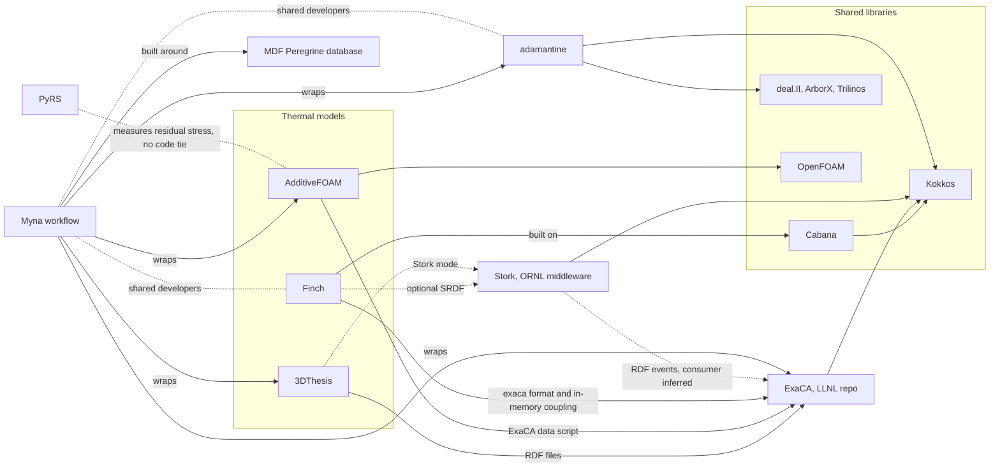

# Additive manufacturing tools deep dive: connections and usage

Map and usage sections for the additive manufacturing (3D printing) deep dive. The walkthrough is being written separately, and the timing against releases and programs is in [additive-manufacturing-timing.md](additive-manufacturing-timing.md), which is not repeated here. This is independent research from public sources only and is not affiliated with ORNL. All sources were accessed 2026-10-24 (ET). Link numbers refer to `connections/map.md` (pass 28). People appear by role only. Rule 16 limits apply: artifacts only.

## Map

### Plain-language picture
Metal 3D printing melts powder with a moving laser, and the way each spot heats and cools decides the grain structure of the part. ORNL's public tools split that problem into layers.
- **Three thermal models** estimate the heat at different levels of detail: 3DThesis (a fast semi-analytic estimate), Finch (a GPU-ready grid model built on Cabana and Kokkos) and AdditiveFOAM (full melt-pool flow on OpenFOAM) [KNOWN: each README]. Each has its own route to ExaCA, the grain-growth code that predicts microstructure:
  - 3DThesis writes "Reduced Data Format" files that ExaCA can read [KNOWN].
  - AdditiveFOAM has a helper script for ExaCA data [KNOWN].
  - Finch has an ExaCA output format and can also be built into ExaCA for in-memory coupling. Both repos state this [CORROBORATED].
- **Stork** is a new public ORNL middleware library that lets Finch and 3DThesis pass sparse thermal data, which it expands into the fine-grid events a microstructure code needs, with no giant temperature file in between [KNOWN: Stork README]. That the consumer is ExaCA is [INFERRED].
- **Myna** sits above the models as a workflow layer. It wraps 3DThesis, AdditiveFOAM, ExaCA and adamantine, and it is built around the Peregrine database from ORNL's Manufacturing Demonstration Facility (MDF) [KNOWN].
- **adamantine** is a separate thermomechanical simulator on deal.II, ArborX, Trilinos and Kokkos. It connects to the others only through Myna and shared developers, not through code [KNOWN].
- **Two "ladder" items are framing only:** calling the three models a ladder, and the PyRS tie, which comes from PyRS measuring the residual stress these models help explain [INFERRED].

### Diagram

Validated with mermaid-cli on 2026-10-24. Solid arrows are KNOWN from code, docs or config, and dashed lines are optional, inferred, or people ties. Thermochimica is left out on purpose: no AM repo mentions it (link 191, UNRELATED).

### Links (map.md numbers)
- **Link 33, the three thermal models** [INFERRED] common domain, and the "ladder" is an editorial framing. Pass 28 adds that Stork is a second, file-free path toward ExaCA.
- **Link 171, Finch to ExaCA** [CORROBORATED]: Finch's `exaca` sampling format, plus ExaCA's optional Finch dependency, its `Finch-ExaCA` executable and `find_package(Finch QUIET)`.
- **Link 172, 3DThesis to ExaCA** [KNOWN]: an RDF output "compatible with ExaCA". ExaCA's side is [UNKNOWN] because its docs don't name 3DThesis.
- **Link 173, AdditiveFOAM to ExaCA** [KNOWN]: the `reconstructExaCAData` helper. ExaCA's side is [UNKNOWN].
- **Link 174, Stork** [KNOWN] identity and both hooks (updated this pass):
  - **Repo and license:** github.com/ORNL/Stork, created 2026-09-20 UTC, BSD 3-Clause "Copyright (c) 2026, Oak Ridge National Laboratory", depends on Kokkos.
  - **What its README says:** it converts SRDF thermal data "to fine-grid Reduced Data Format (RDF) phase-change events for use by a microstructure simulation" without "a large intermediate thermal field".
  - **The two hooks:** Finch can optionally build with it (CMake option "Build with Stork interpolation"), and 3DThesis has a Stork tracking mode that came first, in 2024.
  - **Paper:** Computational Materials Science 2026, DOI 10.1016/j.commatsci.2026.114832.
  - **Consumer:** that it is ExaCA is [INFERRED].
  - **Discovery:** the fact-check pass found the repo (verification/log.md), and I checked it against the repo directly.
- **Links 27, 28, 29, 70 and 189, Myna's wrappers** [KNOWN]: `src/myna/application/` has adamantine, additivefoam, exaca, thesis, openfoam, cubit, deer, rve and bnpy, with no Finch wrapper. That Finch reaches ExaCA directly is [INFERRED].
- **Links 30 and 71, Myna and MDF** [KNOWN]: the README says Myna was "developed for the database structure maintained by ORNL MDF's Peregrine tool", and its examples use the public Peregrine v2023-10 dataset.
- **Links 31 and 124, shared developers** [KNOWN] contributor overlaps between Myna, Finch, AdditiveFOAM and adamantine (counts only); [INFERRED] one team.
- **Links 32, 146 and 147, Finch to Cabana to Kokkos** [KNOWN]: `find_package(Cabana 0.6.1 REQUIRED COMPONENTS Cabana::Grid)`. Kokkos is an outside multi-lab project with ORNL as a contributor organization.
- **Link 188, ExaCA to Kokkos, MPI and JSON** [KNOWN]: README "ExaCA uses Kokkos and MPI for parallelism". Kokkos is shared with Finch, adamantine and Stork.
- **Link 123, adamantine's libraries** [KNOWN]: deal.II 9.6, ArborX, Trilinos, Kokkos, Boost and MPI.
- **Link 16, AdditiveFOAM to OpenFOAM** [KNOWN]: the README says it "requires OpenFOAM-14 from the OpenFOAM Foundation".
- **Link 187, Spack packaging** [KNOWN]: Spack has `finch`, `exaca` (with a Finch variant) and `additivefoam`, but there is drift: the Spack recipe pins `openfoam-org@10` while the README says OpenFOAM-14. There is no Spack package for 3DThesis, adamantine or Myna. PyPI `finch` is an unrelated REST client [UNRELATED].
- **Link 190, adamantine and the thermal models** [KNOWN]: there is no code tie; adamantine joins only through Myna.
- **Link 191, Thermochimica** [UNRELATED] to this cluster.
- **Link 175, PyRS** [INFERRED] common domain (residual stress) with no code tie; actual use on AM parts is [UNKNOWN].
- **Link 5, AdditiveFOAM and HydraGNN** [KNOWN] shared contributor (a side tie to the AI-for-materials work).

## Who actually uses it
The existing usage sections cover [Myna](../signals/myna.md#who-actually-uses-it) and [adamantine](../signals/adamantine.md#who-actually-uses-it); their numbers are summarized below without repeating the tables. Finch, 3DThesis and AdditiveFOAM have no signals files yet, so their numbers are recorded here first. ExaCA is an outside project.

| Project | Packages | GitHub (stars, forks, dependents) | Main paper and citing works | ORNL vs outside | Tag | Source |
|---|---|---|---|---|---|---|
| 3DThesis | none (no Spack, conda-forge or PyPI) | 17, 3, 0 | "An adaptive integration scheme for heat conduction in additive manufacturing" (2019, 10.1016/j.apm.2019.07.008): 69 | 24 with an ORNL author, 45 without | [KNOWN] | GitHub API; api.openalex.org |
| Finch | Spack `finch`; PyPI name taken by an unrelated package | 8, 7, 0 | Zenodo 0.1.0 record (10.5281/zenodo.10698940): 0; no journal paper found | not measurable | [KNOWN]; PyPI [UNRELATED] | GitHub API; Spack; api.openalex.org |
| AdditiveFOAM | Spack `additivefoam` (pins OpenFOAM 10) | 78, 22, 0 | JOSS 2025 (10.21105/joss.07770): 6 | 3 with an ORNL author, 3 without | [KNOWN] | GitHub API; Spack; api.openalex.org |
| ExaCA (outside, LLNL repo) | Spack `exaca` with a Finch variant | 97, 31, 0 | Computational Materials Science 2022 (10.1016/j.commatsci.2022.111692): 55; its repo also lists 7 entries in PUBLICATIONS.bib | 25 with an ORNL author, 30 without | [KNOWN] | GitHub API; Spack; api.openalex.org; ExaCA PUBLICATIONS.bib |
| Stork | none | 0, 0 (created 2026-09-20) | Computational Materials Science 2026 (10.1016/j.commatsci.2026.114832): 0 | too new | [KNOWN] | GitHub API; api.openalex.org |
| Myna | no package; a bare PyPI `myna` 0.1 can't be tied to it | 14, 6, 0 | 2025 paper: 2 | 0 with an ORNL author | [KNOWN]; PyPI [UNKNOWN] | signals/myna.md |
| adamantine | none | 57, 16, 0 | JOSS 2024: 6 | 4 with an ORNL author | [KNOWN] | signals/adamantine.md |

**In-house versus outside.** No tool in this cluster has GitHub dependents. Outside use shows instead in Spack packaging and in citations [KNOWN counts]:
- **3DThesis** has the widest reach: about two thirds of the 69 papers citing its 2019 paper have no ORNL author [KNOWN].
- **ExaCA** is cited mostly outside ORNL too, with 30 of 55 citing papers [KNOWN].
- **AdditiveFOAM** has the most stars (78), but its JOSS paper is new, with an even 3 and 3 split [KNOWN].
- **Finch, Myna, Stork and adamantine** are mostly used by the team that builds them, so far [INFERRED, medium].
- **Funding:** stays [UNKNOWN] here for Finch, 3DThesis, AdditiveFOAM and Stork. Only adamantine's OSTI record names sponsors (LDRD and EERE, link 125), and Myna's DOE CODE record names the Office of Science (link 55).

Reasoning: the thermal models reach outside researchers mainly through papers and through ExaCA, and the coupling layers (Stork, Myna) are new and still inside the team [INFERRED, medium confidence].
