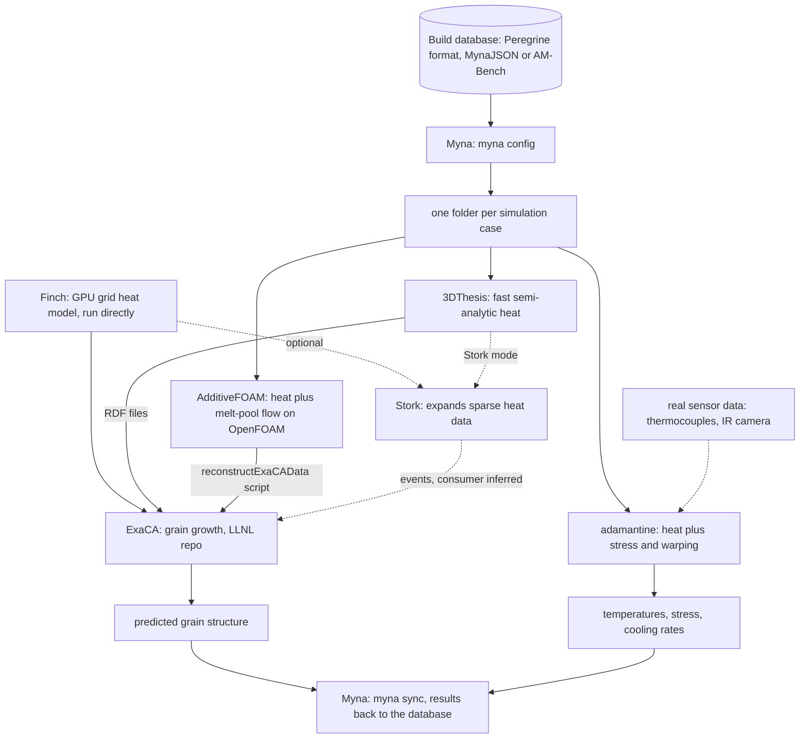

# Deep dive: ORNL's 3D-printing (additive manufacturing) simulation tools
Written in the reading pass on 2026-10-29, from the team's existing briefs, map and companion notes, which all cite public repos, public docs and OSTI/DOE CODE records. No new outside facts were added in this pass. Independent research, not affiliated with ORNL. People appear by role only. The map and usage numbers are in [the connections notes](additive-manufacturing-connections.md), and the timing against programs and releases is in [the timing notes](additive-manufacturing-timing.md). Link numbers refer to `connections/map.md`.

Covers: [3DThesis](../projects/3dthesis.md), [Finch](../projects/finch.md), [AdditiveFOAM](../projects/additivefoam.md), [Myna](../projects/myna.md) and [adamantine](../projects/adamantine.md), plus two outside or map-only pieces: ExaCA (an LLNL repo kept off the catalog under rule 13) and Stork (a new public ORNL library). The Transformational Challenge Reactor appears as history only and has no catalog row (lead decision 2026-10-29, batch-12).

Limits: this covers software artifacts only. We say nothing about how the Manufacturing Demonstration Facility (MDF) runs its machines or networks (rule 16), and nothing about any part design.

## The short version
Metal 3D printing builds a part by melting thin layers of metal powder with a moving laser. How fast each spot heats and cools decides the grain structure (the crystal pattern inside the metal), and the grain structure decides how strong the part is. ORNL's public tools split that question into steps:
1. A **heat model** works out the temperature history. There are three, from fast and rough to slow and detailed: 3DThesis, Finch and AdditiveFOAM. [KNOWN: each brief/README; the fast-to-detailed "ladder" is our framing, INFERRED, link 33]
2. A **grain model**, ExaCA, turns those cooling conditions into a predicted microstructure. [KNOWN: links 171-173]
3. **Myna** is the conductor. It reads a real build's records from a database and sets up and runs the chain automatically. [KNOWN: Myna README, ARCHITECTURE.md]
4. **adamantine** is a separate branch that predicts heat plus warping and stress, and it can be corrected with sensor data from a real print. [KNOWN: adamantine brief, OSTI 2472702]

## Key terms
- **Additive manufacturing (AM):** building an object layer by layer, also called 3D printing. **Powder bed fusion** is the version where a laser melts a bed of metal powder. [KNOWN: Myna brief, paper title]
- **Melt pool:** the tiny puddle of liquid metal right under the beam.
- **Scan path:** the route the laser takes. Every tool here takes one as input. [KNOWN: all five briefs]
- **Solidification conditions:** for each spot, the thermal gradient G and the speed V of the freezing front. Together they predict grain shape. [KNOWN: 3DThesis and Finch outputs]
- **Conduction-only vs fluid flow:** 3DThesis and Finch treat heat moving through still metal. AdditiveFOAM also simulates the liquid swirling in the melt pool (Marangoni flow, which is driven by surface-tension differences). [KNOWN: briefs]
- **Kokkos / Cabana:** C++ libraries that let one code run on ordinary processors or on GPUs. Finch is built on Cabana, which sits on Kokkos. [KNOWN: Finch brief, link to Kokkos in INDEX]
- **Digital twin:** a simulation tied to one specific real object, here one particular print, rather than a generic part. [KNOWN: Myna paper title uses the term; INFERRED: the definition]

## How the pieces fit, step by step

Solid arrows are KNOWN from code or docs; dashed arrows are optional or inferred. This matches the diagram in [the connections notes](additive-manufacturing-connections.md) (links 27-30, 70, 171-174, 189-190). Myna has no Finch wrapper, so Finch is drawn outside Myna. [KNOWN: `src/myna/application/` list; that Finch reaches ExaCA directly is INFERRED]

1. **Start from a real build.** Myna reads build, part and layer metadata from a database. It was built around the database format of Peregrine, MDF's powder-bed monitoring software. Release 1.1.0 added MynaJSON, PeregrineHDF5 and AMBench2022 database types. [KNOWN: Myna README, CHANGELOG; https://github.com/ORNL-MDF/Myna]
2. **Plan the runs.** You write a YAML workflow file listing the steps. `myna config` creates one folder per case. [KNOWN: ARCHITECTURE.md]
3. **Run the heat model.** Each step calls an outside code through a wrapper with three stages: configure, execute and postprocess. [KNOWN: `src/myna/application/readme.md`]
   - 3DThesis takes small text files (mode, material, beam, path) and adds up the heat from the beam's past path with a known formula, so it is fast. [KNOWN: [3DThesis brief](../projects/3dthesis.md), https://github.com/ORNL-MDF/3DThesis]
   - AdditiveFOAM takes an OpenFOAM case folder (mesh, material such as SS316L, heat source, scan path) and steps time forward with fluid flow and adaptive mesh refinement. [KNOWN: [AdditiveFOAM brief](../projects/additivefoam.md), https://ornl.github.io/AdditiveFOAM/]
   - Finch takes a JSON file and steps the heat equation on a 3-D grid split across processes, on CPUs or GPUs. [KNOWN: [Finch brief](../projects/finch.md), https://github.com/ORNL-MDF/Finch]
4. **Hand off to the grain model.** Each heat model has its own route to ExaCA: 3DThesis writes "Reduced Data Format" (RDF) files, AdditiveFOAM has a `reconstructExaCAData` helper, and Finch has an `exaca` output format and can be built into ExaCA for in-memory coupling. [KNOWN, links 172 and 173; CORROBORATED from both repos, link 171] ExaCA's own docs don't name 3DThesis or AdditiveFOAM. [UNKNOWN: ExaCA's side of links 172-173]
5. **Optional shortcut: Stork.** Stork (github.com/ORNL/Stork, created 2026-09-20, BSD 3-Clause) converts sparse thermal data into fine-grid RDF events "for use by a microstructure simulation" without "a large intermediate thermal field". Finch and 3DThesis both have Stork hooks. [KNOWN: Stork README, link 174] That the consumer is ExaCA is [INFERRED: the RDF format matches what ExaCA reads].
6. **The stress branch.** adamantine solves heat with the finite element method and can add elastic and plastic deformation, and its outputs include von Mises stress and cooling rates. It can correct itself mid-run with an Ensemble Kalman filter fed by thermocouple or infrared camera data. [KNOWN: [adamantine brief](../projects/adamantine.md), https://github.com/adamantine-sim/adamantine, https://www.osti.gov/biblio/2472702] It ties to the others only through Myna and shared developers, not through code. [KNOWN: link 190]
7. **Write back.** `myna sync` pushes results back into the database, so the build record and its simulations sit together. [KNOWN: ARCHITECTURE.md]

## One concrete example
A researcher wants to know the grain structure in one region of one printed part. Myna ships about 20 example cases, including `microstructure_region` and `melt_pool_geometry_part`, and its examples use the public Peregrine v2023-10 dataset. [KNOWN: Myna brief, link 30/71] In a run like that, Myna would pull the part's layer and scan data, run 3DThesis for the thermal history of that region, pass the RDF output to ExaCA, and sync the predicted grains back. [INFERRED: the exact steps inside `microstructure_region` weren't read line by line in this pass] A smaller hands-on version is Finch's bundled `single_line` example, which melts one straight laser track on a small block and writes the solidification data along it. [KNOWN: Finch `examples/single_line/`]

## Where humans act
- A researcher picks the material, beam settings and scan path, and decides which outputs to sample. [KNOWN: input files in all briefs]
- With Myna, a person writes the YAML workflow and chooses which simulation steps to chain. [KNOWN: ARCHITECTURE.md]
- AdditiveFOAM users can calibrate the heat-source model against experiments with `calibrateHeatSource`, a Bayesian workflow. [KNOWN: AdditiveFOAM CHANGELOG 2.0.0]
- adamantine users supply sensor readings if they have them. [KNOWN: OSTI 2472702 abstract]
- Someone has to build the dependencies first (Kokkos and Cabana for Finch, OpenFOAM for AdditiveFOAM). [KNOWN: READMEs]

## What it is not
- None of these tools was identified as a standalone printer-control or CAD system in the original brief reads [INFERRED]. Update 2026-11-04: [a 2025 INTERSECT study](https://dl.acm.org/doi/10.1145/3731599.3767592) incorporates adamantine simulations into a wider control workflow; its printer and sensing service were simulated [KNOWN: H02 in ../docs/public-research-sources.md]. This does not establish standalone physical-printer control by adamantine.
- Peregrine, the print-monitoring tool, isn't one of these open tools. Whether it's public is [UNKNOWN] (Myna brief), and a search result described it as licensed, which was not fetched (discovery/nuclear-reactor-scan-2026-10-28.md). [UNKNOWN]
- ExaCA isn't an ORNL catalog project. It's an LLNL repo with many ORNL-authored citing papers, and it's kept on the map only (rule 13). [KNOWN: INDEX outside projects, connections notes]
- Thermochimica isn't part of this cluster. No AM repo mentions it. [UNRELATED: link 191]
- PyRS (neutron residual-stress reduction) shares the topic, not the code. [INFERRED: link 175]

## History: the Transformational Challenge Reactor (history only)
DOE's nuclear energy office launched TCR in 2019 with ORNL leading, aiming at a 3D-printed microreactor, and it did not complete a reactor demonstration. [KNOWN: https://www.ans.org/news/2026-08-27/article-8345/ornl-and-inl-collaborate-on-3dprinted-pressure-vessels/, via discovery/nuclear-reactor-scan-2026-10-28.md] An ORNL report says TCR used AM to print nuclear components and predicted material properties from in-situ laser powder bed data, and a later ORNL report says that from FY21 it shifted toward AI-informed design, materials, sensing and a digital platform. [KNOWN: https://doi.org/10.2172/1831630; https://info.ornl.gov/sites/publications/Files/Pub166838.pdf; map link 222] A software tie between TCR and Peregrine or Myna is [INFERRED only]: neither report was read for a named software link. Myna's 2025 paper lists the Nuclear Energy office among its sponsors (OSTI 3002570), which fits but doesn't prove a TCR link. [KNOWN: sponsor field; INFERRED: the fit] It has no catalog row and no brief, by lead decision.

## Life story and who pays (from the timing notes)
- adamantine is the long-runner (first commit 2016, steady team since 2020). AdditiveFOAM, Finch and Myna all started within about seven weeks in spring 2023 by first-commit date (AdditiveFOAM repo created 2023-03-28; Finch first commit 2023-05-15; Myna 2023-05-11). Finch's and Myna's GitHub repos were only created on 2024-02-23, with earlier history imported. [KNOWN: git log, author dates; GitHub API] (corrected in a fact-check pass, 2026-10-29)
- Finch's activity mostly stopped after 2024, as the Exascale Computing Project (ECP, 2016-2024) ended. That ECP's end caused it is [INFERRED, low to medium].
- Sponsors on the records: AdditiveFOAM and Finch name Office of Science plus NNSA (the same pair as the ExaAM overview paper); Myna names Office of Science, and its paper adds AMMTO and Nuclear Energy; adamantine's paper names LDRD and EERE; 3DThesis's record says only USDOE, and its README credits EERE's manufacturing office and the Office of Electricity's TRAC program. [KNOWN: OSTI API, READMEs] That the 2023-24 records were ExaAM-funded is [INFERRED, medium].
Full ledger: [additive-manufacturing-timing.md](additive-manufacturing-timing.md).

## Who uses it (from the connections notes)
No tool here has GitHub dependents. Outside use shows in citations: about two thirds of the 69 papers citing 3DThesis's 2019 paper have no ORNL author, and 30 of 55 citing ExaCA's 2022 paper don't. Finch, Myna, Stork and adamantine are used mostly by the team that builds them so far. [KNOWN counts; INFERRED, medium, for the "mostly in-house" reading] See [additive-manufacturing-connections.md](additive-manufacturing-connections.md).

## What it teaches about how ORNL works
1. Hard physics gets split into swappable stages with agreed file formats between them (RDF, the `exaca` format). [KNOWN: formats; INFERRED: the lesson]
2. The lab offers more than one model for the same step, trading speed for detail. [INFERRED from link 33]
3. Simulation is tied to real build data from a facility (MDF's database), which is the digital-twin idea. [KNOWN: Myna README; INFERRED: the lesson]

## Student angle
Myna is the easiest entry point: about 99% Python, pytest tests, a YAML config, a uv lockfile, and an AGENTS.md file for AI coding agents. [KNOWN: Myna brief] For a security-minded student, the interesting part is the data plumbing: wrappers that configure, execute and postprocess outside programs, and a sync step that writes back to a database. Finch's `single_line` example is the smallest physics run to read. [KNOWN: briefs; INFERRED: the fit] We haven't run any of them.

## Claim boundary
| Topic | Source says | We infer | Don't say |
|---|---|---|---|
| Hand-offs | Each heat model has an ExaCA output or script | Stork's consumer is ExaCA | That ExaCA documents 3DThesis or AdditiveFOAM support |
| Ownership | ORNL copyright or DOE CODE for 3DThesis, Finch, AdditiveFOAM, Myna; OSTI 2472702 for adamantine | ORNL-MDF org means the MDF | That ExaCA is an ORNL project |
| Funding | Sponsor fields above | ExaAM money behind the 2023-24 records | That ECP's end caused Finch's slowdown |
| TCR | Printed parts, in-situ data, shift to a digital platform | A tie to Peregrine or Myna | That any tool here was built for TCR |
| Facility | Myna targets Peregrine's database format | | Anything about MDF machines, hosts or networks |

## Unknown and searched without result
- Whether Peregrine is publicly available. [UNKNOWN]
- What `microstructure_region` runs step by step. [UNKNOWN: not read in this pass]
- Who funds Finch, 3DThesis and AdditiveFOAM work after 2024. [UNKNOWN; searched in the timing pass]
- Whether a Finch 0.3 release is planned. [UNKNOWN]
- Would more public research change the core picture? Probably not: the stage-by-stage flow comes from code in several repos that agree. The open edges are funding, the TCR tie and outside use. [INFERRED]

## Sources (accessed 2026-10-24 unless noted; via the briefs and companion notes)
- Briefs: [3dthesis](../projects/3dthesis.md), [finch](../projects/finch.md), [additivefoam](../projects/additivefoam.md), [myna](../projects/myna.md), [adamantine](../projects/adamantine.md)
- https://github.com/ORNL-MDF/3DThesis; https://www.osti.gov/doecode/biblio/26241
- https://github.com/ORNL-MDF/Finch; https://www.osti.gov/doecode/biblio/122647
- https://github.com/ORNL/AdditiveFOAM; https://ornl.github.io/AdditiveFOAM/; https://www.osti.gov/doecode/biblio/108345
- https://github.com/ORNL-MDF/Myna; https://ornl-mdf.github.io/Myna/; https://www.ornl.gov/facility/mdf
- https://github.com/adamantine-sim/adamantine; https://www.osti.gov/biblio/2472702
- https://github.com/ORNL/Stork (map link 174)
- TCR: https://doi.org/10.2172/1831630; https://info.ornl.gov/sites/publications/Files/Pub166838.pdf; https://www.ans.org/news/2026-08-27/article-8345/ornl-and-inl-collaborate-on-3dprinted-pressure-vessels/ (map link 222, accessed 2026-10-28/29)
- https://www.exascaleproject.org/ (timing notes)
- [connections notes](additive-manufacturing-connections.md), [timing notes](additive-manufacturing-timing.md), `connections/map.md` links 27-30, 33, 70-71, 171-175, 189-191, 222

## Quality gate
- [x] Every claim has a tag, and KNOWN claims point to a brief and its source URL
- [x] Facts kept apart from interpretation (lessons and student angle are tagged INFERRED)
- [x] ORNL relationship not overstated (ExaCA kept as outside; TCR as history only); maturity verbs match sources
- [x] Walkthrough: inputs, steps, outputs, where humans act, what it is not, unknowns, one example
- [x] Mermaid flow consistent with connections/map.md links
- [x] No copied text beyond short cited quotes; people by role only
- [ ] Two fact-check sweeps done
- [ ] INDEX updated

## Fact-check notes (2026-10-29)
First fact-check pass against the underlying briefs, the connections notes and GitHub.
- Verified: Stork created 2026-09-20, BSD-3 (GitHub API); ExaCA is an LLNL repo (llnl/ExaCA, MIT); adamantine repo created 2016; Myna's database types and Peregrine origin (Myna README and CHANGELOG); Myna ships 21 example case folders, matching "about 20".
- Corrected: "all got public repos in spring 2023" mixed up first commits with repo creation. Finch and Myna repos were created in February 2024; their histories start in spring 2023.
- Open questions remain stated as open: whether Peregrine is public, and who funds Finch, 3DThesis and AdditiveFOAM after 2024.
- Nothing about MDF machines, hosts or networks. Nothing restricted.

### Second pass (2026-10-29)
Skeptical reread of the riskiest claims against sources not leaned on in the first pass.
- The corrected repo-dates line reads cleanly and matches GitHub (Finch and Myna repos created 2024-02-23; first commits 2023-05-15 and 2023-05-11). Verified.
- Stork BSD-3 and created 2026-09-20; ExaCA MIT under llnl. Verified.
- Open questions (Peregrine public?, funding after 2024) still stated as open. Verified.
- No corrections.
