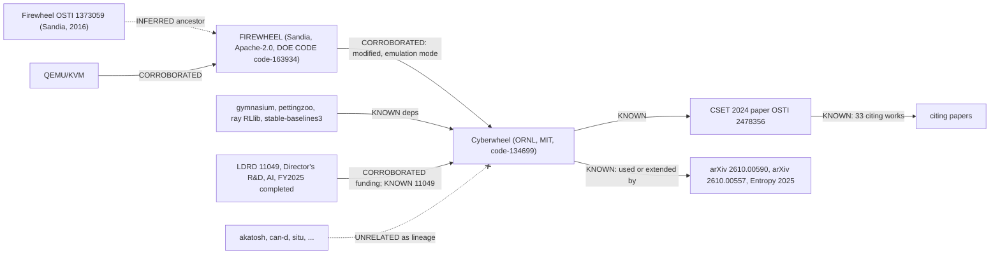

# Cyberwheel deep dive: lineage (Connector)

Owner: ORNL Connector. Accessed 2026-10-24 for every source below. Public sources only.
Tags: [KNOWN] one primary source · [CORROBORATED] two independent sources · [INFERRED] reasoning stated · [UNKNOWN] · [UNRELATED] checked, not part of the lineage.

## Plain-language walkthrough
Cyberwheel is ORNL's training ground for AI cyber defenders. A config file describes a fake network; Cyberwheel builds a fast *simulated* version (a graph in Python) where reinforcement-learning (RL) agents (programs that learn by trial and reward) practise attacking and defending. To check that a trained defender works on something closer to real computers, Cyberwheel can also build an *emulated* version: real virtual machines started by Sandia's FIREWHEEL tool on QEMU/KVM. Example: a blue agent learns in simulation to place a decoy server; in emulation, the red agent's commands hit the decoy VM instead of the real server. Humans write the configs, pick agents and read results. It is not a product for live networks: the source says the *goal* is agents "deployable in live networks", not that they have been deployed. Unknown: what exactly ORNL changed in FIREWHEEL.

## 1. FIREWHEEL (upstream, external)
| # | Claim | Tag | Source / quote / section |
|---|---|---|---|
| F1 | FIREWHEEL is an experiment orchestration tool for repeatable experiments of distributed network systems | [CORROBORATED] | GitHub repo description, github.com/sandialabs/firewheel: "experiment orchestration tool that assists a user in building and controlling repeatable experiments"; DOE CODE code-163934 abstract, same wording (both Sandia-authored, but repo vs. OSTI record are separate publications) |
| F2 | Made by Sandia National Laboratories | [CORROBORATED] | DOE CODE https://www.osti.gov/biblio/code-163934 research org "Sandia National Laboratories (SNL-NM), Albuquerque, NM"; Cyberwheel README §Emulation: "FIREWHEEL network emulation tool by Sandia National Laboratories" (independent, ORNL-authored) |
| F3 | Public repo github.com/sandialabs/firewheel, created 2024-11-13 (UTC), licence Apache 2.0 | [KNOWN] | GitHub API + LICENSE file: "Apache License Version 2.0, January 2004" (GitHub API reports NOASSERTION because LICENSE is wrapped in a docs heading) |
| F4 | DOE CODE record code-163934 "FIREWHEEL", dated 2024-10-24, sponsor USDOE, report no. SAND2024-16910O, covers "FIREWHEEL v2.7 and its associated companion model components" | [KNOWN] | https://www.osti.gov/biblio/code-163934 abstract |
| F5 | Older Sandia items exist: OSTI 1373059 "Firewheel." (conference, 2016-07) | [KNOWN] | https://www.osti.gov/biblio/1373059. Content not fetched; that it is the same tool's ancestor is [INFERRED] (same name, same lab, emulation context) |
| F6 | Public releases: v2.9.0 2025-09-10, v2.10.0 2025-09-25, v2.11.0 2025-12-17, v2.12.0 2026-05-05, v3.0.0 2026-06-09, v3.1.0 2026-10-22 (UTC dates) | [KNOWN] | GitHub releases API |
| F7 | Maturity word in sources: the repo/OSTI text says "repeatable experiments ... at any scale"; no "production" claim found. LDRD report describes it as "an experimental platform built on QEMU" | [KNOWN] | OSTI 3025007 p.13 §Results |
| F8 | FIREWHEEL uses QEMU/KVM VMs (2 GB default memory) | [CORROBORATED] | Cyberwheel cyberwheel/emulator/README.md: "Firewheel uses QEMU/KVM to host virtual machines"; LDRD report p.13: "experimental platform built on QEMU" |
| F9 | Scale "over 100,000 virtual nodes" | [KNOWN] (single source, ORNL's description of FIREWHEEL) | OSTI 3025007 p.13: "instantiation of networks with over 100,000 virtual nodes" |

## 2. How Cyberwheel uses FIREWHEEL
| # | Claim | Tag | Source / quote / section |
|---|---|---|---|
| C1 | Emulation mode uses a *modified* FIREWHEEL | [KNOWN] | OSTI 3025007 (= 3027393, same report, not independent) p.13 §Results: "uses a modified version of the Firewheel test bed for emulation" |
| C2 | Cyberwheel uses FIREWHEEL for emulation | [CORROBORATED] | C1 + Cyberwheel README §Emulation: "we've incorporated the FIREWHEEL network emulation tool by Sandia" |
| C3 | The "modification" is Cyberwheel's own model components/topology copied into /opt/firewheel/model_components (plus custom Ubuntu/VyOS qcow2 images), not a fork of FIREWHEEL's core | [INFERRED] | No source states what was modified: OSTI 3025007 p.13 says only "modified version", "built on QEMU", "over 100,000 virtual nodes" (FC confirmed). Basis: emulator/README.md install steps; no FIREWHEEL fork under github.com/ORNL |
| C4 | Five run modes: train, evaluate, emulate, visualizer, run | [KNOWN] | README: "There are 5 modes for running cyberwheel" |
| C5 | Emulations use ART Campaigns only | [KNOWN] | README §ART Campaign: "When running emulations, we exclusively train and evaluate with ART Campaigns" |
| C6 | Emulation added in a later major update (with multi-agent support); "first iteration of our emulator". Per timeline.md: v1.1.0 2025-03-10, v2.0 (Firewheel emulation) 2025-08-11, last commit 2025-08-26; "dormant" since is [INFERRED] | [KNOWN] | README (news section); GitHub release notes via timeline.md |
| C7 | Sim-to-emulation transfer shown | [KNOWN] | OSTI 3025007 p.13: agents "can be transferred from simulation environments to more realistic emulation environments" |
| C8 | FIREWHEEL is NOT listed in pyproject.toml or requirements.txt; installed separately | [KNOWN] | repo dependency files (checked); emulator/README.md "follow the installation guide" |
| C9 | Repo: github.com/ORNL/cyberwheel, MIT, created 2024-07-08, last push 2025-08-26 (UTC); pyproject version 0.1.0; DOE CODE code-134699 dated 2024-07-16, ORNL | [CORROBORATED] (ORNL ownership: repo org + DOE CODE) | GitHub API; https://www.osti.gov/biblio/code-134699 |
| C10 | Maturity words: "goal ... deployable in live networks" (aim, not achievement); README calls emulation "first iteration" | [KNOWN] | OSTI 3025007 p.13; README |

## 3. LDRD project 11049
| # | Claim | Tag | Source / quote / section |
|---|---|---|---|
| L1 | 11049 "Automating Cyber Defense Using Reinforcement Learning", Director's R&D Program, Artificial Intelligence (AI) initiative | [KNOWN] | OSTI 3025007 contents p.iii and p.13 heading "ARTIFICIAL INTELLIGENCE (AI) 11049" under "Summaries of projects supported by the Director's R&D Program" |
| L2 | Reported as completed in FY2025 | [KNOWN] | report title "FY 2025 Completed Projects" (OSTI 3025007, 2026-03-31; reissue 3027393, 2026-03) |
| L3 | Start year / earlier FYs | [UNKNOWN] | not stated; earlier LDRD reports not located (see not-found) |
| L4 | Named team: Credited developer A, Credited developer B, Credited developer C | [KNOWN] | OSTI 3025007 p.13, line under the title. PI role not stated: first-listed ≠ PI per RULES (authorship = participation) |
| L5a | Cyberwheel is LDRD-funded | [CORROBORATED] | OSTI 3025007 p.13: "trained in a custom-built, realistic network test bed environment called Cyberwheel"; DOE CODE code-134699 sponsor field: "USDOE Laboratory Directed Research and Development (LDRD) Program". The CSET paper (OSTI 2478356) shows the same team but lists only USDOE, so it is not funding evidence |
| L5b | The LDRD project is number 11049 | [KNOWN] (single source) | OSTI 3025007 p.13 heading "11049: Automating Cyber Defense Using Reinforcement Learning" (3027393 is a reissue, not independent) |
| L5c | LDRD described as "internal" | [INFERRED] | the word is not in the source; LDRD is lab-directed by definition (Reader, synthesis.md) |
| L6 | Outputs: decoy-deploying agents in unseen topologies; linear runtime scaling with hosts | [KNOWN] | p.13: "AI agents can autonomously deploy decoys in unseen network topologies"; "runtime ... increased linearly with the number of hosts" |
| L7 | Other OSTI products: 2478356 "Towards a High Fidelity Training Environment for Autonomous Cyber Defense Agents" (CSET workshop, 2024-08-13); code-134699 (software) | [INFERRED] tie to 11049 | same team/topic; the OSTI records were not checked for an LDRD funding note |
| L8 | 3002907 "The Path to Autonomous Cyberdefense" (2024) and 3002671 "Agentic AI and the Cyber Arms Race" (2025, cites the CSET paper) | [INFERRED] related ORNL work | OSTI search credited developer A + RL cyber; link to 11049 unproven |

## 4. Upstream / downstream
| # | Item | Tag | Source |
|---|---|---|---|
| U1 | RL/env libs in pyproject.toml: gymnasium ^1.1.0, pettingzoo ^1.24.3, ray ^2.43.0, stable-baselines3 ^2.5.0, networkx, wandb, tensorboard | [KNOWN] | pyproject.toml [tool.poetry.dependencies] |
| U2 | requirements.txt pins older versions (gymnasium==0.28.1, ray[rllib]==2.10.0, stable-baselines3==2.2.1, torch==2.2.1) than pyproject.toml | [KNOWN] | both files |
| U2a | Authoritative dependency spec is pyproject.toml + poetry.lock | [KNOWN] | README install section says to use `poetry install` and calls requirements.txt a fallback (FC) |
| U2b | The mismatch is a stale requirements.txt export | [INFERRED] | fallback file not regenerated after pyproject updates |
| U3 | PyTorch only in requirements.txt (not pyproject) | [KNOWN] | both files |
| U4 | Citing work: Semantic Scholar shows 33 papers citing the CSET 2024 paper (OpenAlex showed 20); 4 name Cyberwheel | [KNOWN] | deep-dives/cyberwheel/synthesis.md (Reader) |
| D1 | arXiv 2610.00590 "Towards Hierarchical Cyber Defense with Large Language Models" runs defenders in Cyberwheel | [KNOWN] | abstract: "Using the high fidelity Cyberwheel environment" (abstract checked 2026-10-24; synthesis.md) |
| D2 | arXiv 2610.00557 "No One Architecture Fits All" tests red agents in Cyberwheel | [KNOWN] | abstract: "in CybORG CAGE-4 and in Cyberwheel at two network scales" (checked; synthesis.md) |
| D3 | Entropy 2025, DOI 10.3390/e27060622, extends Cyberwheel | [KNOWN] | abstract: Cyberwheel "is extended by adding new fine-grained defense mechanisms" (Crossref abstract checked; synthesis.md) |
| D4 | ISDFS 2025, DOI 10.1109/ISDFS65363.2025.11012027, only describes Cyberwheel | [KNOWN] | abstract per synthesis.md |
| D5 | Whether D1–D4 authors are outside ORNL | [UNKNOWN] | affiliations not checked |
| U5 | Successor ORNL work: LDRD supplementary report "Pentesting and Commissioning Operational Technology with AI" (OSTI 3827147, 2026-09) and 3367033 | [INFERRED] at most adjacent; no source cites Cyberwheel in their abstracts | OSTI search hits; not read |
| U6 | Predecessor ORNL cyber RL project | [UNKNOWN] | none found |
| U7 | 11053 "Next-Generation Security for Interconnected Systems" (same report, same AI initiative, different team) | [UNRELATED] as lineage (sibling project only) | OSTI 3025007 p.13 |
| U8 | akatosh, can-d, cincinnatus, heartbeat-malware, cpad, situ, hyperion | [UNRELATED] as lineage; same cyber domain only | catalog OSTI records 1419663, 1822873, 1562290, 1574875, 1396084, 1232450, 1231925 (all stub-osti-only); no shared code, authors on 11049 or citation found. Map keeps them as [INFERRED] "same domain" links, not lineage |
| U9 | Sandia FIRESTORM / Staghorn / Proteus (other Sandia emulation OSTI hits for "firewheel") | [UNRELATED] to Cyberwheel | OSTI search results, no Cyberwheel mention |

## 5. Diagram

## Counts
KNOWN 26 · CORROBORATED 6 · INFERRED 7 (F5, C3, L5c, L7, L8, U2b, U5) · UNKNOWN 3 (L3, U6, D5) · UNRELATED 3 (U7, U8, U9) = 45. U4's "use" sub-claim UNKNOWN not counted separately.

## Open questions
- Settled (FC): no source states what is modified in FIREWHEEL; C3 stays INFERRED.
- Settled (FC): pyproject.toml + poetry.lock is authoritative (U2a).
- Settled (FC): code-134699 sponsor is the LDRD Program (L5a); no OSTI product besides the report names project 11049, so L7 stays INFERRED.
- Settled (Reader): 3 papers run or extend Cyberwheel (D1–D3); author affiliations still UNKNOWN (D5).

## Map changes
connections/map.md pass 6: link 54 and 56 now CORROBORATED with quotes; new nodes fw16 (Sandia Firewheel 2016, link 95) and ldrd (LDRD 11049); link 96 RL libraries; cyber stubs marked UNRELATED as lineage (links 69, 84).
connections/map.md pass 10: link 56 split (LDRD-funded CORROBORATED; 11049 KNOWN; "internal" INFERRED); link 108 downstream users added.
