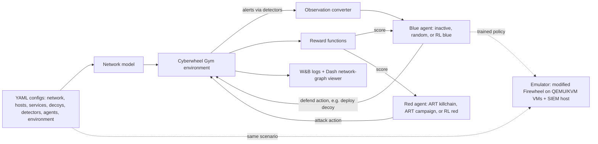

# Cyberwheel deep dive: system and data flow
Built from the public repo tree, v1.1.0 and v2.0 release notes, `cyberwheel/emulator/README.md` and OSTI 3025007 p. 13. Accessed 2026-10-24.

## Step by step
1. **Configure.** YAML files describe the network, the host types, the services, decoy hosts, detectors, red and blue agents, and the environment and training settings. Command-line flags can override them. [KNOWN: v1.1.0 notes; `data/configs/` folders]
2. **Build the network.** The `network` code turns the config into hosts and subnets. [KNOWN: repo tree]
3. **Red moves.** A red agent picks an attack step. The heuristic ART agent follows a fixed killchain: discovery first, then privilege escalation and later phases, using Atomic Red Team techniques. It also learns a host's CVEs (publicly known vulnerability IDs) when it does discovery. An RL red agent learns its own choices instead. [KNOWN: `red_agents/art_agent.py` docstring, v1.1.0 notes]
4. **Detect.** Detectors turn red's actions into alerts, sometimes imperfectly, like real security tools. [KNOWN: `detectors/` with `alert.py` and `handler.py`; INFERRED: "imperfectly", from the detector design]
5. **Observe.** An observation converter turns the alerts into the inputs a blue agent sees. Red and blue get separate observation classes. [KNOWN: `observation/blue_observation.py`, `red_observation.py`; OSTI 3025007 names the "observation converter"]
6. **Blue moves.** The blue agent acts, for example by deploying a decoy or isolating a host. [KNOWN: `reward/decoy_reward.py`, `isolate_reward.py`; OSTI 3025007 for decoy deployment]
7. **Score.** Reward functions score the step. Examples: whether the attack step succeeded or was detected, a decoy reward, an isolation reward, or separate red and blue rewards. The RL agents learn from those scores. [KNOWN: `reward/` file names; INFERRED: the exact formulas weren't read]
8. **Repeat and log.** Episodes repeat. Runs log to Weights & Biases, and the Dash app replays an episode as a network graph. [KNOWN: README]
9. **Emulate (v2.0).** The same scenario generates an emulated network in Firewheel, Sandia's tool that runs QEMU/KVM virtual machines. Ordinary hosts are Ubuntu 22.04 VMs (2 GB each), and a SIEM host on Ubuntu 16.04 (4 GB) runs ElasticSearch, Kibana and Fleet. A SIEM is a security information and event management system, the central alert log. An action controller runs the agents' actions on the VMs over SSH, and a SIEM query module feeds the alerts back as observations. [KNOWN: emulator README, `emulator/siem/siem_query.py`, OSTI 3025007 "simulated and an emulated network"] The README asks for 16 GB of RAM minimum. [KNOWN]

## Where humans act
They write the scenario configs, choose the agents and rewards, launch the training runs, and read the W&B and Dash outputs. Running emulation means installing Firewheel and the VM images. [KNOWN: README, emulator README] Live response during an episode isn't part of the design. [INFERRED]

## What it is not
It isn't a live intrusion-prevention product. No public source describes connecting it to a real production network. The LDRD report states that as a *goal* ("deployable in live networks"), not as something done. [KNOWN: OSTI 3025007 p. 13 wording]

## Results the sources report (keep these words)
- The simulator's runtime "increased linearly with the number of hosts", while many existing simulators "performed poorly with more than 100 hosts in this testing". [KNOWN: OSTI 3025007 p. 13]
- In their test, the red agent attacked a decoy the blue agent had placed instead of the real server. [KNOWN: OSTI 3025007 p. 13, paraphrased]
