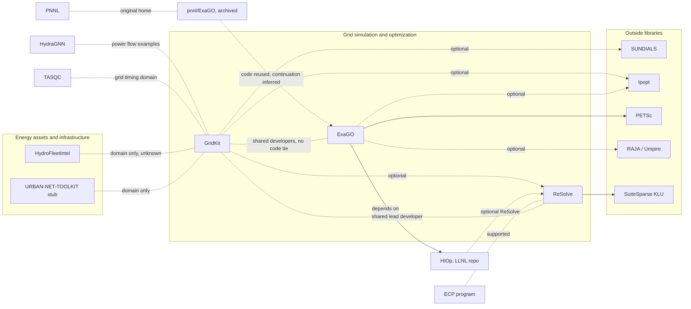

# Grid tools deep dive: connections and usage

Map and usage sections for the power grid software deep dive. The walkthrough will be written separately, and the timing story is in [grid-tools-timing.md](grid-tools-timing.md). This is independent research from public sources only and is not affiliated with ORNL. All sources accessed 2026-10-24 (ET). Link numbers refer to `connections/map.md` (pass 29), which covers the 66 catalog projects. People appear by role only. Rule 16 limits apply: software artifacts only, with no mapping of grid infrastructure or of the systems these tools run on.

## Map

### Plain-language picture
The catalog's grid software forms two groups.
- **Simulation and optimization codes, linked through shared math libraries rather than direct code ties.**
  - GridKit simulates how a grid behaves over time [KNOWN].
  - ExaGO optimizes how a large grid should be run, and it moved from PNNL's GitHub org to ORNL's [KNOWN].
  - ReSolve is ORNL's GPU solver library underneath. GridKit can use it directly. ExaGO depends on HiOp, an outside optimization library (LLNL's repo), and HiOp can optionally use ReSolve too [KNOWN].
  - So the shared pieces are libraries (ReSolve, HiOp, Ipopt, SUNDIALS, PETSc, RAJA and Umpire) plus overlapping developers, not code from one project inside another [KNOWN for the libraries; INFERRED for one community].
- **Energy-asset and infrastructure tools that share no solvers with the first group.**
  - HydroFleetIntel is a web app for hydropower plant data [KNOWN].
  - URBAN-NET-TOOLKIT is only an OSTI stub [KNOWN].
  - TASQC (grid timing security) and HydraGNN (power-flow machine learning) touch the grid domain from the cyber and AI clusters [KNOWN domain; no code tie].
- **Real-Twin is not a grid tool:** it simulates traffic [UNRELATED].

### Diagram

Validated with mermaid-cli on 2026-10-24. Solid arrows are required dependencies. Dashed lines are optional dependencies, people or program ties, or domain-only ties.

### Links (map.md numbers)
- **Link 1, GridKit to ReSolve** [KNOWN]:
  - The build option "Enable ReSolve support" is off by default.
  - SUNDIALS 7.8.0 is optional.
  - KLU comes in through SUNDIALS.
  - Ipopt is optional.
- **Link 7, GridKit and ReSolve share a lead developer** [KNOWN] shared contributor; [INFERRED] one group.
- **Link 14, ReSolve to SuiteSparse KLU** [KNOWN]: ReSolve's CMake uses KLU.
- **Link 195, ReSolve with PNNL and ECP** (new) [KNOWN]:
  - The README says "Development of this code was supported by the Exascale Computing Project (ECP)".
  - It gives build notes for clusters "such as PNNL's Deception or ORNL's Ascent". These are machine names only.
- **Link 148, ExaGO moved from PNNL to ORNL** [KNOWN]:
  - pnnl/ExaGO is archived, and the ORNL LICENSE says "uses code from the ExaGO v1.6.0".
  - The ORNL tie is [CORROBORATED] by DOE CODE code-176348.
  - That ORNL's repo continues PNNL's is [INFERRED].
- **Link 149, ExaGO's libraries** [KNOWN]: PETSc (on), Ipopt (on), HiOp (off), plus CUDA/HIP and RAJA/Umpire options. **Link 193** (new) [KNOWN]: Spack's exago recipe depends on hiop, ipopt with "+ipopt", and raja and umpire with "+raja". It has no resolve or gridkit dependency.
- **Link 192, HiOp to ReSolve** (new):
  - [KNOWN] LLNL/hiop has the option "Build with external ReSolve sparse solver support", and Spack maps HiOp's `cusolver_lu` variant to it.
  - [INFERRED] this makes a possible chain from ExaGO through HiOp to ReSolve. No evidence of that chain in use was read.
- **Link 194, HiOp's home** (new):
  - [KNOWN] Spack points to LLNL/hiop.
  - [KNOWN] an ORNL/hiop repo also exists, with no fork flag and 0 stars.
  - [UNKNOWN] what the ORNL copy is for. HeCBench links it (link 12).
- **Link 150, ExaGO and GridKit** [KNOWN]:
  - There is no direct dependency.
  - Their only shared outside library is Ipopt.
  - 4 GitHub contributor accounts overlap.
  - [INFERRED] they belong to the same community.
- **Link 12, HeCBench takes kernels from HiOp and SUNDIALS** [KNOWN]: a tie from the grid libraries into the HPC benchmark cluster.
- **Link 24, IRIS mentions ExaGO once** [UNKNOWN] relationship.
- **Link 167, ExaGO's own usage** [KNOWN]: see the usage section below.
- **Links 25 and 127, HydraGNN and the grid** [CORROBORATED]:
  - HydraGNN's repo has power-flow examples (examples/opf), and OSTI 3377970 is a power-grid foundation-model dataset sponsored by the DOE Office of Electricity.
  - It has no code tie to GridKit or ExaGO [INFERRED domain link only].
- **Link 49, HydroFleetIntel and GridKit** [UNKNOWN]. **Link 196** (new) [KNOWN]: HydroFleetIntel is a Next.js client plus a Python Flask API (pandas, scipy, matplotlib). It uses none of the grid solver libraries, and its LICENSE reads "Copyright 2024, UT-Battelle, LLC".
- **Link 86, URBAN-NET-TOOLKIT and GridKit** [INFERRED] common domain. It is an OSTI stub only.
- **Links 68 and 88, TASQC with GridKit and CPAD** [INFERRED]: grid timing and cyber-physical security. There is no code link.
- **Link 57, the LLNL "GridKit" record** [UNRELATED]: an LLNL 2016 software record that shares the GridKit name and is not a source for ORNL GridKit.
- **Link 197, Real-Twin** (new) [UNRELATED]: a traffic and mobility tool, not part of the grid cluster.

## Who actually uses it
The existing usage sections for [GridKit](../signals/gridkit.md#who-actually-uses-it) and [ExaGO](../signals/exago.md#who-actually-uses-it) are summarized here rather than repeated. ReSolve, HiOp and HydroFleetIntel have no signals usage sections yet, so their numbers are recorded here.

| Project | Packages | GitHub (stars, forks, dependents) | Papers and citations | ORNL vs outside | Tag | Source |
|---|---|---|---|---|---|---|
| GridKit | none; PyPI `gridkit` is an unrelated grid-geometry library | 27, 11, 0 | no GridKit software paper found | not measurable | [KNOWN]; PyPI [UNRELATED] | signals/gridkit.md |
| ExaGO | Spack `exago` | 17, 11, 0 | PNNL-led 2022 arXiv paper (2203.10587): 1 citing work | not measurable | [KNOWN] | signals/exago.md |
| ReSolve | Spack `resolve` (homepage ORNL/ReSolve) | 85, 14, 0 | no ReSolve paper found in OpenAlex | not measurable | [KNOWN]; paper [UNKNOWN] | GitHub API; Spack; api.openalex.org |
| HiOp (outside, LLNL repo) | Spack `hiop` | 232, 50 (LLNL/hiop) | 2026 arXiv paper on porting HiOp to accelerators (2605.13736), with an ORNL author; 0 citing works yet | too new | [KNOWN] | GitHub API; api.openalex.org |
| HydroFleetIntel | none | 0, 0, last push 2024-03-12 UTC | DOE CODE record (10.11578/dc.20240307.4): 0 citing; "Predictive Analytics for Hydropower Fleet Intelligence" (PHM 2023): 1 citing | ORNL-authored records | [KNOWN] | GitHub API; api.openalex.org |
| URBAN-NET-TOOLKIT | none | no repo | OSTI stub only | not measurable | [KNOWN] | catalog |

**In-house versus outside.** Nothing in this cluster has GitHub dependents or an indexed paper with real outside citation counts [KNOWN counts]. The grid codes reach other users through Spack, which packages ExaGO, ReSolve and HiOp, and through the shared library stack across DOE labs, not through direct adoption that public data can measure.
- **ReSolve** has the most stars of the ORNL grid repos (85), and it is wired into HiOp as an option, which is its clearest outside hook [KNOWN].
- **HydroFleetIntel** has been quiet since March 2024 and shows no outside trace [KNOWN].
- **Funding:** ReSolve's README credits ECP [KNOWN]. HydraGNN's grid dataset lists the DOE Office of Electricity [KNOWN, link 127]. GridKit's DOE CODE record names USDOE generically [KNOWN, link 55]. ExaGO's ORNL-era DOE CODE record (code-176348) also names only USDOE generically [KNOWN: OSTI API]. Funding is otherwise [UNKNOWN] for ExaGO's ORNL era, HydroFleetIntel and URBAN-NET-TOOLKIT.

Reasoning: the grid software here is shared DOE-lab infrastructure, maintained by overlapping developers across ORNL, PNNL and LLNL, and used mostly by those same teams so far [INFERRED, medium confidence].

## Sweep 2 notes (fact-check pass, 2026-10-24)
- Verified against Spack's builtin recipes, LLNL/hiop's CMakeLists.txt, the GitHub API and the OSTI API: Spack exago depends on hiop, ipopt and raja/umpire by variant with no resolve or gridkit dependency; HiOp's `HIOP_USE_RESOLVE` option and Spack's `cusolver_lu` mapping; stars and forks for HiOp, ReSolve, GridKit and the ORNL hiop copy (no fork flag); HydroFleetIntel's last push 2024-03-12.
- Added: ExaGO's ORNL-era DOE CODE record names only USDOE, matching the GridKit wording. No corrections.

## Fact-check notes (2026-10-29)
Second logged check of this file (the first was the 2026-10-24 sweep).
- Verified: link 148, ORNL/ExaGO created 2026-01-08 and pnnl/ExaGO archived (GitHub API); ReSolve 85 and GridKit 27 stars.
- No corrections.
