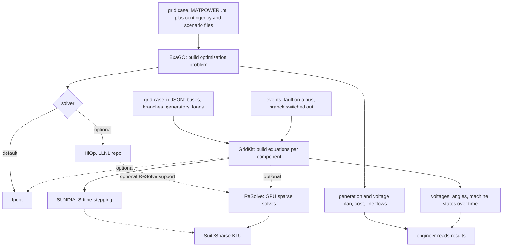

# Deep dive: ORNL's power grid software
Written in the reading pass on 2026-10-29, from the team's existing briefs, map and companion notes, which all cite public repos, public docs and OSTI/DOE CODE records. No new outside facts were added in this pass. Independent research, not affiliated with ORNL. People appear by role only. The map and usage numbers are in [the connections notes](grid-tools-connections.md), and the timing story is in [the timing notes](grid-tools-timing.md). Link numbers refer to `connections/map.md`.

Covers the core three: [GridKit](../projects/gridkit.md), [ExaGO](../projects/exago.md) and [ReSolve](../projects/resolve.md), plus HiOp (an LLNL repo, map only under rule 13). Side tools in the same domain with no code tie: [Hydropower Fleet Intelligence](../projects/hydrofleetintel.md), [URBAN-NET](../projects/urban-net-toolkit.md) (short brief), [TASQC](../projects/tasqc.md) and HydraGNN's power-flow examples.

Limits (rule 16): software artifacts only. All cases named here are public synthetic or benchmark grids that ship with the repos. We don't map any real grid, utility or the systems these tools run on, and none of these tools connects to a real grid. [INFERRED from the shipped cases; see briefs]

## The short version
There are two big questions about a power grid, and ORNL's open tools split them:
1. **"What's the cheapest safe way to run it?"** That's ExaGO, an optimizer. [KNOWN: ExaGO README]
2. **"If something breaks, does it stay stable?"** That's GridKit, a simulator. [KNOWN: GridKit README]
Both boil down to solving huge sparse systems of equations again and again, so underneath sits **ReSolve**, a GPU solver library. GridKit can call it directly; ExaGO reaches it only possibly, through HiOp. [KNOWN: links 1, 149, 192; the ExaGO-HiOp-ReSolve chain in use is INFERRED]

The key point from the map: these three share math libraries and some developers, but none contains another's code. [KNOWN: links 1, 150, 193; INFERRED: "one community"]

## Key terms
- **Bus:** a connection point in the grid model. Test grids range from 39 to 10,000 buses. [KNOWN: briefs]
- **Power flow:** a steady-state snapshot of voltages and flows on every line. **Optimal power flow (OPF)** finds generator settings that meet demand at minimum cost without overloading anything. [KNOWN: ExaGO and GridKit briefs]
- **Contingency / security-constrained:** the plan must still work if one listed part fails. **Stochastic:** plan across several scenarios, like different wind forecasts. [KNOWN: ExaGO README]
- **Phasor dynamics:** simulating the grid over seconds with averaged sine-wave values, the usual way to test stability after a fault. **EMT** is a much finer waveform-level simulation. [KNOWN: GridKit model folders; INFERRED: definitions]
- **Sparse linear system:** many equations where most coefficients are zero. **Refactorization** reuses the pattern of a previous solve when only the numbers change, which is much cheaper. [KNOWN: ReSolve brief]
- **MATPOWER format:** a common text format for grid cases (`.m` files). [KNOWN: ExaGO `datafiles/`]

## How the pieces fit, step by step

Solid arrows are required or default; dashed are optional build options. This matches [the connections diagram](grid-tools-connections.md) (links 1, 14, 149, 192, 193). There is no arrow between ExaGO and GridKit because no public code links them. [KNOWN: link 150]

**Path A, optimization with ExaGO** ([brief](../projects/exago.md), https://github.com/ORNL/ExaGO):
1. Read a grid case in MATPOWER format, plus optional contingency lists and scenario files and an options file. [KNOWN: `datafiles/`, README "Options"]
2. Build the optimization problem for the chosen application, such as OPFLOW (plain OPF) or SCOPFLOW (security-constrained). [KNOWN: README; INFERRED: step order]
3. Hand it to Ipopt (on by default) or HiOp (off by default). Large stochastic and contingency runs spread across many processes with MPI. [KNOWN: link 149, README]
4. Output: a plan for each generator and bus, with cost and line flows, which can go to a visualizer. [INFERRED from `src/ps/psoutput.cpp` and viz docs]

**Path B, simulation with GridKit** ([brief](../projects/gridkit.md), https://github.com/ORNL/GridKit, https://gridkit.readthedocs.io/en/latest/):
1. Describe the grid in JSON: buses, branches, generators with their controls, loads. [KNOWN: `INPUT_FORMAT.md`, CHANGELOG v0.2]
2. GridKit builds the equations for every component and connects them through buses. [KNOWN: model code; INFERRED: order]
3. A solver runs them: SUNDIALS for time stepping, Ipopt for optimization, or ReSolve for GPU linear solves. ReSolve support is off by default. [KNOWN: link 1]
4. It steps through time and applies events such as a fault or a branch switched out. [KNOWN: CHANGELOG v.03]
5. Output: voltages, angles and machine states for the variables you choose to monitor. [KNOWN: `VariableMonitor*.hpp`]

**Underneath, ReSolve** ([brief](../projects/resolve.md), https://github.com/ORNL/ReSolve): the first factorization runs on the CPU with KLU, later solves refactor on the GPU (cuSOLVER, cuDSS or rocSOLVER), and an optional iterative step cleans up the answer. Output is the solution vector plus error information. [KNOWN: example and solver file names; INFERRED: typical order] Its README says development "was supported by the Exascale Computing Project (ECP)". [KNOWN: README Support section, link 195]

## One concrete example
Take the public IEEE 39-bus test grid, which ships with GridKit. Put a fault on one bus for a fraction of a second, clear it, and watch whether the generators swing back into step. That's a classic stability study. [KNOWN: `cases/PhasorDynamics/IEEE39`, `Bus::setFault`; INFERRED: the scenario] The optimization side of the same idea: run ExaGO's OPFLOW on `case118.m` for the cheapest settings on a 118-bus test grid, then SCOPFLOW with `case118.cont` so the plan survives listed outages. [KNOWN: files in ExaGO `datafiles/`; INFERRED: the pairing] Either way, if the run is big, the repeated sparse solves are where ReSolve can help, by refactoring on the GPU instead of starting over. [INFERRED from ReSolve brief]

## Where humans act
- An engineer prepares or converts the case file, picks the application, solver and events, and reads the results. [KNOWN for ExaGO via its README; INFERRED for GridKit]
- A developer of a bigger code links ReSolve through CMake and picks the GPU back end at build time. [KNOWN: ReSolve README]
- ExaGO v2.1's experimental AgentiGrid tool puts a large language model in the loop, but a human still writes the goal. [KNOWN: agentigrid README, via ExaGO brief]

## What it is not
- None of them is a real-time control system or connected to a utility. They're offline research tools run on test cases. [INFERRED: only synthetic and benchmark cases ship]
- GridKit isn't an optimizer for running the grid the way ExaGO is, and ExaGO doesn't contain GridKit. [KNOWN: link 150]
- ReSolve isn't a grid tool by itself; it's a math library, still at v0.99.x. [KNOWN: tags]
- HiOp isn't an ORNL catalog project; LLNL holds the copyright. An ORNL/hiop copy exists, and what it's for is [UNKNOWN]. [KNOWN: links 194, INDEX]
- Hydropower Fleet Intelligence (a web app for hydropower plant data, quiet since March 2024), URBAN-NET (maps how infrastructure systems depend on each other; ORNL said in 2022 it would be folded into DOE's EAGLE-I outage monitor; no public code) and TASQC (grid timing security) share the domain but no solvers or code. [KNOWN: links 49, 86, 196, 68/88; briefs; https://www.ornl.gov/news/urban-net-infrastructure-modeling-tool-be-incorporated-eagle-i]
- Real-Twin is a traffic tool, not a grid tool. [UNRELATED: link 197] The LLNL "GridKit" record is a namesake. [UNRELATED: link 57]

## Life story and who pays (from the timing notes)
- ExaGO began at PNNL in 2019 and was an ECP-era code; its activity nearly stopped in 2024-2025 (33, then 9 commits across all branches; 22 and 9 on the default branch, author dates) (corrected in a fact-check pass, 2026-10-29) as ECP ended, then restarted in 2026 after the repo moved to ORNL (created 2026-01-08; pnnl/ExaGO archived). [KNOWN: git log, GitHub API; INFERRED, medium: that ECP's end caused the drop]
- ReSolve dipped in 2024 and recovered in 2025-2026; what funds it now is [UNKNOWN].
- GridKit was nearly idle from 2017 to 2024, then jumped (426 commits in 2025, 947 in 2026). An ORNL execution plan for "Next Generation Grid Simulations" (OSTI 3385022, 2025-04-01, ASCR sponsor) fits that timing but doesn't name GridKit. [KNOWN: OSTI API; INFERRED, medium: the link]
- DOE CODE records for GridKit, ReSolve and ExaGO v2 all name only "USDOE". [KNOWN: OSTI API]
Full ledger: [grid-tools-timing.md](grid-tools-timing.md).

## Who uses it (from the connections notes)
Nothing here has GitHub dependents or a paper with meaningful outside citation counts. The codes reach others through Spack packages (ExaGO, ReSolve, HiOp) and the shared DOE-lab library stack. ReSolve has the most stars of the ORNL grid repos (85). [KNOWN counts] Reading: shared infrastructure maintained by overlapping developers at ORNL, PNNL and LLNL, used mostly by those teams so far. [INFERRED, medium] See [grid-tools-connections.md](grid-tools-connections.md).

## What it teaches about how ORNL works
1. Labs share the math layer (solver libraries) more than whole applications. [KNOWN: links 1, 149, 192; INFERRED: the lesson]
2. Projects move between labs: ExaGO kept PNNL's code and copyright line and continues under UT-Battelle. [KNOWN: LICENSE; INFERRED: "continues"]
3. Activity follows programs: ECP-era bursts, then new work after a new ASCR grid plan. [INFERRED, medium]

## Student angle
The cybersecurity hooks are indirect but real: TASQC works on grid timing security, URBAN-NET on cascading infrastructure failure, and the solver codes show how GPU builds and CMake options shape what a program can do. [KNOWN: briefs; INFERRED: the fit] For reading code, ExaGO's `datafiles/` cases and GridKit's `cases/` folder are the most approachable starting points. We haven't built or run any of them.

## Claim boundary
| Topic | Source says | We infer | Don't say |
|---|---|---|---|
| Code ties | GridKit has an optional ReSolve option; HiOp has an optional ReSolve option | ExaGO could reach ReSolve via HiOp | That ExaGO uses ReSolve, or that ExaGO and GridKit share code |
| Ownership | ORNL repos and DOE CODE records for all three; ExaGO carries a Battelle line for v1.6.0 code | ORNL's ExaGO continues PNNL's | That HiOp is an ORNL project |
| Funding | ECP credit on ReSolve; USDOE on DOE CODE records; ASCR on OSTI 3385022 | ECP end slowed ExaGO; the ASCR plan drives GridKit | A named program funding GridKit or ExaGO now |
| Real grids | Synthetic and benchmark cases ship | Research use only | Anything about a real utility, grid or host |

## Unknown and searched without result
- Who funds GridKit's 2025 jump and ExaGO's 2026 restart: OSTI, both READMEs and the 3385022 abstract checked, none says. [UNKNOWN]
- What the ORNL/hiop copy is for. [UNKNOWN]
- How far ExaGO's GPU path is validated beyond its Frontier configuration doc, and how close GridKit's EMT side is to working (its examples README calls them "architecture skeletons"). [UNKNOWN]
- Outside users of v2 ExaGO and of GridKit. [UNKNOWN]
- Would more public research change the core picture? Probably not: the dependencies come straight from build files and Spack recipes. The open edges are funding and users. [INFERRED]

## Sources (accessed 2026-10-24 unless noted; via the briefs and companion notes)
- Briefs: [gridkit](../projects/gridkit.md), [exago](../projects/exago.md), [resolve](../projects/resolve.md), [hydrofleetintel](../projects/hydrofleetintel.md), [urban-net-toolkit](../projects/urban-net-toolkit.md) (2026-10-29), [tasqc](../projects/tasqc.md)
- https://github.com/ORNL/GridKit; https://gridkit.readthedocs.io/en/latest/; https://www.osti.gov/doecode/biblio/152622
- https://github.com/ORNL/ExaGO; https://github.com/pnnl/ExaGO (archived); DOE CODE code-176348
- https://github.com/ORNL/ReSolve; DOE CODE code-114681
- https://github.com/LLNL/hiop (map links 192, 194)
- https://github.com/ORNL/HydroFleetIntel; https://www.osti.gov/biblio/code-123550
- https://www.osti.gov/biblio/1467082; https://www.ornl.gov/news/urban-net-infrastructure-modeling-tool-be-incorporated-eagle-i
- OSTI 3385022 (via OSTI API, timing notes); https://www.exascaleproject.org/
- [connections notes](grid-tools-connections.md), [timing notes](grid-tools-timing.md), `connections/map.md` links 1, 7, 12, 14, 24, 25, 49, 57, 68, 86, 88, 127, 148-150, 167, 192-197

## Quality gate
- [x] Every claim has a tag, and KNOWN claims point to a brief and its source URL
- [x] Facts kept apart from interpretation (lessons and student angle are tagged INFERRED)
- [x] ORNL relationship not overstated (HiOp outside; ExaGO's PNNL origin stated); maturity verbs match sources
- [x] Walkthrough: inputs, steps, outputs, where humans act, what it is not, unknowns, one example
- [x] Mermaid flow consistent with connections/map.md links
- [x] No copied text beyond short cited quotes; people by role only; no real-grid or system mapping
- [ ] Two fact-check sweeps done
- [ ] INDEX updated

## Fact-check notes (2026-10-29)
First fact-check pass against the underlying briefs, map links and GitHub.
- Verified: pnnl/ExaGO is archived (GitHub API); ReSolve has 85 stars, the most of the ORNL grid repos (GridKit 27); ExaGO's 2025 count of 9 and 2026 restart (fresh treeless clone); ExaGO-to-ReSolve stays INFERRED and "possible through HiOp", stated as open; GridKit and ExaGO have no public code link.
- Corrected: ExaGO's 2024 count of 33 is all branches; the default branch shows 22. Both now given.
- Unverifiable this pass: ORNL/ExaGO creation date 2026-01-08 (GitHub API rate-limited).
- URBAN-NET mention matches its brief, which has now had two checks.
- No real grid, utility or host described. Nothing restricted.

### Second pass (2026-10-29)
Skeptical reread of the riskiest claims against sources not leaned on in the first pass.
- Retried ORNL/ExaGO creation date: 2026-01-08 (GitHub API). Verified; was unverifiable in the first pass.
- ExaGO 2024 counts (33 all branches, 22 default) and 2025 (9) re-confirmed. Verified.
- ExaGO-to-ReSolve still stated as open and INFERRED. Verified.
- No corrections.
