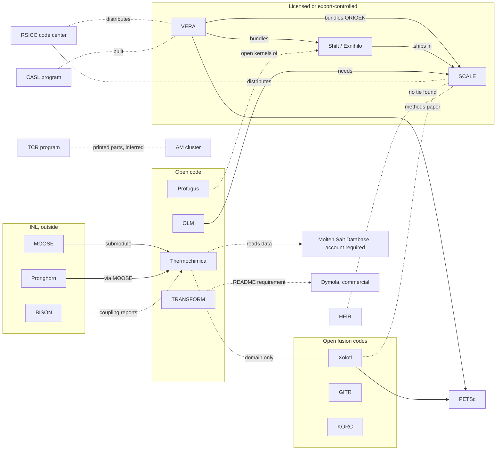

# Nuclear reactor software deep dive: connections and usage

Map and usage sections for the reactor software deep dive. The overview and open versus licensed scan live in [nuclear-reactor-software.md](nuclear-reactor-software.md) and the discovery list in [../discovery/nuclear-reactor-scan-2026-10-28.md](../discovery/nuclear-reactor-scan-2026-10-28.md), which this file uses for project context and the molten salt history. This is independent research from public sources only and is not affiliated with ORNL. Sources accessed 2026-10-28 and 2026-10-29 (ET). Link numbers refer to `connections/map.md` (pass 31), which covers the 69 catalog projects. People appear by role only. We study software artifacts and their public connections only: nothing licensed or export-controlled was requested or downloaded, nothing was signed up for, and no reactor design, fuel or enrichment detail is described.

## Map

### Plain-language picture
- **The licensed core: SCALE, VERA and Shift.** These are ORNL's big reactor analysis codes, and all three are locked.
  - SCALE is licensed through RSICC, ORNL's code center, under a software export control agreement [KNOWN, link 207].
  - VERA is an RSICC package whose source version is only released to people who name a collaborator on its development team [KNOWN, link 205]. The lead reports the VERA page also requires US citizenship plus an export agreement (discovery pass; we could not re-read vera.ornl.gov, which blocked our fetch).
  - Shift, part of the Exnihilo suite, is stated to be export controlled [KNOWN, link 208].
  - The three are tied by code, not just topic: VERA bundles SCALE's ORIGEN isotope module and bundles Shift [KNOWN, links 203 and 204]. Shift also ships inside SCALE [KNOWN: SCALE manual CSAS-Shift chapter, per projects/shift-exnihilo.md].
- **The open edge: OLM, Thermochimica, TRANSFORM and Profugus.** These have public code and a license.
  - OLM is a small Python helper that builds data libraries for SCALE. It is on PyPI, but its real work needs a SCALE install [KNOWN, link 210].
  - Thermochimica computes chemical equilibrium for nuclear materials. It is a MOOSE submodule and INL's Pronghorn work uses it [KNOWN, links 52, 211]. The BISON coupling reports were ORNL-led (ORNL is the OSTI research org), so they show ORNL wiring it into INL's code, not INL adopting it on its own [KNOWN, link 212].
  - TRANSFORM is a Modelica library for plant thermal hydraulics. Its README names Dymola, a commercial tool, as the requirement [KNOWN, link 215].
  - Profugus is an open copy of Exnihilo's core math kernels, made so outside computer scientists can study them [KNOWN, link 209].
- **Fusion codes sit apart.** Xolotl, GITR and KORC are open, but no public source we read ties them to the fission codes [UNKNOWN, link 216].
- **Other labs.** INL's MOOSE family is the one outside framework with a public code tie (Thermochimica). OpenMC and the NEAMS program showed no public tie to ORNL code in what we read [UNKNOWN, links 217, 218].
- **Facilities and history.** HFIR has a public methods paper on vessel characterization [KNOWN title, link 219]. The Molten Salt Reactor Experiment is public history only; no code we cover is shown to model it [UNKNOWN, link 220]. The Transformational Challenge Reactor never built its reactor and moved to printed reactor parts and a data platform, which puts it beside the AM cluster [KNOWN; software tie INFERRED, link 222].

### Diagram

Validated with mermaid-cli on 2026-10-29. Solid arrows are stated dependencies or bundling. Dashed lines are program, distribution, data, inferred or domain-only ties. The HFIR line marks a facility methods paper, not a confirmed SCALE use; see link 219.

### Links (map.md numbers)
- **Link 203, VERA bundles SCALE's ORIGEN** (new) [KNOWN]: RSICC's VERA 4.3 page says ORIGEN "from the SCALE nuclear modeling and simulation code" is used in MPACT. Link 63 (SCALE and VERA, common domain) now has a code tie behind it.
- **Link 204, VERA bundles Shift** (new) [KNOWN]: the same page lists Shift, coupled to Denovo solvers. This upgrades link 83 from INFERRED.
- **Link 205, VERA's distribution** (new) [KNOWN]: RSICC package CCC-855; source requests must name the module being developed and a development-team collaborator. Linux with GNU compilers. Export control [INFERRED] from RSICC's agreement and the discovery pass.
- **Link 206, VERA's third-party libraries** (new) [KNOWN]: PETSc, HDF5, Boost and LAPACK/BLAS. PETSc is shared with Xolotl and ExaGO as an outside library only [INFERRED].
- **Link 207, SCALE's distribution** (new) [KNOWN]: RSICC licenses under a software export control agreement. ORNL's SCALE ordering page redirected to the home page on 2026-10-29 (logged).
- **Link 208, Shift is export controlled** (new) [KNOWN]: Profugus README. Shift ships in SCALE [KNOWN]; whether Profugus is outside SCALE is [UNKNOWN], since no SCALE source names it and that is an absence, not a proof.
- **Link 209, Profugus and Exnihilo** (new) [KNOWN]: the README says it holds Exnihilo's kernels. BSD-2-Clause, last push 2018. Not shown in SCALE [UNKNOWN]. Sponsor: USDOE Office of Science, ASCR, per DOE CODE [KNOWN: https://www.osti.gov/doecode/biblio/10329].
- **Links 62 and 210, OLM and SCALE** [KNOWN]: OLM drives SCALE to build ORIGEN libraries. Primary repo is on a developer's personal GitHub account ("the main development repository"); ORNL's GitLab copy (https://code.ornl.gov/scale/code/olm) is a read-only mirror. PyPI `scale-olm` 0.14.2. **Link 221** (new) [KNOWN]: DOE CODE names NNSA as sponsor.
- **Links 52, 211 and 212, Thermochimica and INL** [CORROBORATED for MOOSE; KNOWN for Pronghorn; BISON coupling reports are ORNL-led per OSTI research org].
- **Link 213, Thermochimica and the Molten Salt Database** (new) [KNOWN]: MSD's about page says its thermochemical files are compatible with Thermochimica (corrected in a fact-check pass, 2026-10-29), which sit behind an ORNL GitLab account plus a membership request; nobody signed up. [INFERRED] the salt tests that failed in a Linux test build (not a real Mac) likely miss a gated MSD file: the four TestMSTDB tests load `LiBeUPuThF_T1.dat`, which is not in the public `data/` folder, and an example input names `MSTDB-TC_V1.3_Fluorides_8-0.dat`; no public page states the tie (projects/molten-salt-database.md, checked 2026-10-29). The named DOE-NE funding programs apply only to the thermochemical side, MSD-TC [KNOWN: https://mstdb.ornl.gov/about/].
- **Links 191 and 214, Thermochimica and the AM cluster** [UNRELATED]: the AM pass found no mention in six AM repos, and that holds. Thermochimica's real neighbours are nuclear.
- **Link 215, TRANSFORM** (new) [KNOWN]: Apache-2.0, UT-Battelle copyright, README requirement Dymola, DOE CODE code-5745 (ORNL, USDOE).
- **Link 216, fusion codes and fission codes** (new) [UNKNOWN]: no tie shown.
- **Link 217, OpenMC** (new) [UNKNOWN]: packaged on Spack and conda-forge, but no ORNL code tie found.
- **Link 218, CASL and NEAMS** (new) [KNOWN] CASL built VERA's packaged pieces; NEAMS [UNKNOWN].
- **Link 219, HFIR methods paper** (new) [KNOWN] title; tool names per the discovery pass [INFERRED].
- **Link 220, MSRE** (new) [UNKNOWN] software tie; third-party MSR model repo [UNRELATED] to ORNL.
- **Link 222, TCR and AM** [KNOWN] printed components and in situ build data. Update 2026-11-07: a [2024 ORNL report](https://impact.ornl.gov/en/publications/evaluation-of-in-situ-am-process-monitoring-techniques-and-potent-3/) directly says Peregrine was developed under TCR, superseding the earlier inferred tie. This does not establish that Myna was developed under TCR. [KNOWN: Y04 in ../docs/public-research-sources.md; accessed 2026-11-07]

### Distribution status
| Code | Status | Public distribution page | Tag |
|---|---|---|---|
| SCALE | licensed (RSICC), export control agreement | https://rsicc.ornl.gov/documents/export_control.pdf ; ornl.gov/scale/how-order-scale (redirected 2026-10-29) | [KNOWN] |
| VERA | licensed (RSICC CCC-855), export-controlled | https://rsicc.ornl.gov/codes/ccc/ccc8/ccc-855.html | [KNOWN] licensed; export control [INFERRED] here, KNOWN per discovery pass |
| Shift / Exnihilo | export-controlled; ships in SCALE and VERA | https://github.com/ORNL-CEES/Profugus (README); SCALE manual CSAS-Shift chapter | [KNOWN] |
| OLM | open, BSD-3-Clause | https://pypi.org/project/scale-olm/ ; https://code.ornl.gov/scale/code/olm | [KNOWN] |
| Thermochimica | open, BSD-3-Clause | https://github.com/ORNL-CEES/thermochimica | [KNOWN] |
| TRANSFORM | open, Apache-2.0 | https://github.com/ORNL-Modelica/TRANSFORM-Library | [KNOWN] |
| Profugus | open, BSD-2-Clause (inactive since 2018) | https://github.com/ORNL-CEES/Profugus | [KNOWN] |
| Xolotl | open, BSD-3-Clause per LICENSE | https://github.com/ORNL-Fusion/xolotl | [KNOWN] |
| GITR | open, GPL-2.0 | https://github.com/ORNL-Fusion/GITR | [KNOWN] |
| KORC | open, MIT | https://github.com/ORNL-Fusion/KORC | [KNOWN] |
| Molten Salt Database | data, free but account required (not accessed) | https://mstdb.ornl.gov/about/ | [KNOWN] |

## Who actually uses it
Existing usage sections for [SCALE](../signals/scale.md#who-actually-uses-it), [VERA](../signals/vera.md#who-actually-uses-it), [Shift](../signals/shift-exnihilo.md#who-actually-uses-it), [Thermochimica](../signals/thermochimica.md#who-actually-uses-it), [Xolotl](../signals/xolotl.md#who-actually-uses-it) and [GITR](../signals/gitr.md#who-actually-uses-it) are summarized here. OLM, TRANSFORM, Profugus and KORC numbers were read fresh on 2026-10-29. OpenAlex's free daily budget ran out on 2026-10-29, so no new ORNL versus outside splits were made (logged).

| Project | Packages | GitHub (stars, forks, dependents) | Papers and citations | ORNL vs outside | Tag | Source |
|---|---|---|---|---|---|---|
| SCALE | none (PyPI `scale` is a namesake) | no repo | SCALE 6 paper: 171 citing, 53 with ORNL author | about 69% outside | [KNOWN] | signals/scale.md |
| VERA | none (PyPI `vera` is a namesake) | no repo | core simulator paper: 93 citing, 30 ORNL | about two thirds outside | [KNOWN] | signals/vera.md |
| Shift | none | no repo | 2015 JCP paper: 134 citing, 95 ORNL | mostly ORNL | [KNOWN] | signals/shift-exnihilo.md |
| OLM | PyPI `scale-olm`; no conda-forge, no Spack | 4, 2 | no paper found | not measurable | [KNOWN] | GitHub API; PyPI; registries |
| Thermochimica | none on PyPI, conda-forge or Spack | 69, 36, 0 dependents | 2013 library paper: 56 citing (Crossref, no split); CALPHAD 2021: 21 citing, 2 ORNL | mostly outside for the 2021 paper | [KNOWN] | signals/thermochimica.md; api.crossref.org |
| TRANSFORM | none | 91, 33 | not checked | not measurable | [KNOWN] | GitHub API |
| Profugus | none | 29, 6 | not checked | not measurable | [KNOWN] | GitHub API |
| Xolotl | Spack `xolotl` | 28, 28, 0 | multi-lab fission-gas papers | multi-lab | [KNOWN] | signals/xolotl.md |
| GITR | none | 13, 18, 0 | CPC 2021: 34 citing, 22 ORNL | mostly ORNL | [KNOWN] | signals/gitr.md |
| KORC | none on Spack | 9, 2 | not checked | not measurable | [KNOWN] | GitHub API |

**In-house versus outside.** The locked codes are the most used outside ORNL, measured by citations: SCALE and VERA are cited mostly by outside authors, which fits a licensed industry and regulator tool [INFERRED, medium confidence]. Of the open codes, Thermochimica has the clearest outside life, through MOOSE and INL's Pronghorn work plus outside citers [KNOWN]; the BISON coupling was ORNL's own work. OLM, TRANSFORM and Profugus show small public footprints. None of the open codes has GitHub dependents [KNOWN].

**Funding.** OLM: NNSA (link 221) [KNOWN]. TRANSFORM: USDOE generically (link 215) [KNOWN]. The Thermochimica coupling report lists DOE-NE as sponsor of INL's work, not of Thermochimica itself [KNOWN, link 211]. Xolotl credits two SciDAC projects (link 13) [KNOWN]. Profugus: USDOE Office of Science ASCR per DOE CODE (link 209) [KNOWN]. Molten Salt Database: DOE-NE MSR Campaign, NEAMS and NEUP for the thermochemical side only (link 213) [KNOWN]. Funding is [UNKNOWN] for SCALE, VERA, Shift, Thermochimica, GITR and KORC from the records read.

## What's open to build and run
Only codes with public source and a license. Mac notes are INFERRED unless the docs say so.
- **Thermochimica** (BSD-3-Clause): the README has a MacOS section (Xcode tools plus Homebrew gcc). Realistic [KNOWN: README].
- **OLM** (BSD-3-Clause): pure Python, "OS Independent" on PyPI, so it installs on a Mac [KNOWN: classifier]. Without licensed SCALE it only writes input files [KNOWN: projects/olm.md].
- **TRANSFORM** (Apache-2.0): the README names Dymola, which is paid. Whether a free Modelica tool such as OpenModelica can run it is [UNKNOWN]; the README does not say so.
- **Profugus** (BSD-2-Clause): a CMake C++ build with macOS build scripts in install/ [KNOWN: repo], untested since 2017, so a Mac build may need fixes for newer compilers and libraries [INFERRED]. It is for performance testing, not validated answers [KNOWN: README].
- **Xolotl** (BSD-3-Clause): needs Kokkos, PETSc, HDF5 and MPI; the README names no Mac path. Possible through Spack, heavy [INFERRED].
- **GITR** (GPL-2.0): the README has a "Mac OSx, No CUDA" section [KNOWN: README].
- **KORC** (MIT): the README shows a Linux workstation build with Spack; a Mac build is possible but undocumented [INFERRED].

## Sweep notes
Not yet fact-checked (sweep 2 pending).

## Fact-check notes (2026-10-29)
First fact-check pass, checking each claim against the underlying brief, map entry and original public source.
- Verified against briefs and sources: SCALE via RSICC under an export control agreement (RSICC document resolves); Shift ships in SCALE (SCALE manual CSAS-Shift chapter) and VERA; Profugus holds Exnihilo kernels, BSD-2, sponsor ASCR per DOE CODE; Profugus in SCALE stays UNKNOWN; TRANSFORM Apache-2.0 with Dymola named and OpenModelica UNKNOWN; TRANSFORM 91 stars and 33 forks and Profugus 29 and 6 (GitHub API, 2026-10-29); the salt-database clue stays INFERRED; MSD funding limited to MSD-TC.
- Corrected: link 213 said the about page says Thermochimica "reads" the files; the page says the files are compatible with Thermochimica.
- Not re-checked this pass: "none of the open codes has GitHub dependents" (rests on the signals pass) and the SCALE citation counts.
- No tag found raised above its source brief. Nothing restricted.

### Second pass (2026-10-29)
Skeptical reread of the riskiest claims against sources not leaned on in the first pass.
- Retried "none of the open codes has GitHub dependents": GitHub's dependents pages show 0 for Thermochimica, Profugus and TRANSFORM. OLM's page (its primary GitHub repo) did not give a readable count. Verified for three of four; OLM unverifiable.
- Retried SCALE citations: OpenAlex shows 171 citing works for the SCALE 6 paper. Verified (the ORNL-author split was not recounted).
- Profugus-not-in-SCALE UNKNOWN, TRANSFORM-on-OpenModelica UNKNOWN and the salt clue INFERRED all still match their briefs. Verified.
- No corrections.
