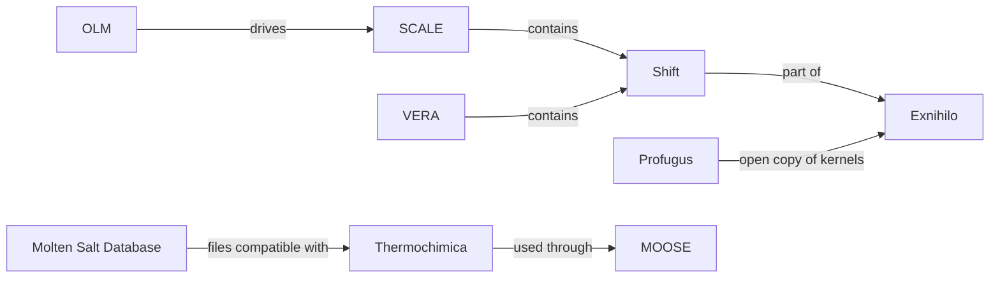

# Deep dive: ORNL's nuclear reactor software (opened 2026-10-28)

Independent research from public sources only; not affiliated with ORNL. This deep dive covers the software side: what ORNL's reactor codes simulate, which of them are open, licensed or export-controlled, and how they connect. Physical reactor designs and any restricted or export-controlled material are out of scope (RULES items 1 and 16). Where a code is only released under license, we record that and stop; we don't try to get around it.

Existing briefs this builds on: [SCALE](../projects/scale.md), [VERA](../projects/vera.md), [Shift / Exnihilo](../projects/shift-exnihilo.md), [Thermochimica](../projects/thermochimica.md). [OLM](../projects/olm.md) brief now written (corrected in a fact-check pass, 2026-10-29).

## Current public reactor projects (discovery pass)
ORNL's reactor work right now is mostly physical research, with software alongside it. Here is what the public pages say.
- **HFIR pressure vessel replacement.** HFIR (the High Flux Isotope Reactor, a research reactor used for neutron experiments) runs at 85 MW instead of its 100 MW design because the steel shell around the core is slowly getting brittle. DOE approved the project start in October 2020; a new vessel is expected in the mid 2030s and the swap in the late 2030s or early 2040s. [KNOWN: per the discovery scan; the neutrons.ornl.gov address now lands on a general home page, so the dates rest on the slides] (source note added in a fact-check pass, 2026-10-29) [https://neutrons.ornl.gov/content/hfir-pressure-vessel-replacement-project ; https://indico.phy.ornl.gov/event/433/contributions/1879/attachments/1377/3417/HFIR_Upgrades_2024.pdf]
- **Molten salt irradiation tests in HFIR.** A February 2026 report plans tests in phases, starting with sealed capsules of salt with no fuel; a capsule design paper followed in September 2026. Prepared for DOE-NE's Advanced Fuels Campaign. [KNOWN: https://www.osti.gov/servlets/purl/3018127 ; https://www.ornl.gov/publications/msirt-1-molten-salt-irradiation-capsule-design-for-hfir/]
- **Salt property measurements.** In May 2026 ORNL announced new heat flow and viscosity (how thick a liquid is) measurements for uranium-bearing salts, added to the Molten Salt Database. [KNOWN: https://www.ornl.gov/news/new-measurements-advance-molten-salt-reactor-technologies]
- **Kairos Power partnership.** A five-year, $27M partnership announced in February 2026 on fuel pebbles, salt-facing materials and related work for the Hermes demo reactors being built in Oak Ridge; the fourth ORNL and Kairos partnership since 2020. [KNOWN: https://www.ornl.gov/news/ornl-kairos-power-partner-advance-deployment-next-gen-nuclear-energy] [CORROBORATED: https://www.ans.org/news/2026-02-23/article-7780/triso-pebble-lifecycle-studied-in-new-ornl-kairos-power-partnership/]
- **NuCAMP.** An August 2026 initiative led by Kairos to mature new nuclear manufacturing and construction methods and train workers in East Tennessee, with ORNL taking part through its Manufacturing Demonstration Facility. [KNOWN: https://www.ornl.gov/news/kairos-power-announces-new-collaboration-advance-nuclear-manufacturing-construction-and/]
- **Transformational Challenge Reactor (past).** A DOE-NE program launched in 2019 with ORNL leading, aiming for a 3D-printed microreactor; it did not finish a reactor demonstration. Follow-on work prints pressure vessels with INL. [KNOWN: https://www.ans.org/news/2026-08-27/article-8345/ornl-and-inl-collaborate-on-3dprinted-pressure-vessels/] An AI print-inspection tool from that era, Peregrine, showed up in search as licensed, but we never checked it. [UNKNOWN]

Open, licensed or gated: these are projects, not code downloads, so there is nothing here to open or license. Their software side is covered below.

**What this means:** the hot topics are an aging research reactor, molten salt reactors and new ways to build reactor parts, and the software in this deep dive feeds into that work.

## History: the Molten Salt Reactor Experiment (discovery pass)
- ORNL ran the first molten salt reactor about 60 years ago. [KNOWN: https://www.ornl.gov/news/ornl-kairos-power-partner-advance-deployment-next-gen-nuclear-energy] A molten salt reactor uses melted salt as its coolant, and sometimes to carry the fuel itself. [KNOWN: https://mstdb.ornl.gov/about/]
- The experiment's Design and Operations Report is a 12-part ORNL series starting in 1965. Part I is public on OSTI and marked unclassified; Part VIII is on ORNL's publications server; Part XII had limited distribution. [KNOWN: https://www.osti.gov/biblio/4654707 ; https://info.ornl.gov/sites/publications/Files/Pub209949.pdf]
- A volunteer group keeps a searchable text archive of these old public reports. It is not ORNL's, just a handy reading index. [KNOWN: https://github.com/openmsr/msr-archive] [UNRELATED to ORNL ownership]
- Whether any of today's codes descends from software used in that experiment is not shown anywhere we read. [UNKNOWN: map link 220]

**What this means:** today's salt work stands on 1960s reports that are still public, but no software line runs from then to now that we can prove.

## Walkthroughs of the open codes (reading pass)
First, the locked codes, so the open ones make sense.
- **SCALE** is a large ORNL suite for nuclear safety calculations: making sure fuel, storage casks and shipping packages can't start an uncontrolled chain reaction and that shielding is enough. [KNOWN: https://www.ornl.gov/scale] It is not openly distributed. [KNOWN: https://www.ornl.gov/scale] It is licensed through RSICC, ORNL's code center, under an export control agreement. [KNOWN: https://rsicc.ornl.gov/documents/export_control.pdf]
- **VERA** is a set of coupled codes that simulate a whole reactor core down to single fuel rods, built under the CASL program. [KNOWN: https://vera.ornl.gov/] It is licensed through RSICC as package CCC-855, with individual licenses limited to US citizens and permanent residents. [KNOWN: https://vera.ornl.gov/vera-license/ ; https://rsicc.ornl.gov/codes/ccc/ccc8/ccc-855.html]
- **Shift** is ORNL's Monte Carlo radiation transport code, part of the Exnihilo suite. Monte Carlo means it follows huge numbers of simulated neutrons one random step at a time and averages the results. [KNOWN: https://www.ornl.gov/publication/shift-massively-parallel-monte-carlo-radiation-transport-package] It ships inside SCALE. [KNOWN: https://scale-manual.ornl.gov/6.3.3/CSAS-Shift.html] Exnihilo is export controlled. [KNOWN: https://github.com/ORNL-CEES/Profugus README]

Now the open ones.
- **Profugus** (BSD-2-Clause) is a "mini-app": a small open stand-in that keeps the core math kernels of Exnihilo so outside computer scientists can study speed on new hardware without seeing controlled code. [KNOWN: https://github.com/ORNL-CEES/Profugus README] It is built to study performance, not correctness, so it is not for real reactor analysis. [KNOWN: same README] It is a C++ project built with CMake, with macOS build scripts in its install folder, and its last commits are from 2017. [KNOWN: repo tree; git log] It was a test bed for DOE ASCR projects, and DOE CODE names the DOE Office of Science ASCR as sponsor. [KNOWN: https://www.osti.gov/doecode/biblio/10329] Whether Profugus ships inside SCALE is not stated anywhere. [UNKNOWN] It is a rare public window into how the locked transport codes are built inside. [INFERRED: from the README's description of holding Exnihilo's kernels]
- **Thermochimica** (BSD-3-Clause) is a Fortran library that predicts what a hot mix of chemicals settles into: which phases form, how much of each, and energy totals. [KNOWN: https://github.com/ORNL-CEES/thermochimica README] It needs a data file describing the chemicals, [KNOWN: README] It works out the end state (equilibrium), not how fast reactions get there. [INFERRED: an equilibrium solver by design; neither the README nor the brief says this outright] (corrected in a fact-check pass, 2026-10-29) It builds with a Makefile and needs gfortran (a free Fortran compiler) plus LAPACK and BLAS (standard matrix math libraries). [KNOWN: README]
- **TRANSFORM** (Apache-2.0) is a Modelica library of building blocks such as pipes, pumps, heat exchangers and reactor cores for simulating how a whole plant behaves over time. Modelica is a language for describing physical systems as connected parts. [KNOWN: https://github.com/ORNL-Modelica/TRANSFORM-Library README] Its reactor part covers simple power rise and fall equations, not full core physics. [KNOWN: Nuclear/ReactorKinetics package] [INFERRED: scope]
- **OLM** (ORIGEN Library Manager, BSD-3-Clause) is a Python command-line helper that builds and checks the data libraries SCALE uses for quick spent-fuel calculations. [KNOWN: https://pypi.org/project/scale-olm/ ; https://www.osti.gov/doecode/biblio/122128] Its config walks through steps called generate, run, assemble, check and report. [KNOWN: tested config output]
- **Molten Salt Database** is a reference book of salt property numbers, not software. It is free to use, but the files sit behind an account and a membership request. [KNOWN: https://mstdb.ornl.gov/about/ ; https://msd.ornl.gov/access-instructions/] We did not sign up, and its data was not read.

**What this means:** the big analysis codes are locked, but four open pieces let you see real ORNL reactor-adjacent code: a speed-test copy of the transport math, a chemistry solver, a plant modeling library and a SCALE helper.

## Connections (connections pass)
- **Shift sits inside SCALE and VERA.** [KNOWN: SCALE manual CSAS-Shift chapter; https://rsicc.ornl.gov/codes/ccc/ccc8/ccc-855.html]
- **Profugus is the open copy of Exnihilo's kernels.** [KNOWN: Profugus README; map links 208 and 209]
- **OLM drives SCALE** to build its spent-fuel data libraries. [KNOWN: map links 62 and 210] DOE CODE names NNSA as its sponsor. [KNOWN: https://www.osti.gov/doecode/biblio/122128 ; map link 221]
- **Thermochimica and INL's MOOSE.** Thermochimica is used through INL's MOOSE framework [CORROBORATED: map link 52] and INL's Pronghorn work [KNOWN: map link 211]. The BISON coupling reports were ORNL-led. [KNOWN: map link 212]
- **Thermochimica and the Molten Salt Database.** The database's about page says its thermochemical files are compatible with Thermochimica. [KNOWN: https://mstdb.ornl.gov/about/] Its named DOE-NE funding covers only that thermochemical side. [KNOWN: same page]
- **VERA came out of CASL.** The RSICC package names a CASL data library and CASL support libraries. [KNOWN: map link 218] (corrected in a fact-check pass, 2026-10-29) NEAMS ties are not shown. [UNKNOWN]
- **OpenMC and the ORNL fusion codes.** No tie to ORNL's fission codes found. [UNKNOWN: map links 216 and 217]
- **Funding** stays unknown for SCALE, VERA, Shift and Thermochimica in the records read. [UNKNOWN] TRANSFORM's DOE CODE record names USDOE generically. [KNOWN: https://www.osti.gov/doecode/biblio/5745]

**What this means:** the locked codes form one family around SCALE, and the open tools hang off its edges, either as a helper, a teaching copy, or a chemistry partner.

## Out of scope, logged
- SCALE, VERA and Shift/Exnihilo are licensed and export controlled; we described them only from public pages and requested nothing. [KNOWN: sources above]
- The Molten Salt Database files are behind an account; nobody signed up, and this walkthrough does not suggest doing so. [KNOWN: https://msd.ornl.gov/access-instructions/]
- ORNL's GitLab server was not followed (team rule), including OLM's read-only mirror there. [KNOWN: OLM brief]
- Tools named in an HFIR analysis paper (ADVANTG, HFIRCON) have unknown access and were not searched. [UNKNOWN: https://doi.org/10.13182/PHYSOR24-43454]
- Reactor design details are left out on purpose.

**What this means:** every locked door was noted and left shut.

## What Cayden can build and run himself
Nothing below was run on a real Mac. Every test result came from a Linux test build, so anything about how it would go on a Mac beyond what the docs say is a guess. [KNOWN: Thermochimica and OLM briefs]

- **Thermochimica: the best bet.** Its README has a MacOS section: install Xcode command line tools, then Homebrew's gcc for gfortran, then `make test`. [KNOWN: README] In our Linux test build, building one step at a time worked and a parallel build failed. [KNOWN: tested on Linux] On Linux, the carbon and oxygen example reported mostly CO2 and CO gas with some graphite left. [KNOWN: tested on Linux 2026-10-28] Whether a Mac gives the same result is a guess. [INFERRED] Apple Silicon support for Homebrew gcc is not tested on hardware. [INFERRED] Four salt tests failed there because their data file is not in the public repo; that file is likely part of the gated Molten Salt Database. [INFERRED: map link 213] One other test (TestThermo90) failed for an unknown reason. [UNKNOWN]
- **OLM: installs, but only half works.** It is pure Python and marked OS independent, so it should install on a Mac. [INFERRED from the OS-independent label at https://pypi.org/project/scale-olm/] In our Linux test build, the PyPI release crashed on missing dependencies and installing from its source (linked from the PyPI page) worked. [KNOWN: tested on Linux] Without licensed SCALE it only does the generate step: the quick example wrote six SCALE input files you can read. [KNOWN: tested on Linux]
- **TRANSFORM: read, don't run (yet).** The README names Dymola, a paid tool, as its requirement. [KNOWN: README] Whether the free OpenModelica can run it is not stated. [UNKNOWN]
- **Profugus: possible project, expect fixes.** It has macOS build scripts [KNOWN: repo], but it is untested since 2017, so newer compilers may need fixes. [INFERRED] It shows speed, not right answers. [KNOWN: README]
- **SCALE, VERA, Shift:** not available to run. [KNOWN: licensing above]

**What this means:** going by the docs, Thermochimica is the one with real Mac instructions, OLM should install anywhere Python runs, and Profugus has Mac build scripts, but none of it was tried on an actual Mac. TRANSFORM waits on a paid tool.

## Verification (fact-check pass)
Every claim here is carried over from the double-checked briefs (SCALE, VERA, Shift / Exnihilo, Profugus, Thermochimica, TRANSFORM, Molten Salt Database, OLM), the discovery scan notes, the connections map and the connections deep dive, with tags unchanged. The open versus licensed calls match the distribution table in the connections deep dive. Awaiting the fact-check pass for this filled version.

**What this means:** nothing new was added from outside; the checkers only need to confirm it matches the sources.

## Fact-check notes (2026-10-29)
- Sections are still placeholders; no factual claims to check yet beyond the scope note and links. All four brief links and the new OLM link resolve. The open vs licensed calls were checked in discovery/nuclear-reactor-scan-2026-10-28.md.

### Second check (2026-10-29)
- Reread: sections are still placeholders, so there are no new claims. The scope note and the five brief links still resolve. Nothing restricted.

## Fact-check notes (2026-10-29, filled version)
First full check of the filled walkthrough, claim by claim against the briefs, the discovery scan and connections/map.md.
- Verified against sources: current projects (scan rows), MSRE history, SCALE/VERA/Shift licensing and export control, Shift inside SCALE (manual) and VERA (RSICC CCC-855), Profugus facts and its UNKNOWN SCALE status, TRANSFORM's Dymola requirement and OpenModelica UNKNOWN, Thermochimica's build needs and README MacOS section, OLM's steps and NNSA sponsor, Molten Salt Database access and the INFERRED salt-file clue, OpenMC and fusion links UNKNOWN, Kairos CORROBORATED.
- Mac section: already worded correctly when checked. Every test result is labeled as Linux; Mac-specific statements are either from the Thermochimica README's MacOS section or Profugus's macOS scripts (cited) or tagged INFERRED. OLM "should install on a Mac" is INFERRED from PyPI's "OS Independent" label, which is the right strength. Verified, no change.
- Thermochimica through MOOSE and Pronghorn: matches the brief (CORROBORATED for MOOSE via MOOSE's submodule list and OSTI 3374533; KNOWN for Pronghorn).
- Corrected: "does not model reaction speed" was tagged KNOWN from the README, which doesn't say it; now INFERRED.
- Corrected: "CASL built VERA's packaged pieces" overstated map link 218; now "VERA came out of CASL", with what the RSICC page names.
- Source note: the HFIR project page address now lands on a general home page.
- Diagram: its arrows match the Connections text. It leaves out Pronghorn, BISON and TRANSFORM, which the text covers; a simplification, not a conflict.
- No people or handles named; nothing restricted.

### Second pass (2026-10-29, filled version)
Adversarial reread of the riskiest claims against primary sources.
- Shift inside VERA: RSICC CCC-855 says Shift is "integrated into VERA" and lists it among VERA 4.3's physics components. Verified.
- Thermochimica Mac steps: the README has a MacOS section (Xcode and Command Line Tools, then Homebrew). Verified.
- Pronghorn tie: OSTI 3374533's abstract describes integrating Thermochimica into MOOSE for this acceleration work. Verified.
- OLM: PyPI 0.14.2 classifier reads "OS Independent", which supports only the INFERRED Mac wording. Verified as tagged.
- Profugus: `install/` has three macOS configure scripts. Verified.
- No further corrections.