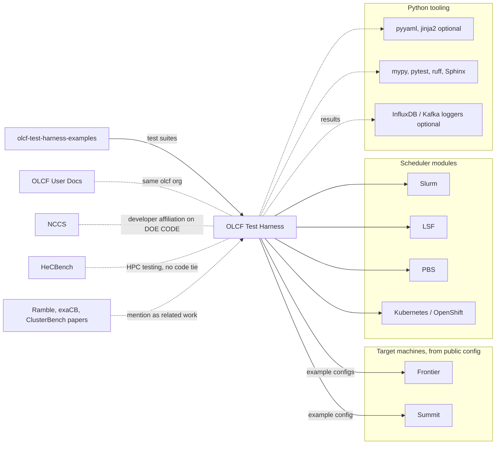

# OLCF Test Harness deep dive: connections and usage

Map and usage sections for the OLCF Test Harness deep dive (walkthrough expected at `deep-dives/olcf-test-harness.md`; timing against machine launches is in [olcf-test-harness-timing.md](olcf-test-harness-timing.md)). Independent research from public sources only; not affiliated with ORNL. All sources accessed 2026-10-24 (ET). Link numbers refer to `connections/map.md` (pass 26). People appear by role only. Rule 16 limits apply: artifacts only, no systems. Machines are named only as the public config and README name them; no hostnames, networks or addresses were read or recorded.

## Map

### Plain-language picture
The OLCF Test Harness is a Python tool that runs batches of application tests on a supercomputer and records whether they pass, mainly while a new machine is being accepted and checked. Its public example configs target Frontier and the older Summit [KNOWN]. It talks to whichever job scheduler the machine uses, with modules for Slurm, LSF, PBS, Kubernetes and OpenShift [KNOWN]. It needs nothing beyond standard Python to run, with optional YAML and template extras and optional loggers that send results to InfluxDB or Kafka [KNOWN]. The tests themselves live in a separate public examples repo [KNOWN]. Nothing in the public record depends on it, and no other ORNL catalog project shares code with it; HeCBench is a neighbor in purpose only [INFERRED].

### Diagram

Validated with mermaid-cli on 2026-10-24. Solid arrows come from code or config. Dashed lines mean optional pieces, same-organization ties, inferred neighbors, or mentions in papers (see the tags below).

### Links (map.md numbers)
- **Link 43, OLCF Test Harness and OLCF User Docs** [KNOWN]: both are in the olcf GitHub org, and the README configures Frontier test suites.
- **Link 76, and NCCS** [KNOWN]: developers on DOE CODE code-153320 list NCCS affiliations; the record's research-org field says only ORNL.
- **Link 181, target machines** (new) [KNOWN]: `configs/olcf_examples/` holds `frontier.ini`, `frontier_k8s.ini`, `frontier_openshift.ini` and `summit.ini`, and the README walks through launching an example on Frontier. This corroborates link 43's Frontier part. Note: the discovery-pass signals section says Frontier is the one machine with its own example config, but `summit.ini` is also in the public folder.
- **Link 182, schedulers** (new) [KNOWN]: `harness/schedulers/` has `slurm.py`, `lsf.py`, `pbs.py`, `k8s.py` and `openshift.py` on a shared `base.py`.
- **Link 183, Python tooling** (new) [KNOWN]: `pyproject.toml` lists "dependencies = []" and Python ">=3.6". Optional extras are pyyaml and jinja2. Dev tools are mypy, pytest and ruff, docs use Sphinx, and the build backend is hatchling. Optional result loggers for InfluxDB and Kafka sit in `harness/libraries/rgt_database_loggers/db_backends/`.
- **Link 184, the examples repo** (new) [KNOWN]: the README says "Sample tests can be found at https://github.com/olcf/olcf-test-harness-examples". That repo has `frontier`, `summit` and `hello_world` folders, 4 stars, 0 forks, and a last push on 2023-09-19 UTC.
- **Link 185, HeCBench** (new) [INFERRED] common domain: both are ORNL-side HPC testing or benchmark codes; [KNOWN] neither README names the other. Related HeCBench links: 11 and 155 (OLCF training material) and 158 (HeCBench's own reach).
- **Link 186, outside benchmarking frameworks** (new) [KNOWN] mentions; [INFERRED] as related work; [UNKNOWN] use by any other center. See the usage section below.
- **Anything that depends on it:** GitHub dependents shows "0 Repositories", and there is no package on PyPI or conda-forge [KNOWN: signals/olcf-test-harness.md].

## Who actually uses it
The full usage table, with registries, GitHub dependents and the DOE CODE record citations, is in [signals/olcf-test-harness.md](../signals/olcf-test-harness.md#who-actually-uses-it) and is not repeated here. This adds the paper-mention split and the other-centers question.

**In-house versus outside.** The harness is OLCF's own acceptance and regression testing tool, and nearly all of its public trace comes from ORNL [INFERRED, medium].
- **Papers:** an OpenAlex full-text search for "OLCF Test Harness" finds 11 works. 8 include an ORNL author: the DOE CODE record, a 2025 paper on adding database support to the harness, OLCF acceptance-testing and Frontier hardware-defect papers, and a Summit deployment paper. Some of these also have university co-authors. [KNOWN: api.openalex.org]
- **Outside papers:** 3 have no ORNL author. They are Ramble (2023, Google), exaCB (2026, with Jülich, Pawsey and Pittsburgh Supercomputing Center authors) and ClusterBench (2026, FAU Erlangen-Nürnberg). All three are benchmarking frameworks of their own, so they most likely mention the harness as related work, not as a tool they run [INFERRED, medium].
- **GitHub:** 14 stars, 10 forks, 0 dependents. All 10 forks are owned by personal accounts, not organizations. They were counted only, with no owners looked up. [KNOWN: GitHub API]
- **Other centers:** no public page found says another computing center runs the harness [UNKNOWN; logged in verification/not-found.md].
- **Funding:** the DOE CODE record (code-153320) lists the Office of Science as sponsor, and the discovery pass found ASCR on 3 of 4 OSTI hits [KNOWN per signals/olcf-test-harness.md]. Nothing beyond those records is claimed.

Reasoning: the harness is used where it was built. Outsiders who build their own test frameworks know about it and cite it, which is a sign of influence, not of adoption [INFERRED, medium confidence].

## Sweep 2 notes (fact-check pass, 2026-10-24)
- Verified against a fresh clone and the GitHub API: the four example configs including `summit.ini`, the five scheduler modules on `base.py`, `dependencies = []`, Python >=3.6, hatchling, the InfluxDB and Kafka loggers, the examples-repo quote, and that repo's `frontier`, `summit` and `hello_world` folders. No corrections.
