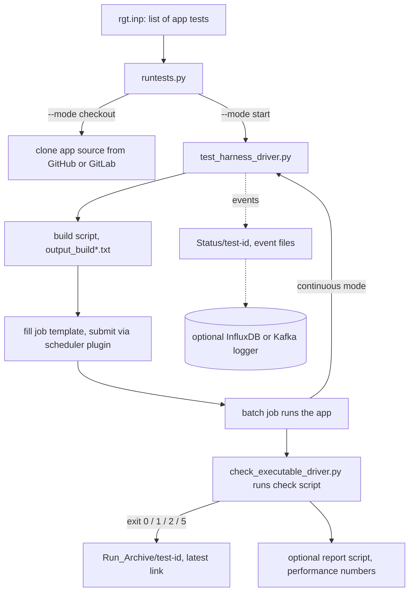

# Deep dive: the OLCF Test Harness (OTH)
Written in the reading pass on 2026-10-24 from the public repo and docs only. The project facts and sources are in [the brief](../projects/olcf-test-harness.md). This page follows one test from the input file to a pass or fail result. The map and users section is in [the connections notes](olcf-test-harness-connections.md), and the timing against machine launches is in [the timing notes](olcf-test-harness-timing.md).

Limits: this is based on code and docs. We name the harness's own files, modes and folders because the public repo does. We don't describe any machine's configuration, nodes, filesystems, queues or accounts, and we didn't read them (rule 16). The test suites OLCF actually runs in production aren't public, and we don't guess at them.

## The short version
OTH is a robot QA tester for supercomputers. You give it a list of science apps, and for each one it does four things:
1. It fetches the code.
2. It builds the code.
3. It submits a batch job, which is a request to run the program on the machine.
4. It runs a check script that answers with a code meaning passed, failed, wrong answer or too slow.

In continuous mode the job resubmits itself when it finishes, so a big set of tests can keep a new machine busy the way real users would, and problems show up before the real users arrive. [KNOWN: `doc-sphinx/source/user_guide/overview.rst`, `adding_new_test.rst`; INFERRED: the "before users arrive" purpose, see the brief]

## Key terms
- **Batch scheduler:** the line-keeper program on a supercomputer, such as Slurm, LSF or PBS. You hand it a job script, and it runs the job when nodes free up. [KNOWN: `harness/schedulers/` has slurm, lsf, pbs, k8s and openshift]
- **Application test:** one app plus one way of running it, like LAMMPS on one node. Tests live in folders shaped `<app>/<test>/`. [KNOWN: `launching.rst`]
- **Template:** a job script with blanks (`{{resubmit}}`, `{{max_submissions}}`, node counts) that the harness fills in for each test, using Jinja2 `.j2` files. [KNOWN: `adding_new_test.rst` examples]
- **Acceptance testing:** proving a new machine works before the center signs off on it. [INFERRED: how HPC centers use the term; the README's install path says "acceptance"]

## One test, step by step

1. **Pick the tests.** You write an input file (`rgt.inp`) that lists the app tests and where they live. The path can also come from the `RGT_PATH_TO_TESTS` environment variable. [KNOWN: `launching.rst`]
2. **Fetch the code.** `runtests.py --mode checkout` clones each app's source from a GitHub or GitLab repo without running anything. The docs recommend this as its own step, so you can see the clone worked. [KNOWN: `launching.rst` lines 137-150; `harness/libraries/repositories/git.py`] The other modes are start, stop, status and summarize. [KNOWN: `harness/libraries/harness_internal_config/harness_modes.py`]
3. **Know the machine.** A machine file (`.ini`) tells the harness what system it's on, and a machine type plus a scheduler plugin handle the system-specific parts. The repo ships example files named for Frontier (plus Kubernetes and OpenShift variants) and Summit. [KNOWN: `configs/olcf_examples/` file names, `harness/machine_types/`] We list the file names only.
4. **Build.** `test_harness_driver.py` runs the test's build script in a scratch folder and saves the build output. If the build fails, the job isn't submitted. [KNOWN: `harness/bin/test_harness_driver.py` lines 163-192; `launching.rst` `$BUILD_DIR`]
5. **Submit.** The harness fills in the job template and hands it to the scheduler. Which queue and project account to use can come from the machine file, the test's own input, or override environment variables, with a set order of priority. [KNOWN: `launching.rst` lines 213-227]
6. **Run and time.** The job runs the app in a work folder. A helper (`log_binary_execution_time.py`) records start and end times, and the output gets copied to the results folder. [KNOWN: `adding_new_test.rst` job script example]
7. **Check.** The job calls `check_executable_driver.py`, which runs the test's check script. The docs suggest a standard set of exit codes: 0 means passed, 1 failed, 2 means it finished but gave a wrong answer, and 5 means correct but too slow. To the harness itself, only zero versus non-zero matters. [KNOWN: `adding_new_test.rst` lines 470-480] The check output goes to `output_check.txt`. An optional report script can collect performance numbers into `output_report.txt`, and its exit code is ignored. [KNOWN: same file]
8. **Record.** Every step writes a timestamped event file, from logging start through build, submit, queued, execute and check. Each test run gets its own `Status/<test-id>` folder and `Run_Archive/<test-id>` folder, and `Run_Archive/latest` points at the newest run. [KNOWN: `harness/libraries/status_file.py` event list lines 76-111; `launching.rst` lines 154-155, 238-241] Results can also stream to an InfluxDB time-series database or a Kafka message stream. [KNOWN: `rgt_database_loggers/db_backends/`] The streaming work is most of the 2025 burst. [KNOWN: timing notes]
9. **Repeat or stop.** If resubmit is on, the job script calls the driver again at the end, so the test loops, up to a maximum count or forever. A comment in the example says resubmission happens when a `.kill_test` file is absent, so that file appears to be the off switch. [KNOWN: `adding_new_test.rst` line 704; INFERRED: how it is used] That loop is what lets a suite keep simulating a production workload. [KNOWN: `overview.rst`]

## Where humans act
- Test authors write each app's build script, job template and check script, and they set the pass bars for correctness and speed. [KNOWN: `adding_new_test.rst` requires all three scripts]
- Center staff choose which suites to run on which machine, and read the results. [INFERRED; the suites themselves aren't public]

## What it is not
- It isn't a benchmark suite. It ships no science apps of its own. Sample tests are in a separate examples repo. [KNOWN: README]
- It isn't a monitoring system, though from 2025 it can feed one. [KNOWN: database loggers; INFERRED: the framing]
- It isn't something we ran or pointed at any system.

## Life story (from the timing notes)
In short, each burst of work lands near a machine bring-up.
- The first push came in 2016-17 (213, then 146 commits), with Summit's early test system named in commit subjects from October 2016. 2018, the year Summit opened, has 6 commits.
- Work came back in 2022-23 (121 and 105) around Frontier, adding Slurm support and timing metrics.
- 2025 was the busiest year since 2016 (203 commits, v3.0), focused on streaming results. It came after Summit was retired and after DOE opened bids for Discovery, the next machine.

The commit counts are [KNOWN: git log]. The cause is [UNKNOWN], and the link to machine launches is [INFERRED, medium]. The docs' own header dates the tool to 2016, as "NCCS_Test_Harness", and the GitHub repo was created in 2021. [KNOWN: `doc-sphinx/source/index.rst`, GitHub API] See [the timing notes](olcf-test-harness-timing.md) for the ledger.

## Who pays
code-153320 names the DOE Office of Science in general, with no specific program listed. No separate money tied to a machine launch is visible. [KNOWN: OSTI record, per the fact-check pass correction; UNKNOWN: which program]

## Who uses it (from the connections notes)
In public, only OLCF's own work uses it. No public project depends on it, most papers that mention it come from the lab, and outside mentions are other benchmarking frameworks naming it as related work. HeCBench is related in purpose only. [KNOWN/INFERRED per [connections notes](olcf-test-harness-connections.md)]

## What it teaches about how ORNL works
1. A new supercomputer has to earn trust. The center proves it with real apps run over and over, not just a speed benchmark. [KNOWN: overview.rst; INFERRED: the lesson]
2. The test tool is public, but the tests and results the center actually runs aren't. That split between public framework and private content matches the neutron pipeline, where the code is public and the data sits behind sign-in. [KNOWN: README, ONCat; INFERRED: the pattern]
3. Lab tools follow the machines. Activity tracks Titan to Summit to Frontier, and possibly Discovery. [INFERRED, medium]

## Student angle
This is one of the best fits in the catalog for a cybersecurity or IT student. It's plain Python driving shell scripts and batch schedulers, with exit-code conventions, environment-variable precedence, event logs and metrics streaming. All of that is everyday Linux operations work. [KNOWN: repo contents; INFERRED: the fit] You can learn it without a supercomputer by reading `adding_new_test.rst`'s hello-world example, and `example_machine.ini` plus the `linux_x86_64` machine type suggest a plain Linux box is a supported target. [KNOWN: file names; INFERRED: that it runs locally, untested by us] There's a `contributing.rst` in the user guide but no root CONTRIBUTING file, and no "good first issue" labels. [KNOWN: tree; brief]

## Claim boundary
| Topic | Source says | We infer | Don't say |
|---|---|---|---|
| Purpose | Automates build, run and check; continuous mode simulates production | It's used for acceptance of new machines | That a specific machine was accepted with it |
| Exit codes | 0, 1, 2 and 5 are a suggested standard | | That the harness treats 2 and 5 differently from 1 |
| Machines | Example config files named for Frontier and Summit | | Anything about those machines' layout |
| Timing | Commit counts per year | Bursts track bring-ups | A stated cause |
| Users | No public dependents found | It's OLCF-internal in practice | That no other center uses it |

## Unknown and searched without result
- Which suites and apps OLCF runs, and their pass rates: not public, and we didn't look. [UNKNOWN]
- What the next major version after v3.2 changes. [UNKNOWN: the README only says v3.2 is the last version fully compatible with 2.x]
- Whether it runs on a laptop or a single Linux box out of the box: not tested by us. [UNKNOWN]
- Outside users: searched by the connections pass, none found. [UNKNOWN]
- Would more research change the picture? The flow comes straight from the code and docs. The open edges are who uses it and why it was built when it was. [INFERRED]

## Sources (accessed 2026-10-24)
- https://github.com/olcf/olcf-test-harness: README, `doc-sphinx/source/{index.rst, user_guide/overview.rst, launching.rst, adding_new_test.rst}`, `harness/bin/test_harness_driver.py`, `harness/libraries/{status_file.py, harness_internal_config/harness_modes.py, repositories/git.py, rgt_database_loggers/}`, `harness/schedulers/`, `harness/machine_types/`, `configs/` (file names only)
- https://olcf.github.io/olcf-test-harness/
- https://www.osti.gov/biblio/code-153320
- [Timing notes](olcf-test-harness-timing.md), [connections notes](olcf-test-harness-connections.md), [brief](../projects/olcf-test-harness.md)

## Sweep 2 notes (fact-check pass, 2026-10-24)
- Verified against a fresh clone and the GitHub API: the exit-code list and its "only zero versus non-zero matters" caveat, the `.kill_test` resubmit comment, the ten event names in `status_file.py`, the five modes, the 2016 Sphinx header naming NCCS_Test_Harness, repo creation 2021-01-11, the README's v3.2 compatibility note, `example_machine.ini`, the `linux_x86_64` machine type, `contributing.rst` with no root CONTRIBUTING file, and the funding paragraph (Office of Science only).
- Corrected: the modes file path, and the summitdev date carried over from the timing-notes fix.
- Nothing about machine layout, nodes or accounts appears; the rule 16 boundary holds.
