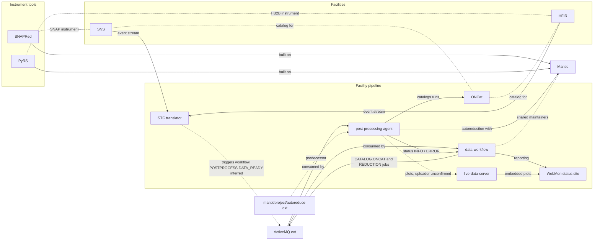

# SNS neutron pipeline deep dive: connections and usage 

Written for the deep dive at `deep-dives/sns-neutron-pipeline.md`, whose main text another writer owns. That file's "Map and usage (connections pass)" section links here, so this file is the single home for these two sections. Independent research from public sources only; not affiliated with ORNL. All sources accessed 2026-10-24 (ET). Link numbers refer to `connections/map.md` (pass 25). People appear by role only. Rule 16 limits apply: artifacts only, no systems. For ONCat, only its public front page and the pyoncat package metadata were used. Facility internals behind login, including any non-public data pipeline such as DataFed's, exist and are out of scope.

## Map

### Plain-language picture
A run at an SNS or HFIR instrument is turned into a NeXus file by the Streaming Translation Client (STC), which "Triggers the post-processing workflow after the NeXus file has been created" [KNOWN: data-workflow glossary]. The trigger is the POSTPROCESS.DATA_READY message that the workflow manager listens for [INFERRED: the glossary does not name the queue; the listener is KNOWN from amq_listener.py]. data-workflow then hands out two jobs over ActiveMQ, CATALOG.ONCAT.DATA_READY and REDUCTION.DATA_READY [KNOWN: workflow/settings.py lines 15-16]. The post-processing agent does both, cataloging in ONCat and running Mantid-based reduction, and reports back on POSTPROCESS.INFO or POSTPROCESS.ERROR [KNOWN: same file]. WebMon, data-workflow's reporting site, shows instrument and autoreduction status and embeds per-run plots from live-data-server [KNOWN: glossary, view_util.py]. Which component uploads those plots is [UNKNOWN]. Instrument tools (SNAPRed for SNAP at SNS, PyRS for HB2B at HFIR) sit beside this flow and use Mantid directly; whether they run inside autoreduction or only by hand is [UNKNOWN]. One maintaining group shares top contributors across most of these repos.

### Diagram

Validated with mermaid-cli on 2026-10-24 (pass 25). Solid arrows are KNOWN from code or docs; dashed lines are inferred, facility membership, or unconfirmed (see tags below).

### Links (map.md numbers)
- **Link 36, data-workflow and SNS** [KNOWN]: its README calls it the SNS data workflow manager and reporting app. **Link 75, and HFIR** [KNOWN]: the workflow and its WebMon site serve both facilities.
- **Link 74, data-workflow to Mantid, through post-processing-agent and livereduce** [KNOWN]: the developer docs say reduction runs in post_processing_agent on autoreducer machines and in livereduce, a Mantid daemon.
- **Link 91, data-workflow, post-processing-agent and live-data-server as sibling repos** [KNOWN]: all three are named in the data-workflow developer docs.
- **Link 179, STC triggers data-workflow** (new, pass 25) [KNOWN] per the glossary; [INFERRED] that the trigger is POSTPROCESS.DATA_READY; [UNKNOWN] STC code (no public repo found).
- **Link 180, WebMon embeds live-data-server plots** (new, pass 25) [KNOWN]: the glossary defines WebMon, and view_util.py builds signed per-run plot links.
- **Link 103, post-processing-agent to ActiveMQ** [KNOWN]: plus (pass 25) the workflow manager's side, which listens on POSTPROCESS.DATA_READY and sends the catalog and reduction jobs (amq_listener.py, settings.py): the agent is an ActiveMQ client (`Consumer.py`, `queueProcessor.py`; `Configuration.py` holds "Post-processing, ActiveMQ, and logging configuration").
- **Link 104, post-processing-agent to ONCat** [KNOWN]: an ONCat processor exists, and the integration test `test_cataloging.py` runs it against a mock ONCat container and expects a message on `CATALOG.ONCAT.COMPLETE` (pass 24). ONCat's own side is [UNKNOWN], since it needs credentials and was not touched.
- **Link 105, predecessor** [KNOWN]: the agent's README points to `mantidproject/autoreduce` for the old version.
- **Link 106, live-data-server to Django and Postgres** [KNOWN]: a Django app storing plots in Postgres; BSD-3, "Copyright (c) 2024, OAK RIDGE NATIONAL LABORATORY".
- **Link 107, who uploads plots to live-data-server** [INFERRED] the agent, per the brief; [UNKNOWN] in code (pass 24): no upload call in a fresh clone of the agent, and live-data-server's README names no client.
- **Links 129 and 130, ONCat** [KNOWN]: ONCat's front page calls itself "the catalog for neutron experiment data at SNS and HFIR", with no public source repo; its public client is PyPI `pyoncat` 2.7.
- **Link 53, Mantid and ORNL Neutron Sciences** [KNOWN]: mantidproject.org's footer lists NScD Oak Ridge National Laboratory alongside ISIS, ESS and others.
- **Links 2 and 4, SNAPRed to Mantid** [KNOWN]: Mantid is its core backend, with calls "routed through 'MantidSnapper'"; one maintainer is a top contributor to both. **Link 23, SNAPRed and SNS** [CORROBORATED]: the repo's SNAP data-mount test marker plus OSTI 3012509 (SoftwareX 2025), whose abstract places SNAP "at the Spallation Neutron Source operated by Oak Ridge National Laboratory".
- **Link 34, PyRS to Mantid** [KNOWN]: it prefers ORNL-specific Mantid builds ("mantid-ornl/label/main") and uses Mantid peak fitting. **Link 37, PyRS and HFIR** [KNOWN]: "neutron data measured at the HFIR HB2B instrument".
- **Link 35, shared maintainers** [KNOWN] shared contributors across data-workflow, PyRS, SNAPRed and Mantid; [INFERRED] one maintaining group.
- **Link 175, PyRS and AM tools** [INFERRED]: a side branch only; no code tie.

Map changes: links 179 and 180 are new (pass 25); links 103, 104 and 107 were updated in place.

## Who actually uses it

**In-house plumbing versus outside-used.** The pipeline splits cleanly. The facility plumbing (data-workflow, post-processing-agent, live-data-server, ONCat) shows almost no outside trace: no packages except the pyoncat client, no GitHub dependents, 0 to 6 stars, and no papers. That fits software built to run one user facility [INFERRED, medium]. Mantid, the shared analysis framework underneath, is the opposite: one of the most cited tools in this research, with most citers outside ORNL [KNOWN counts]. The instrument tools (SNAPRed, PyRS) are in between: public and actively maintained, but used by their instruments' own communities.

| Project | Role | Outside signal | ORNL vs outside | Tag | Source |
|---|---|---|---|---|---|
| Mantid | shared analysis framework | 249 stars, 141 forks; own conda channel; NIM A 2014 paper (10.1016/j.nima.2014.07.029) with 1,807 citing works | 696 with an ORNL author, about 61% without | [KNOWN] | signals/mantid.md; api.openalex.org |
| ONCat | facility data catalog | PyPI `pyoncat` 2.7, 470 downloads last month (not users); no paper found | not measurable | [KNOWN] counts; [UNKNOWN] papers | signals/oncat.md |
| data-workflow | run tracking and reporting | 6 stars, 3 forks, 0 dependents; no package or paper | in-house | [KNOWN] | signals/data-workflow.md |
| post-processing-agent | autoreduction and cataloging | 0 stars, 4 forks, 0 dependents; no package or paper | in-house | [KNOWN] | signals/post-processing-agent.md |
| live-data-server | plot web app | 0 stars, 1 fork, 0 dependents; no package or paper | in-house | [KNOWN] | signals/live-data-server.md |
| SNAPRed | SNAP reduction tool | 2 stars, 4 forks, 0 dependents; SoftwareX 2025 paper (10.1016/j.softx.2025.102464) with 2 citing works | both with an ORNL author | [KNOWN] | GitHub API; api.openalex.org |
| PyRS | HB2B residual stress tool | 6 stars, 10 forks, 0 dependents; PyPI `pyrs` is an unrelated microservice framework; no PyRS paper found in OpenAlex | not measurable | [KNOWN]; namesake [UNRELATED] | GitHub API; pypi.org |

Funding: the Mantid history section reports Office of Science BES on OSTI hits for ORNL Mantid papers [KNOWN, small sample]. SNAPRed's OSTI record 3012509 names DOE Office of Science, Basic Energy Sciences, Scientific User Facilities [KNOWN: OSTI API]. PyRS's OSTI record 17315105 names only USDOE, with no office [KNOWN: OSTI API]. Funding for data-workflow, post-processing-agent, live-data-server and ONCat stays [UNKNOWN] because no public record names a sponsor.

Reasoning: outside users meet the SNS pipeline through Mantid and through the data it produces, not through the plumbing, which exists to serve the facility's own instruments [INFERRED, medium confidence].

## Sweep 2 notes (fact-check pass, 2026-10-24)
- Corrected the funding line: SNAPRed and PyRS do have sponsor fields on OSTI (BES Scientific User Facilities, and plain USDOE), matching the main deep dive and their briefs.
- Verified: queue names and the glossary trigger quote, live-data-server's BSD-3 2024 ORNL copyright, pyoncat 2.7 on PyPI, SNAPRed 2 stars and 4 forks, PyRS 6 stars and 10 forks, and the "routed through 'MantidSnapper'" quote (SNAPRed `pyproject.toml`).
- Mantid citing counts drift slightly between queries (1,807 here against 1,809 in the fact-check pass; ORNL-author subset 696 against 689 by ORNL's ROR id). Both give about 61 to 62 percent without an ORNL author, so the claim stands.
