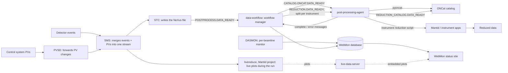

# Deep dive: the SNS and HFIR neutron data pipeline
Written in the reading pass on 2026-10-24, from public repos, public docs and OSTI records only. It covers Mantid, ONCat, live-data-server, post-processing-agent and data-workflow, with SNAPRed and PyRS as side branches. Detailed facts and sources live in each project's brief in `projects/`. This page shows how the pieces fit together. The connections pass adds the map and usage section below. The history and funding check on the 2021-2024 revival is below.

Limits: everything here comes from public code and documentation. We name software parts and the message queues they use, because the public code names them. We don't name hosts, ports, servers or deployment details, and we don't look for them (rule 16). People are described by role only.

## The short version
When a neutron experiment finishes recording a run at ORNL's Spallation Neutron Source (SNS) or High Flux Isotope Reactor (HFIR), a chain of programs takes over automatically:
1. The raw data stream becomes a file.
2. A workflow manager notices it's ready.
3. Messages fan out to a cataloger and a reduction job.
4. Mantid does the physics math.
5. The results land in the ONCat catalog, with plots on a web page.

Instrument staff watch the whole thing on a status website. Every step is a separate program that talks to the others by dropping messages into named queues. [KNOWN: data-workflow glossary and developer docs, post-processing-agent README_developer.md, code cited below; INFERRED: the one-paragraph framing]

## Key terms
- **Run:** one recorded block of measurement on an instrument. [KNOWN: post-processing-agent brief]
- **Event data:** instead of a picture, the detectors log each neutron hit with a position and an arrival time. The files are huge. [INFERRED from "fast neutron event data" in the data-workflow glossary]
- **NeXus file:** the standard file format for neutron and X-ray data, built on HDF5. [KNOWN: glossary names NeXus; INFERRED: the HDF5 detail]
- **PV (process variable):** a reading from the control system, like sample temperature, magnetic field or a motor position. [KNOWN: glossary, quote: "sample environment variables (e.g. temperature, magnetic field), instrument geometry and experiment metadata"]
- **Reduction:** turning raw event data into a clean, corrected pattern a scientist can analyze. [KNOWN: briefs]
- **Message broker / queue:** a post office for programs. One program drops a message into a named queue, and whoever listens on that queue picks it up. Here the broker is ActiveMQ, spoken to over the STOMP protocol. [KNOWN: data-workflow README, post-processing-agent README_developer.md]

## A neutron's data, step by step

1. **Measure.** Detectors record neutron events. A per-beamline daemon called PVSD forwards control-system readings (PVs). The Stream Management Service (SMS) merges both into one data stream "available for both live monitoring and file archiving". [KNOWN: data-workflow `docs/glossary.rst`] These acquisition services aren't in our catalog and have no public repo we found. We know them only from this glossary. [KNOWN: glossary; UNKNOWN: their code]
2. **Watch it live.** During the run, `livereduce`, a daemon from the Mantid project, makes live plots. [KNOWN: data-workflow `docs/developer/index.rst`] DASMON, the per-beamline monitor, writes PV updates and run metadata straight into the WebMon database because there are so many of them. [KNOWN: glossary]
3. **Write the file.** The Streaming Translation Client (STC) turns the stream into a NeXus file and "Triggers the post-processing workflow after the NeXus file has been created." [KNOWN: glossary]
4. **Route it.** data-workflow's workflow manager listens for a `POSTPROCESS.DATA_READY` message. [KNOWN: `src/workflow_app/workflow/amq_listener.py` docstring example] It then sends out tasks:
   - one to `CATALOG.ONCAT.DATA_READY`, for cataloging;
   - one to `REDUCTION.DATA_READY`, for reduction. [KNOWN: `workflow/settings.py` lines 15-16]
   - Reduction queues are split per instrument, for example a dedicated queue for the EQSANS instrument, so one busy instrument can't block the rest. The split covers three shared queues: normal reduction, a high-memory reduction queue (`REDUCTION.HIMEM.DATA_READY`) and the reduced-data catalog queue (`REDUCTION_CATALOG.DATA_READY`). [KNOWN: `workflow/states.py` `_PER_INSTRUMENT_QUEUES`] Cataloging stays on one shared queue because ONCat is "a single external service with no per-instrument fairness problem". [KNOWN: `workflow/states.py` comments lines 25-37]
5. **Catalog the raw file.** post-processing-agent's ONCat processor listens on `CATALOG.ONCAT.DATA_READY` and registers the file with ONCat through the `pyoncat` client. [KNOWN: `postprocessing/processors/oncat_processor.py` lines 13, 23-30]
6. **Reduce.** The agent's reduction processor runs that instrument's reduction script under time and memory limits. The README example uses 60 minutes and 70% of memory. [KNOWN: post-processing-agent README] The scripts call Mantid, the shared neutron analysis framework. The agent's predecessor was `mantidproject/autoreduce`, and its README has a Mantid settings section. [KNOWN: post-processing-agent README; data-workflow developer docs] Instrument-specific apps sit on top of Mantid for some instruments: SNAPRed for SNAP at SNS and PyRS for HB2B at HFIR. SNAPRed pins Mantid 6.16, and both pull Mantid from an ORNL-specific conda channel (`mantid-ornl`). [KNOWN: SNAPRed `pyproject.toml` lines 192 and 285-320; PyRS `pyproject.toml` lines 67-69] Whether those two apps are called from the automatic reduction step or only run by hand is [UNKNOWN].
7. **Catalog the result.** A second ONCat processor handles reduced data on the `REDUCTION_CATALOG.DATA_READY` queue. [KNOWN: `oncat_reduced_processor.py` exists; `states.py` lists the queue] `pyoncat` includes a `ReductionFileBuilder` for describing a reduction's inputs and outputs. [KNOWN: ONCat brief]
8. **Report back.** The agent sends "complete" or "error" messages, and sends heartbeats so monitoring knows it's alive. [KNOWN: post-processing-agent README_developer.md] The workflow manager records each run's state in the database. [KNOWN: `workflow/states.py`, `database/`]
9. **Show it.** WebMon, data-workflow's reporting site, shows instrument status and autoreduction status. [KNOWN: glossary] It pulls each run's plot from live-data-server and embeds it, using a per-instrument, per-run address with a keyed hash. [KNOWN: `webmon_app/reporting/report/view_util.py` `get_plot_template_dict`, `get_plot_data_from_server`; settings `LIVE_PLOT_SECRET_KEY`] live-data-server stores uploaded HTML plots by instrument and run number and keeps them for 3 years by default. [KNOWN: live-data-server brief] Which program uploads the plots isn't shown in the agent's code. I searched it for live-data-server calls and found none. [KNOWN: grep of `postprocessing/` and `scripts/`, 2026-10-24; UNKNOWN: the uploader]
10. **Find and cite it later.** Experiment teams use ONCat to find and download their runs and to mint DOIs for datasets. [KNOWN: oncat.ornl.gov overview page] Anything behind ONCat sign-in is out of scope.

## Where humans act
- Instrument scientists write and tune each instrument's reduction script, and approve calibrations in apps like SNAPRed and PyRS. [KNOWN: post-processing-agent "create reduction script" task; SNAPRed and PyRS GUIs]
- Facility software staff run the services and keep WebMon up. [INFERRED]
- Visiting users check their runs on WebMon, which has separate guides for general users, guests and instrument scientists, and they pull data from ONCat. [KNOWN: data-workflow docs file names; ONCat overview]

## What it is not
- It isn't one program. It's five-plus separate services joined by message queues. [KNOWN]
- It isn't open data. The code is public, but ONCat says teams access "their data", and uploads to live-data-server need credentials. [KNOWN: ONCat overview; live-data-server `check_credentials`]
- It isn't something we mapped as a system. We read code and docs, and we didn't touch, scan or locate any running service (rule 16).

## Life story (summary)
- data-workflow dates from 2012 and post-processing-agent from 2014, and live-data-server was created in 2016. [KNOWN: GitHub API] Mantid dates from 2011 and is shared with other neutron facilities. [KNOWN: Mantid brief]
- The three `neutrons`-org tools went quiet around 2017-2020, then came back from 2021 to 2024 with frequent releases. data-workflow peaked at 447 commits in 2022, and live-data-server peaked at 118 in 2024. [KNOWN: signals files, via lessons/how-ornl-works.md Lesson 6] The cause is [UNKNOWN]. The 2021 restart looks like cleanup work (Python 3, containers), and the 2023-24 bursts line up in time with the SNS power upgrade. See "Revival timing" below.
- All three show signs of a coordinated modernization: the same `next` default branch (data-workflow and live-data-server), the same Pixi environment tooling, refreshed 2022-2024 copyright lines, and Docker-based deployment files. [KNOWN: repo trees, LICENSE files; INFERRED: "coordinated"]

## Who pays
- Mantid: DOE Office of Science, Basic Energy Sciences, on the 2014 paper. [KNOWN: OSTI 1149396, 1556799]
- SNAPRed: BES Scientific User Facilities. [KNOWN: OSTI 3012509]
- PyRS: USDOE with no office named. Its instrument paper is BES. [KNOWN: OSTI 17315105, 1959622]
- data-workflow, post-processing-agent, live-data-server and ONCat: no funding record found. [UNKNOWN; logged in signals and not-found] SNS and HFIR are BES user facilities, so BES is the likely funder, but no record says so for these four. [INFERRED, not to be stated as fact]

## What it teaches about how ORNL works
1. A user facility's software is mostly plumbing. Catalogs, queues, status pages and plot servers surround one big physics engine. [INFERRED from the component list]
2. The lab shares the engine (Mantid, multi-institution) but builds its own facility-specific wiring and ships it openly. [KNOWN: licenses, orgs; INFERRED: the lesson]
3. Old tools get rebuilt in place, not replaced. All three wiring repos keep their 2012-2016 histories but release constantly now. [KNOWN: dates, releases]
4. Design choices show up in code comments. The per-instrument queue split exists for fairness between instruments. [KNOWN: `states.py` comments]

## Student angle
This is the most ops- and security-flavored corner of the catalog: message brokers, service heartbeats, systemd units, RPM packaging, Docker Compose, Django sites with authenticated uploads and keyed links. [KNOWN: post-processing-agent `systemd/`, `SPECS/`; data-workflow Dockerfiles; live-data-server and WebMon code] data-workflow and Mantid have contributor guides. live-data-server is the smallest codebase to read first. None of the five had open "good first issue" labels on 2026-10-24. [KNOWN: GitHub API; see each brief's GOAL.md section]

## Claim boundary
| Topic | Source says | We infer | Don't say |
|---|---|---|---|
| Flow | The queue names and processors above, from code and the glossary | That the steps run in this order for a typical run | That every instrument uses every step |
| Live plots | WebMon embeds plots from live-data-server; livereduce makes live plots | That livereduce or reduction scripts upload them | That post-processing-agent uploads them (no code found) |
| Funding | BES for Mantid and SNAPRed | BES for the rest | That BES funds data-workflow, the agent, live-data-server or ONCat |
| Revival | Commit and release counts | A planned modernization | A specific cause (none stated publicly) |
| Systems | Software components named in public docs | | Any host, server count, network layout or deployment location |

## Revival timing (discovery pass)
Full notes and ledger: [sns-neutron-pipeline-timing.md](sns-neutron-pipeline-timing.md).
- The 2020 to 2022 restart looks like a software catch-up, not a facility event. data-workflow moved to Docker in October 2020, post-processing-agent switched to Python 3 in February 2021, and live-data-server was containerized in March 2022. [KNOWN: git log] Python 2 had reached end of life in January 2020. [INFERRED, medium]
- The 2023 to 2024 bursts line up with the SNS Proton Power Upgrade. The beam was off from August 2023 to April 2024, and user operations resumed on 2024-07-11. [KNOWN: [PPU completion paper](https://doi.org/10.18429/jacow-linac2024-thpb045)] post-processing-agent's busiest months fell inside the outage (2023-11 to 2024-01), and live-data-server's came as the beam returned (2024-06 to 2024-08). [KNOWN: git log] No public source links the two, so the cause stays [UNKNOWN]. The timing match is [INFERRED, low to medium].
- Funding: the upgrade credits DOE Basic Energy Sciences, Scientific User Facilities, the same program as on the Mantid and ONCat records. No public record funds the plumbing tools directly. [KNOWN for the upgrade; UNKNOWN for the tools]

## Unknown and searched without result
- Public code for SMS, STC, PVSD and DASMON itself: not looked for beyond the glossary, so it isn't a claimed negative. [UNKNOWN]
- Who uploads plots to live-data-server: post-processing-agent code searched, none found. [UNKNOWN]
- Whether SNAPRed and PyRS run inside autoreduction. [UNKNOWN]
- Funding for the four wiring tools: OSTI searched (signals files). [UNKNOWN]
- What Calvera and INTERSECT processors connect to. Calvera has a 2023 ORNL platform record (OSTI 1909092). INTERSECT isn't explained in the repo. [UNKNOWN]
- Would more public research change the core picture? Probably not. The flow comes straight from code and docs that agree with each other. The open questions are at the edges: who uploads plots, and why the revival happened. [INFERRED]

## Map and usage (connections pass)
The connections pass keeps its map and usage notes in [sns-neutron-pipeline-connections.md](sns-neutron-pipeline-connections.md). In short, Mantid is the only piece outsiders really use. Its main paper has about 1,800 citing works, and roughly six in ten have no ORNL author (checked in the fact-check pass). The wiring tools around it are in-house, and SNAPRed and PyRS mostly serve their own instruments.

## Sources (accessed 2026-10-24)
- https://github.com/neutrons/data_workflow: `docs/glossary.rst`, `docs/developer/index.rst`, `src/workflow_app/workflow/{amq_listener.py, settings.py, states.py}`, `src/webmon_app/reporting/report/view_util.py`, `src/webmon_app/reporting/reporting_app/settings/base.py`
- https://github.com/neutrons/post_processing_agent: `README.md`, `README_developer.md`, `postprocessing/processors/{oncat_processor.py, oncat_reduced_processor.py, reduction_processor.py}`
- https://github.com/neutrons/live_data_server: `src/apps/plots/`, `src/config/`
- https://github.com/mantidproject/mantid, https://pypi.org/project/pyoncat/, https://oncat.ornl.gov/ (overview page only)
- https://github.com/neutrons/SNAPRed, https://github.com/neutrons/PyRS (`pyproject.toml`)
- OSTI API records 1149396, 1556799, 3012509, 17315105, 1959622, 1909092
- Project briefs and signals files for all seven tools in this repo

## Sweep 2 notes (fact-check pass, 2026-10-24)
- Re-checked against fresh clones of data_workflow, post_processing_agent and live_data_server plus the GitHub API: queue names in `workflow/settings.py` lines 15-17, the per-instrument split and its OnCat comment in `workflow/states.py`, the `POSTPROCESS.DATA_READY` docstring example, all three glossary quotes, the livereduce line, both ONCat processors and their queues, the 60-minute and 70% limits, heartbeat topics, the autoreduce predecessor link, the WebMon plot functions and `LIVE_PLOT_SECRET_KEY`, `check_credentials`, the 3-year plot expiry (`config/settings.py`), creation years 2012, 2014 and 2016, `next` default branches, CONTRIBUTING only in data_workflow, and zero open good-first-issue labels. All match.
- Added: the per-instrument split also covers the high-memory reduction queue and the reduced-data catalog queue, not only normal reduction.
- No hosts, ports or deployment details beyond what the public code names; nothing restricted found.
