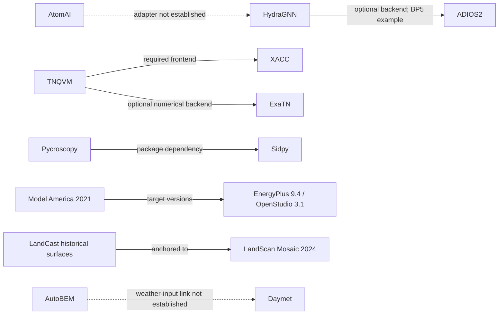

# New connections from this research pass

Access date: 2026-11-10. Read the [chapter index](README.md) for the complete explanations and source ledgers. These are relationships between public artifacts, not a map of deployed ORNL systems.

Solid arrows are narrow directly documented connections. Dashed arrows are unanswered questions; they must not be interpreted as dependencies. The [machine-readable propositions](connections.json) retain source URLs and a separate limitation on every arrow. They are also included in the [whole-portfolio JSON map](../portfolio-map.json).

[KNOWN] The six solid edges come from inspected public source files or primary dataset descriptions: HydraGNN's [ADIOS backend](https://github.com/ORNL/HydraGNN/blob/d49d934403f0cc3276750004c8dfbf3a502a10f1/hydragnn/data/adiosdataset/_backend.py), TNQVM's [build dependency](https://github.com/ORNL-QCI/tnqvm/blob/a70eed190a4448dbe3dae94189d066ac694dc798/CMakeLists.txt) and [numerical visitor](https://github.com/ORNL-QCI/tnqvm/blob/a70eed190a4448dbe3dae94189d066ac694dc798/tnqvm/visitors/exatn-mps/ExaTnMpsVisitor.cpp), Pycroscopy's [manifest](https://github.com/pycroscopy/pycroscopy/blob/90e2d232acc9da634131c1793f082a70a04a3297/pyproject.toml), the [Model America record](https://doi.ccs.ornl.gov/dataset/9e968129-1ca9-5a71-93fa-24f009132a3a), and the [historical population dataset record](https://impact.ornl.gov/en/datasets/landscan-mosaic-annual-global-ambient-population-time-series-vers/).

[UNKNOWN] Reviewed sources do not establish the two dashed implementation links. Similar data shapes and scientific interests are insufficient. A future public adapter, import path, or published experiment naming the link would be stronger evidence.
