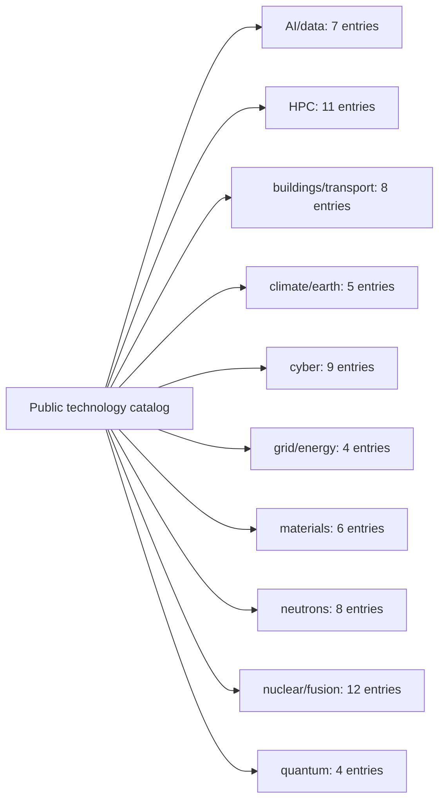

# ORNL public technology portfolio map

Generated navigation over the declared catalog and selected relationship ledger. Not a census of ORNL, a live system map, or a fresh source verification. Briefs, signals, and deep-dive mentions indicate files, not equal research depth. Source retrieval dates remain in their original ledger entries.

This navigation covers **74 catalog entries**, **33 inherited relationships**, and **8 new research propositions**. The [new technical research](portfolio-expansion-2026-11-10/README.md) adds cross-domain detail outside this inherited catalog. The [JSON map](portfolio-map.json) preserves every catalog record and original source-ledger text.

Rebuild with `python3 scripts/build_portfolio_map.py`; check with `python3 scripts/build_portfolio_map.py --check`.

## Read across domains

[Lab tree](../LAB-TREE.md) | [Research guide](public-research-guide.md) | [Relationship propositions](research-relationships.md) | [Coverage and limits](coverage-matrix.md)

## The whole catalog at a glance

These are research categories, not an ORNL reporting hierarchy.

## AI/data

| Project | Recorded status | Reading paths |
|---|---|---|
| [HydraGNN](https://github.com/ORNL/HydraGNN) | active | [brief](../projects/hydragnn.md); [public traces](../signals/hydragnn.md) |
| [Flowcept](https://github.com/ORNL/flowcept) | active | [brief](../projects/flowcept.md); [public traces](../signals/flowcept.md) |
| [DataFed](https://github.com/ORNL/DataFed) | active | [brief](../projects/datafed.md); [public traces](../signals/datafed.md) |
| [Vivaldi](https://github.com/ORNL/vivaldi) | unknown | [brief](../projects/vivaldi.md) |
| [Mind the Gap](https://github.com/ORNL/mind_the_gap) | unknown | [brief](../projects/mind-the-gap.md) |
| [ChatHPC](https://ornl.github.io/ChatHPC/) | active | [brief](../projects/chathpc.md); [public traces](../signals/chathpc.md) |
| [MATEY](https://github.com/ORNL/MATEY) | active | [brief](../projects/matey.md); [public traces](../signals/matey.md) |

## HPC

| Project | Recorded status | Reading paths |
|---|---|---|
| [HeCBench](https://github.com/ORNL/HeCBench) | active | [brief](../projects/hecbench.md); [public traces](../signals/hecbench.md) |
| [ReSolve](https://github.com/ORNL/ReSolve) | active | [brief](../projects/resolve.md); [case-study mention](../deep-dives/grid-tools.md) |
| [TASMANIAN](https://github.com/ORNL/TASMANIAN) | active | [brief](../projects/tasmanian.md); [public traces](../signals/tasmanian.md) |
| [IRIS](https://github.com/ORNL/iris) | active | [brief](../projects/iris.md); [public traces](../signals/iris.md) |
| [OLCF User Documentation](https://github.com/olcf/olcf-user-docs) | active | [brief](../projects/olcf-user-docs.md) |
| [OLCF Test Harness](https://github.com/olcf/olcf-test-harness) | active | [brief](../projects/olcf-test-harness.md); [public traces](../signals/olcf-test-harness.md); [case-study mention](../deep-dives/olcf-test-harness.md) |
| [Zambeze](https://github.com/ORNL/zambeze) | unknown | [brief](../projects/zambeze.md); [public traces](../signals/zambeze.md) |
| [MatRIS](https://github.com/ORNL/MatRIS) | unknown | [brief](../projects/matris.md); [public traces](../signals/matris.md) |
| [Cabana](https://github.com/ECP-copa/Cabana) | active | [brief](../projects/cabana.md); [public traces](../signals/cabana.md) |
| [ADIOS2](https://adios2.readthedocs.io) | active | [brief](../projects/adios2.md); [public traces](../signals/adios2.md) |
| [Celeritas](https://celeritas-project.github.io/celeritas/) | active | [brief](../projects/celeritas.md); [public traces](../signals/celeritas.md) |

## buildings/transport

| Project | Recorded status | Reading paths |
|---|---|---|
| [Gauntlet](https://www.osti.gov/doecode/biblio/157761) | active | [brief](../projects/gauntlet.md); [public traces](../signals/gauntlet.md) |
| [Real-Twin](https://www.osti.gov/doecode/biblio/147051) | active | [brief](../projects/real-twin.md); [public traces](../signals/real-twin.md) |
| [Stor4Build](https://www.osti.gov/doecode/biblio/170060) | active | [brief](../projects/stor4build.md) |
| [EnergyPlus](https://energyplus.net/) | active | [brief](../projects/energyplus.md); [public traces](../signals/energyplus.md) |
| [FIXS (Flexible Interface for X-in-the-loop Simulation)](https://www.osti.gov/doecode/biblio/110562) | active | [brief](../projects/fixs.md); [public traces](../signals/fixs.md) |
| [Roof Savings Calculator Suite](https://www.osti.gov/biblio/1238771) | draft-osti-only | [brief](../projects/roof-savings-calculator.md); [public traces](../signals/roof-savings-calculator.md) |
| [AutoBEM (Automatic Building Energy Modeling)](https://www.osti.gov/biblio/code-115947) | unknown | [brief](../projects/autobem.md); [public traces](../signals/autobem.md) |
| [WUFI-ORNL/IBP](https://www.osti.gov/biblio/1231793) | unknown | [brief](../projects/wufi-ornl.md) |

## climate/earth

| Project | Recorded status | Reading paths |
|---|---|---|
| [ORNL DAAC GEDI Tutorials](https://github.com/ornldaac/gedi_tutorials) | active | [brief](../projects/gedi-tutorials.md) |
| [Daymet](https://daymet.ornl.gov/) | active | [brief](../projects/daymet.md); [public traces](../signals/daymet.md) |
| [TESViS (MODIS/VIIRS subsetting services)](https://modis.ornl.gov/) | active | [brief](../projects/tesvis-modis.md); [public traces](../signals/tesvis-modis.md) |
| [E3SM Land Model (ELM)](https://e3sm.org/) | active | [brief](../projects/e3sm-elm.md); [public traces](../signals/e3sm-elm.md) |
| [LandScan](https://landscan.ornl.gov/) | active | [brief](../projects/landscan.md); [public traces](../signals/landscan.md) |

## cyber

| Project | Recorded status | Reading paths |
|---|---|---|
| [Cyberwheel](https://github.com/ORNL/cyberwheel) | active | [brief](../projects/cyberwheel.md); [public traces](../signals/cyberwheel.md) |
| [TASQC](https://www.osti.gov/biblio/1339958) | unknown | [brief](../projects/tasqc.md); [case-study mention](../deep-dives/grid-tools.md) |
| [Akatosh](https://www.osti.gov/biblio/1419663) | unknown | [brief](../projects/akatosh.md) |
| [CAN-D](https://www.osti.gov/biblio/1822873) | unknown | [brief](../projects/can-d.md) |
| [Cincinnatus](https://www.osti.gov/biblio/1562290) | stub-osti-only | no brief; catalog stub |
| [Heartbeat Malware Detection](https://www.osti.gov/biblio/1574875) | unknown | [brief](../projects/heartbeat-malware.md) |
| [CPAD: Cyber-Physical Attack Detection](https://www.osti.gov/biblio/1396084) | stub-osti-only | no brief; catalog stub |
| [Situ](https://www.osti.gov/biblio/1232450) | draft-osti-only | [brief](../projects/situ.md); [public traces](../signals/situ.md) |
| [Hyperion](https://www.osti.gov/biblio/1231925) | unknown | [brief](../projects/hyperion.md) |

## grid/energy

| Project | Recorded status | Reading paths |
|---|---|---|
| [GridKit](https://github.com/ORNL/GridKit) | active | [brief](../projects/gridkit.md); [public traces](../signals/gridkit.md); [case-study mention](../deep-dives/grid-tools.md) |
| [Hydropower Fleet Intelligence](https://github.com/ORNL/HydroFleetIntel) | unknown | [brief](../projects/hydrofleetintel.md); [case-study mention](../deep-dives/grid-tools.md) |
| [URBAN-NET-TOOLKIT](https://www.osti.gov/biblio/1467082) | unknown | [brief](../projects/urban-net-toolkit.md); [case-study mention](../deep-dives/grid-tools.md) |
| [ExaGO](https://github.com/ORNL/ExaGO) | active | [brief](../projects/exago.md); [public traces](../signals/exago.md); [case-study mention](../deep-dives/grid-tools.md) |

## materials

| Project | Recorded status | Reading paths |
|---|---|---|
| [AdditiveFOAM](https://github.com/ORNL/AdditiveFOAM) | active | [brief](../projects/additivefoam.md); [case-study mention](../deep-dives/additive-manufacturing.md) |
| [3DThesis](https://github.com/ORNL-MDF/3DThesis) | active | [brief](../projects/3dthesis.md); [case-study mention](../deep-dives/additive-manufacturing.md) |
| [Myna](https://github.com/ORNL-MDF/Myna) | active | [brief](../projects/myna.md); [public traces](../signals/myna.md); [case-study mention](../deep-dives/additive-manufacturing.md) |
| [Finch](https://github.com/ORNL-MDF/Finch) | active | [brief](../projects/finch.md); [case-study mention](../deep-dives/additive-manufacturing.md) |
| [adamantine](https://github.com/adamantine-sim/adamantine) | active | [brief](../projects/adamantine.md); [public traces](../signals/adamantine.md); [case-study mention](../deep-dives/additive-manufacturing.md) |
| [DEDFoam](https://github.com/ORNL/DEDFOAM) | active | [brief](../projects/dedfoam.md); [public traces](../signals/dedfoam.md) |

## neutrons

| Project | Recorded status | Reading paths |
|---|---|---|
| [Mantid](https://github.com/mantidproject/mantid) | active | [brief](../projects/mantid.md); [public traces](../signals/mantid.md) |
| [SNAPRed](https://github.com/neutrons/SNAPRed) | active | [brief](../projects/snapred.md) |
| [SNS Data Workflow Manager](https://github.com/neutrons/data_workflow) | active | [brief](../projects/data-workflow.md); [public traces](../signals/data-workflow.md) |
| [PyRS](https://github.com/neutrons/PyRS) | active | [brief](../projects/pyrs.md) |
| [django-remote-submission](https://github.com/ornl-ndav/django-remote-submission) | unknown | [brief](../projects/django-remote-submission.md) |
| [ONCat (ORNL Neutron Catalog)](https://oncat.ornl.gov/) | active | [brief](../projects/oncat.md); [public traces](../signals/oncat.md) |
| [Post Processing Agent](https://github.com/neutrons/post_processing_agent) | active | [brief](../projects/post-processing-agent.md); [public traces](../signals/post-processing-agent.md) |
| [Live Data Server](https://github.com/neutrons/live_data_server) | active | [brief](../projects/live-data-server.md); [public traces](../signals/live-data-server.md) |

## nuclear/fusion

| Project | Recorded status | Reading paths |
|---|---|---|
| [Thermochimica](https://github.com/ORNL-CEES/thermochimica) | active | [brief](../projects/thermochimica.md); [public traces](../signals/thermochimica.md); [case-study mention](../deep-dives/nuclear-reactor-software.md) |
| [Xolotl](https://github.com/ORNL-Fusion/xolotl) | active | [brief](../projects/xolotl.md); [public traces](../signals/xolotl.md) |
| [FAR3d](https://www.osti.gov/doecode/biblio/144364) | active | [brief](../projects/far3d.md) |
| [KORC](https://github.com/ORNL-Fusion/KORC) | active | [brief](../projects/korc.md) |
| [GITR](https://github.com/ORNL-Fusion/GITR) | active | [brief](../projects/gitr.md); [public traces](../signals/gitr.md) |
| [SCALE](https://www.ornl.gov/scale) | active | [brief](../projects/scale.md); [public traces](../signals/scale.md); [case-study mention](../deep-dives/nuclear-reactor-software.md) |
| [ORIGEN Library Manager (OLM)](https://www.osti.gov/doecode/biblio/122128) | active | [brief](../projects/olm.md); [case-study mention](../deep-dives/nuclear-reactor-software-connections.md) |
| [VERA (Virtual Environment for Reactor Applications)](https://vera.ornl.gov/) | unknown | [brief](../projects/vera.md); [public traces](../signals/vera.md); [case-study mention](../deep-dives/nuclear-reactor-software.md) |
| [Shift / Exnihilo](https://www.ornl.gov/publication/shift-massively-parallel-monte-carlo-radiation-transport-package) | active | [brief](../projects/shift-exnihilo.md); [public traces](../signals/shift-exnihilo.md); [case-study mention](../deep-dives/nuclear-reactor-software-connections.md) |
| [TRANSFORM (TRANsient Simulation Framework of Reconfigurable Models)](https://github.com/ORNL-Modelica/TRANSFORM-Library) | active | [brief](../projects/transform-library.md) |
| [Profugus](https://github.com/ORNL-CEES/Profugus) | unknown | [brief](../projects/profugus.md) |
| [Molten Salt Database (MSD, formerly MSTDB)](https://mstdb.ornl.gov/about/) | unknown | [brief](../projects/molten-salt-database.md); [case-study mention](../deep-dives/nuclear-reactor-software-connections.md) |

## quantum

| Project | Recorded status | Reading paths |
|---|---|---|
| [ExaTN](https://github.com/ORNL-QCI/exatn) | unknown | [brief](../projects/exatn.md); [public traces](../signals/exatn.md) |
| [QIR-EE](https://github.com/ORNL-QCI/qiree) | active | [brief](../projects/qiree.md); [public traces](../signals/qiree.md) |
| [XACC](https://github.com/eclipse-xacc/xacc) | unknown | [brief](../projects/xacc.md); [public traces](../signals/xacc.md) |
| [TNQVM](https://github.com/ORNL-QCI/tnqvm) | unknown | [brief](../projects/tnqvm.md) |

## Reading the connections

The JSON relationship records preserve `DIRECT`, `INFERRED`, and `UNKNOWN` separately, including source dates and limitations. An unknown link is a question, not a dependency. A case-study mention does not establish that a project was deeply reconstructed or integrated with its neighbors.
